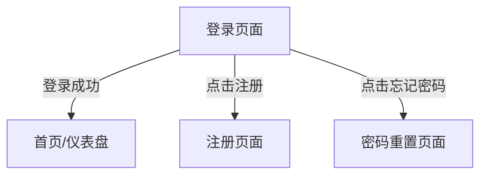
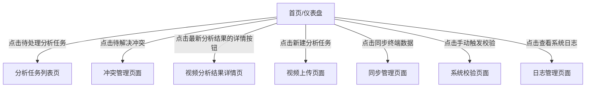
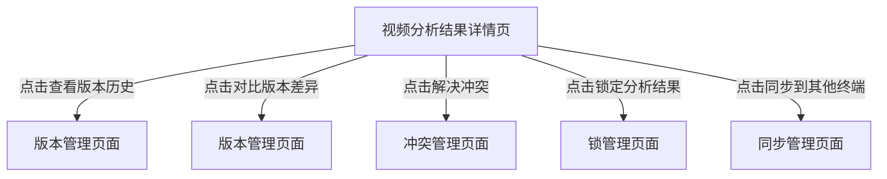
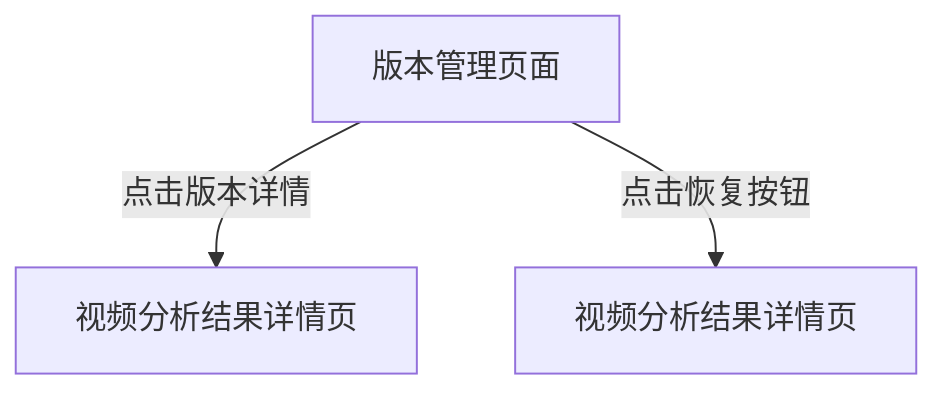
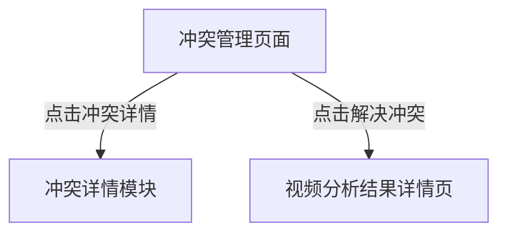
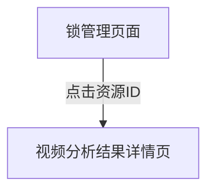
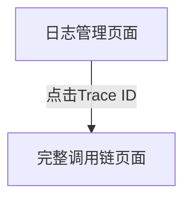
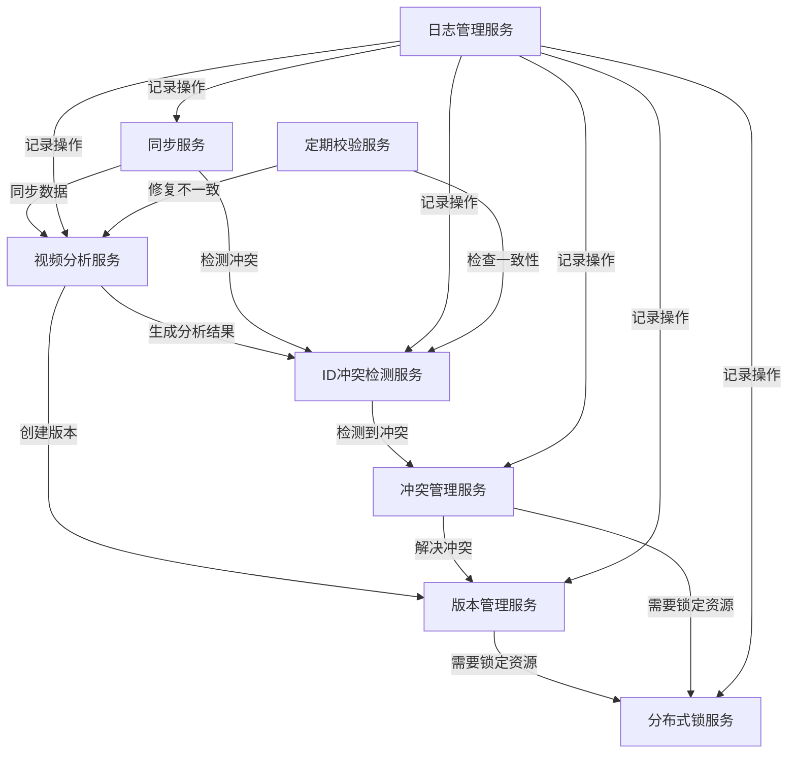

# Figma智能体功能描述文档

## 1. 页面结构说明

视频分析系统采用响应式设计，同时支持PC端和移动端，提供一致的用户体验。系统包含10个核心页面，覆盖从用户登录到高级管理功能的完整工作流。

### 1.1 页面列表

| 页面名称 | 主要功能定位 | 设计优先级 | 适用终端 |
|----------|--------------|------------|----------|
| 登录页面 | 用户身份验证，系统入口 | 高 | PC/移动端 |
| 首页/仪表盘 | 系统概览，核心数据展示，快捷操作入口 | 高 | PC/移动端 |
| 视频分析结果详情页 | 展示单个视频的详细分析结果，包括标签、摘要、关键帧等 | 高 | PC/移动端 |
| 版本管理页面 | 管理分析结果的版本历史，支持版本比较、回溯和合并 | 中 | PC/移动端 |
| 冲突管理页面 | 展示和解决不同终端间的分析结果冲突 | 中 | PC/移动端 |
| 锁管理页面 | 管理分布式锁，防止多终端并发修改同一资源 | 中 | PC/移动端 |
| 日志管理页面 | 记录和查询系统全链路日志，支持问题追溯 | 低 | PC端 |
| 系统设置页面 | 配置系统参数，管理用户权限 | 低 | PC/移动端 |
| 视频管理页面 | 管理视频文件，支持上传、删除、分类等操作 | 中 | PC/移动端 |
| 同步管理页面 | 管理终端间的数据同步，支持手动触发同步 | 中 | PC/移动端 |

### 1.2 布局设计

#### 1.2.1 PC端布局

采用经典的三栏布局，充分利用大屏幕优势：
- **左侧导航栏**：固定宽度，包含主要功能模块入口
- **中间内容区**：自适应宽度，展示核心业务数据
- **右侧辅助区**：固定宽度，展示辅助信息和快捷操作

#### 1.2.2 移动端布局

遵循移动优先原则，采用单列布局：
- **顶部导航栏**：固定高度，包含系统Logo和主要功能入口
- **内容区域**：自适应高度，展示核心业务数据
- **底部导航栏**：固定高度，包含常用功能模块快捷入口

## 2. 页面功能详情

### 2.1 登录页面

#### 功能模块
1. **用户认证模块**
   - 用户名输入
   - 密码输入
   - 登录按钮
   - 记住我选项
   - 忘记密码链接
   - 注册链接

2. **错误提示模块**
   - 显示登录失败原因
   - 表单验证提示

### 2.2 首页/仪表盘

#### 功能模块
1. **系统概览模块**
   - 待处理分析任务统计
   - 今日分析完成统计
   - 待解决冲突统计
   - 系统健康状态

2. **快捷操作模块**
   - 新建分析任务
   - 同步终端数据
   - 手动触发校验
   - 查看系统日志

3. **最新分析结果模块**
   - 展示最近生成的分析结果列表
   - 包含视频名称、分析ID、终端ID、当前版本、分析状态、置信度等信息
   - 支持查看详情和删除操作

4. **系统状态模块**
   - CPU使用率
   - 内存使用率
   - 磁盘使用率
   - 在线终端数

5. **最近告警模块**
   - ID冲突数量
   - 锁超时数量
   - 同步失败数量

### 2.3 视频分析结果详情页

#### 功能模块
1. **视频播放模块**
   - 视频播放器
   - 播放控制（播放/暂停、进度条、音量控制等）

2. **分析信息模块**
   - 视频名称
   - 分析ID
   - 终端ID
   - 当前版本
   - 分析状态
   - 置信度
   - 创建时间
   - 更新时间

3. **分析结果模块**
   - 标签列表（包含标签名称、置信度、帧范围）
   - 视频摘要
   - 关键帧列表

4. **版本历史模块**
   - 版本号
   - 终端ID
   - 变更类型
   - 变更描述
   - 创建时间
   - 操作（恢复/查看）

5. **操作面板模块**
   - 查看版本历史
   - 对比版本差异
   - 解决冲突
   - 锁定分析结果
   - 同步到其他终端

### 2.4 版本管理页面

#### 功能模块
1. **版本列表模块**
   - 版本号
   - 分析ID
   - 终端ID
   - 父版本
   - 变更类型
   - 创建时间
   - 操作（查看/恢复）

2. **搜索筛选模块**
   - 版本搜索
   - 终端筛选
   - 分析ID筛选
   - 状态筛选

3. **版本对比模块**
   - 选择版本1
   - 选择版本2
   - 显示版本差异（标签、摘要等）

### 2.5 冲突管理页面

#### 功能模块
1. **冲突列表模块**
   - 冲突ID
   - 分析ID
   - 冲突类型
   - 冲突级别
   - 涉及终端
   - 创建时间
   - 状态/操作（待解决/解决/查看）

2. **搜索筛选模块**
   - 冲突搜索
   - 冲突类型筛选
   - 冲突级别筛选
   - 状态筛选

3. **冲突详情模块**
   - 展示冲突双方的分析结果
   - 提供冲突解决方式选择
   - 确认解决/取消按钮

### 2.6 锁管理页面

#### 功能模块
1. **锁列表模块**
   - 锁ID
   - 资源ID
   - 锁类型
   - 终端ID
   - 获取时间
   - 过期时间
   - 状态/操作（活跃/释放）

2. **搜索筛选模块**
   - 锁搜索
   - 锁类型筛选
   - 状态筛选
   - 资源筛选

3. **锁统计模块**
   - 活跃锁总数
   - 写锁数量
   - 读锁数量
   - 过期锁数量

### 2.7 日志管理页面

#### 功能模块
1. **日志列表模块**
   - 时间戳
   - 日志级别
   - 模块
   - Trace ID
   - Span ID
   - 日志内容

2. **搜索筛选模块**
   - 日志搜索
   - 日志级别筛选
   - 模块筛选
   - 时间范围筛选

3. **日志详情模块**
   - 完整调用链展示
   - 日志上下文查看

### 2.8 系统设置页面

#### 功能模块
1. **用户管理模块**
   - 用户列表
   - 角色管理
   - 权限配置

2. **系统参数模块**
   - 分析参数设置
   - 同步参数设置
   - 冲突检测参数设置

3. **安全设置模块**
   - 密码策略
   - 认证方式
   - 审计日志配置

### 2.9 视频管理页面

#### 功能模块
1. **视频列表模块**
   - 视频名称
   - 视频ID
   - 上传时间
   - 大小
   - 状态
   - 操作（查看/删除/分析）

2. **视频上传模块**
   - 文件选择
   - 批量上传
   - 上传进度显示

3. **视频分类模块**
   - 分类列表
   - 视频分类操作

### 2.10 同步管理页面

#### 功能模块
1. **同步任务列表**
   - 任务ID
   - 源终端
   - 目标终端
   - 同步内容
   - 开始时间
   - 结束时间
   - 状态

2. **手动同步模块**
   - 选择源终端
   - 选择目标终端
   - 选择同步内容
   - 开始同步按钮

3. **同步配置模块**
   - 自动同步开关
   - 同步频率设置
   - 冲突解决策略设置

## 3. 控件设计规范

### 3.1 通用控件规范

| 控件类型 | 交互方式 | 设计规范 | 适用终端 |
|----------|----------|----------|----------|
| 文本输入框 | 键盘输入，支持Tab键切换 | 最小宽度200px，最大宽度500px，支持自动完成 | PC/移动端 |
| 密码输入框 | 键盘输入，支持显示/隐藏密码 | 与文本输入框相同，添加密码可见性切换按钮 | PC/移动端 |
| 主按钮 | 点击触发主要操作 | 背景色#2563EB，白色文字，圆角4px，最小高度40px | PC/移动端 |
| 次要按钮 | 点击触发次要操作 | 白色背景，#2563EB边框和文字，圆角4px | PC/移动端 |
| 危险按钮 | 点击触发危险操作 | 背景色#EF4444，白色文字，圆角4px | PC/移动端 |
| 图标按钮 | 点击触发快捷操作 | 圆形，直径40px，背景色透明，悬停时显示背景色 | PC/移动端 |
| 复选框 | 点击切换选择状态 | 方形，边长18px，选中时显示对勾图标 | PC/移动端 |
| 下拉菜单 | 点击展开选项列表 | 最小宽度200px，支持搜索过滤，最大高度300px | PC/移动端 |
| 表格 | 展示结构化数据 | 支持分页、排序、筛选，表头固定，行高40px | PC端 |
| 列表 | 展示列表数据 | 移动端优先，支持下拉刷新，上拉加载更多 | PC/移动端 |
| 卡片 | 展示独立内容块 | 白色背景，阴影效果，圆角8px，内边距16px | PC/移动端 |
| 进度条 | 展示操作进度 | 高度4px，背景色#E5E7EB，进度色#2563EB | PC/移动端 |
| 视频播放器 | 播放视频内容 | 自适应容器大小，支持全屏播放 | PC/移动端 |
| 图片缩略图 | 展示图片预览 | 固定尺寸，支持点击放大查看 | PC/移动端 |
| 标签 | 展示分类信息 | 圆角20px，背景色#E5E7EB，文字颜色#4B5563 | PC/移动端 |

### 3.2 页面特定控件

#### 3.2.1 登录页面控件

| 功能模块 | 控件类型 | 交互方式 |
|----------|----------|----------|
| 用户名输入 | 文本输入框 | 键盘输入，支持Tab键切换 |
| 密码输入 | 密码输入框 | 键盘输入，支持显示/隐藏密码 |
| 登录按钮 | 主按钮 | 点击触发登录请求 |
| 记住我选项 | 复选框 | 点击切换状态 |
| 忘记密码链接 | 文本链接 | 点击跳转到密码重置页面 |
| 注册链接 | 文本链接 | 点击跳转到注册页面 |
| 错误提示 | 文本提示 | 自动显示/隐藏，红色文字 |

#### 3.2.2 首页/仪表盘控件

| 功能模块 | 控件类型 | 交互方式 |
|----------|----------|----------|
| 统计卡片 | 卡片组件 | 点击可跳转到对应详情页面 |
| 快捷操作按钮 | 图标按钮 | 点击触发对应操作，悬停显示提示 |
| 分析结果列表 | 表格组件（PC）/列表组件（移动端） | 支持分页、排序、点击查看详情 |
| 删除按钮 | 危险按钮 | 点击弹出确认对话框 |
| 系统状态指标 | 文本+进度条 | 实时更新，鼠标悬停显示详细信息 |

#### 3.2.3 视频分析结果详情页控件

| 功能模块 | 控件类型 | 交互方式 |
|----------|----------|----------|
| 视频播放器 | 视频控件 | 支持播放、暂停、进度调整、音量控制 |
| 分析信息 | 文本展示 | 静态展示，支持复制 |
| 标签列表 | 列表组件 | 支持展开/折叠，点击查看详细信息 |
| 关键帧 | 图片缩略图 | 点击放大查看，支持滑动切换 |
| 版本历史 | 表格组件（PC）/列表组件（移动端） | 点击查看详情或恢复版本 |
| 操作按钮 | 按钮组 | 点击触发对应操作，支持批量操作 |

## 4. 数据范围定义

### 4.1 核心数据类型

| 数据类型 | 生成规则 | 唯一性保证 | 数据格式 | 取值范围 |
|----------|----------|------------|----------|----------|
| **video_id** | 复合标识 = `SHA-256(视频内容) + ":" + 感知哈希` | 全局唯一，基于视频内容 | 字符串 | 任意长度 |
| **analysis_id** | UUID v4 | 全局唯一，基于随机数 | UUID字符串 | 36个字符 |
| **conflict_id** | UUID v4 | 全局唯一，基于随机数 | UUID字符串 | 36个字符 |
| **version_id** | 格式：`v<主版本号>.<次版本号>.<修订号>-<终端ID>` | 基于语义化版本控制 | 字符串 | 如：v1.2.0-terminal001 |
| **lock_id** | UUID v4 | 全局唯一，基于随机数 | UUID字符串 | 36个字符 |
| **trace_id** | UUID v4 | 全局唯一，基于随机数 | UUID字符串 | 36个字符 |
| **span_id** | UUID v4 | 全局唯一，基于随机数 | UUID字符串 | 36个字符 |

### 4.2 页面数据定义

#### 4.2.1 登录页面数据

| 控件 | 数据类型 | 数据格式 | 取值范围 | 数据来源 |
|------|----------|----------|----------|----------|
| 用户名 | 字符串 | 文本 | 3-20个字符 | 用户输入 |
| 密码 | 字符串 | 密码 | 6-20个字符 | 用户输入 |
| 记住我 | 布尔值 | 复选框 | true/false | 用户选择 |

#### 4.2.2 首页/仪表盘数据

| 控件 | 数据类型 | 数据格式 | 取值范围 | 数据来源 |
|------|----------|----------|----------|----------|
| 待处理分析任务 | 数字 | 整数 | ≥0 | 数据库查询 |
| 今日分析完成 | 数字 | 整数 | ≥0 | 数据库查询 |
| 待解决冲突 | 数字 | 整数 | ≥0 | 数据库查询 |
| 系统健康状态 | 枚举 | 文本 | 正常/警告/错误 | 系统监控 |
| CPU使用率 | 数字 | 百分比 | 0-100% | 系统监控 |
| 内存使用率 | 数字 | 百分比 | 0-100% | 系统监控 |
| 磁盘使用率 | 数字 | 百分比 | 0-100% | 系统监控 |
| 在线终端数 | 数字 | 整数 | ≥0 | 终端管理服务 |
| 视频名称 | 字符串 | 文本 | 任意长度 | 数据库查询 |
| 分析ID | 字符串 | UUID | 36个字符 | 数据库查询 |
| 终端ID | 字符串 | 文本 | 自定义格式 | 数据库查询 |
| 当前版本 | 字符串 | 语义化版本 | vX.Y.Z-终端ID | 数据库查询 |
| 分析状态 | 枚举 | 文本 | 进行中/完成/失败 | 数据库查询 |
| 置信度 | 数字 | 浮点数 | 0.0-1.0 | 分析服务 |

#### 4.2.3 视频分析结果详情页数据

| 控件 | 数据类型 | 数据格式 | 取值范围 | 数据来源 |
|------|----------|----------|----------|----------|
| 视频名称 | 字符串 | 文本 | 任意长度 | 数据库查询 |
| 分析ID | 字符串 | UUID | 36个字符 | 数据库查询 |
| 终端ID | 字符串 | 文本 | 自定义格式 | 数据库查询 |
| 当前版本 | 字符串 | 语义化版本 | vX.Y.Z-终端ID | 数据库查询 |
| 分析状态 | 枚举 | 文本 | 进行中/完成/失败 | 数据库查询 |
| 置信度 | 数字 | 浮点数 | 0.0-1.0 | 分析服务 |
| 创建时间 | 日期时间 | ISO 8601 | YYYY-MM-DDTHH:MM:SSZ | 数据库查询 |
| 更新时间 | 日期时间 | ISO 8601 | YYYY-MM-DDTHH:MM:SSZ | 数据库查询 |
| 标签 | 字符串 | 文本 | 任意长度 | 分析服务 |
| 标签置信度 | 数字 | 浮点数 | 0.0-1.0 | 分析服务 |
| 帧范围 | 数组 | [start, end] | 整数数组 | 分析服务 |
| 视频摘要 | 字符串 | 文本 | 任意长度 | 分析服务 |
| 关键帧 | 字符串 | URL | 图片地址 | 分析服务 |
| 版本号 | 字符串 | 语义化版本 | vX.Y.Z-终端ID | 数据库查询 |
| 变更类型 | 枚举 | 文本 | 创建/更新/合并/恢复 | 数据库查询 |
| 变更描述 | 字符串 | 文本 | 任意长度 | 数据库查询 |

## 5. 页面跳转关系

### 5.1 核心跳转流程

#### 5.1.1 登录流程

#### 5.1.2 首页跳转

#### 5.1.3 分析结果详情跳转

#### 5.1.4 版本管理跳转

#### 5.1.5 冲突管理跳转

#### 5.1.6 锁管理跳转

#### 5.1.7 日志管理跳转

### 5.2 通用导航规则

- 所有功能页面 →（点击返回按钮或浏览器返回）→ 上一级页面
- 所有功能页面 →（点击导航栏Logo）→ 首页/仪表盘
- 所有功能页面 →（点击导航栏菜单）→ 对应功能页面
- PC端支持面包屑导航，显示当前页面路径
- 移动端支持底部导航栏，快速访问常用功能

## 6. 功能协同关系

### 6.1 核心功能协同架构

### 6.2 ID冲突检测与其他功能的协同

1. **与分析服务的协同**
   - 分析服务生成ID时，调用ID冲突检测服务验证唯一性
   - 检测到冲突时，通知分析服务重新生成ID

2. **与同步服务的协同**
   - 同步数据前，检测目标终端是否存在ID冲突
   - 冲突检测结果影响同步策略

3. **与定期校验的协同**
   - 定期校验服务调用ID冲突检测服务进行全量检查
   - 检测到冲突时，生成冲突记录

### 6.3 版本管理与其他功能的协同

1. **与分析服务的协同**
   - 分析服务生成新结果时，调用版本管理服务创建新版本
   - 版本管理服务为新结果分配唯一版本号

2. **与冲突解决服务的协同**
   - 冲突解决后，调用版本管理服务创建合并版本
   - 版本管理服务记录冲突解决的版本关系

3. **与同步服务的协同**
   - 同步服务根据版本号决定是否需要同步
   - 版本管理服务提供版本比较功能，支持增量同步

### 6.4 分布式锁与其他功能的协同

1. **与分析服务的协同**
   - 分析服务修改分析结果前，获取写锁
   - 修改完成后释放锁

2. **与同步服务的协同**
   - 同步数据前，获取读锁
   - 同步完成后释放锁

3. **与冲突解决服务的协同**
   - 解决冲突前，获取写锁
   - 解决完成后释放锁

### 6.5 数据合并与其他功能的协同

1. **与冲突解决服务的协同**
   - 冲突解决服务调用数据合并服务进行自动合并
   - 无法自动合并时，标记为需要人工干预

2. **与版本管理服务的协同**
   - 合并结果可作为新的分析结果输入
   - 分析服务可基于合并结果进行进一步分析

### 6.6 全链路日志与其他功能的协同

1. **与所有服务的协同**
   - 所有服务调用时生成日志记录
   - 日志包含Trace ID和Span ID，支持全链路追踪

2. **与监控服务的协同**
   - 日志服务向监控服务提供关键指标
   - 监控服务基于日志触发告警

3. **与问题追溯的协同**
   - 日志服务支持按Trace ID查询完整调用链
   - 支持问题定位和根因分析

### 6.7 定期数据一致性校验与其他功能的协同

1. **与ID冲突检测服务的协同**
   - 定期调用ID冲突检测服务进行全量检查
   - 检测到冲突时生成告警

2. **与修复服务的协同**
   - 检测到不一致时，调用修复服务进行自动修复
   - 无法自动修复时，生成人工干预任务

3. **与监控服务的协同**
   - 校验结果发送至监控服务
   - 异常情况触发告警

## 7. 设计规范补充

### 7.1 色彩方案

| 色彩名称 | 色值 | 用途 |
|----------|------|------|
| 主色调 | #2563EB | 按钮、导航栏、高亮元素 |
| 辅助色 | #10B981 | 成功状态、积极操作 |
| 警告色 | #F59E0B | 警告状态、需要注意的操作 |
| 错误色 | #EF4444 | 错误状态、危险操作 |
| 中性色-100 | #F3F4F6 | 背景色 |
| 中性色-200 | #E5E7EB | 边框色、分隔线 |
| 中性色-800 | #1F2937 | 主文本色 |
| 中性色-600 | #4B5563 | 次要文本色 |

### 7.2 字体规范

| 设备类型 | 字体大小 | 行高 | 用途 |
|----------|----------|------|------|
| PC端 | 16px | 1.5 | 正文 |
| PC端 | 18px | 1.6 | 标题 |
| 移动端 | 14px | 1.5 | 正文 |
| 移动端 | 16px | 1.6 | 标题 |

### 7.3 交互规范

- **加载状态**：所有页面在数据加载时显示加载动画，异步操作显示进度指示器
- **成功状态**：操作成功后显示成功提示，3-5秒自动消失
- **错误状态**：操作失败后显示错误提示，包含具体错误原因
- **确认状态**：重要操作（如删除、释放锁）需要用户确认
- **编辑状态**：表单编辑时显示保存/取消按钮，支持实时表单验证
- **锁定状态**：资源被锁定时显示锁定提示，包含锁的持有者和过期时间
- **冲突状态**：存在冲突时显示冲突标记，包含冲突类型和级别

### 7.4 响应式设计规范

#### 7.4.1 PC端设计
- 采用三栏布局：左侧导航栏、中间内容区、右侧辅助区
- 支持1920x1080及以上分辨率
- 支持键盘快捷键操作
- 支持鼠标悬停效果

#### 7.4.2 移动端设计
- 采用单列布局：顶部导航栏、内容区域、底部导航栏
- 支持320px-414px宽度的移动设备
- 支持触控操作
- 支持横竖屏切换
- 支持不同DPI屏幕

## 8. 性能要求

### 8.1 页面加载时间
- 登录页面：≤1秒
- 首页/仪表盘：≤2秒
- 其他功能页面：≤3秒

### 8.2 操作响应时间
- 按钮点击响应：≤0.5秒
- 表单提交响应：≤1秒
- 数据加载响应：≤2秒
- 复杂查询响应：≤5秒

### 8.3 并发支持
- 支持1000+并发用户
- 支持100+并发操作
- 支持10+终端同时同步

## 9. 安全要求

### 9.1 身份认证
- 支持用户名密码登录
- 支持多因素认证
- 支持单点登录（SSO）

### 9.2 授权管理
- 基于角色的访问控制（RBAC）
- 细粒度的权限管理
- 支持权限继承和委托

### 9.3 数据安全
- 数据传输加密（TLS 1.3）
- 数据存储加密
- 敏感数据脱敏
- 定期数据备份

### 9.4 审计日志
- 记录所有关键操作
- 日志不可篡改
- 支持日志查询和分析

---

本功能描述文档为Figma智能体提供了完整的设计依据，包含页面结构、功能详情、控件规范、数据定义、页面跳转和功能协同关系等所有必要信息。文档遵循规范的结构和专业术语，内容准确、完整、无歧义，确保Figma智能体能够直接基于此文档生成符合需求的产品原型。