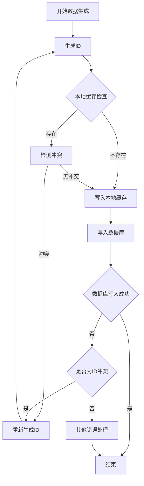

# ID冲突检测机制实施文档

## 1. 概述

本文档详细说明视频分析系统中ID冲突检测机制的实施细节，确保在数据生成阶段实时验证ID唯一性，避免分布式环境下的ID冲突问题。

## 2. ID生成规则

### 2.1 核心ID类型

| ID类型 | 生成规则 | 唯一性保证 |
|--------|----------|------------|
| **video_id** | 复合标识 = `SHA-256(视频内容) + ":" + 感知哈希` | 全局唯一，基于视频内容 |
| **analysis_id** | `UUID v4` | 全局唯一，基于随机数 |
| **conflict_id** | `UUID v4` | 全局唯一，基于随机数 |
| **version_id** | 格式：`v<主版本号>.<次版本号>.<修订号>-<终端ID>` | 基于语义化版本控制 |
| **track_id** | 人物跟踪算法生成（如ByteTrack） | 会话内唯一，基于算法分配 |

### 2.2 ID生成函数实现

```python
import uuid
import hashlib
from typing import Tuple

def generate_video_id(content_path: str, perceptual_hash: str) -> str:
    """生成视频唯一标识
    
    Args:
        content_path: 视频文件路径
        perceptual_hash: 视频感知哈希
        
    Returns:
        视频唯一标识，格式：content_hash:perceptual_hash
    """
    # 计算视频内容SHA-256哈希
    with open(content_path, 'rb') as f:
        content_hash = hashlib.sha256(f.read()).hexdigest()
    return f"{content_hash}:{perceptual_hash}"

def generate_analysis_id() -> str:
    """生成分析结果唯一标识
    
    Returns:
        UUID v4格式的分析结果ID
    """
    return str(uuid.uuid4())

def generate_conflict_id() -> str:
    """生成冲突唯一标识
    
    Returns:
        UUID v4格式的冲突ID
    """
    return str(uuid.uuid4())

def generate_version_id(terminal_id: str, major: int = 1, minor: int = 0, patch: int = 0) -> str:
    """生成版本标识
    
    Args:
        terminal_id: 终端ID
        major: 主版本号
        minor: 次版本号
        patch: 修订号
        
    Returns:
        版本标识字符串
    """
    return f"v{major}.{minor}.{patch}-{terminal_id}"
```

## 3. 数据生成阶段ID验证流程

### 3.1 实时ID验证流程



### 3.2 本地缓存设计

使用Redis或内存缓存存储近期生成的ID，实现快速冲突检测：

| 缓存键类型 | 缓存键格式 | 过期时间 | 用途 |
|------------|------------|----------|------|
| video_id | `video_id:{video_id}` | 7天 | 检测视频ID冲突 |
| analysis_id | `analysis_id:{analysis_id}` | 30天 | 检测分析结果ID冲突 |
| conflict_id | `conflict_id:{conflict_id}` | 90天 | 检测冲突ID冲突 |

### 3.3 数据库唯一性约束

在数据库表中添加唯一索引，确保持久化存储时的ID唯一性：

```sql
-- 视频分析结果表
CREATE TABLE IF NOT EXISTS video_analysis (
    analysis_id VARCHAR(36) PRIMARY KEY,
    video_id VARCHAR(256) NOT NULL,
    content JSON NOT NULL,
    metadata JSON NOT NULL,
    version VARCHAR(64) NOT NULL,
    parent_version VARCHAR(64),
    created_at TIMESTAMP NOT NULL DEFAULT CURRENT_TIMESTAMP,
    updated_at TIMESTAMP NOT NULL DEFAULT CURRENT_TIMESTAMP,
    UNIQUE INDEX idx_video_id (video_id)
);

-- 冲突记录表
CREATE TABLE IF NOT EXISTS conflicts (
    conflict_id VARCHAR(36) PRIMARY KEY,
    video_id VARCHAR(256) NOT NULL,
    analysis_id VARCHAR(36) NOT NULL,
    conflict_type VARCHAR(64) NOT NULL,
    conflict_data JSON NOT NULL,
    resolution JSON NOT NULL,
    created_at TIMESTAMP NOT NULL DEFAULT CURRENT_TIMESTAMP,
    updated_at TIMESTAMP NOT NULL DEFAULT CURRENT_TIMESTAMP
);
```

## 4. 冲突检测实现

### 4.1 核心冲突检测服务

```python
import hashlib
import uuid
from typing import Dict, List, Optional
import redis

class IDConflictDetectionService:
    """ID冲突检测服务"""
    
    def __init__(self, redis_client: redis.Redis):
        self.redis = redis_client
        self.retry_limit = 5
    
    def generate_unique_id(self, id_type: str, generate_func, *args, **kwargs) -> str:
        """生成唯一ID，自动处理冲突
        
        Args:
            id_type: ID类型（video_id, analysis_id, conflict_id）
            generate_func: ID生成函数
            *args: 生成函数参数
            **kwargs: 生成函数关键字参数
            
        Returns:
            唯一ID
        """
        for _ in range(self.retry_limit):
            # 生成ID
            new_id = generate_func(*args, **kwargs)
            
            # 检查本地缓存
            cache_key = f"{id_type}:{new_id}"
            if not self.redis.exists(cache_key):
                # 使用Redis SETNX原子操作确保唯一性
                if self.redis.setnx(cache_key, 1):
                    # 设置过期时间
                    expire_time = self._get_expire_time(id_type)
                    self.redis.expire(cache_key, expire_time)
                    return new_id
        
        # 重试多次失败，抛出异常
        raise Exception(f"Failed to generate unique {id_type} after {self.retry_limit} attempts")
    
    def _get_expire_time(self, id_type: str) -> int:
        """获取不同类型ID的缓存过期时间
        
        Args:
            id_type: ID类型
            
        Returns:
            过期时间（秒）
        """
        expire_times = {
            "video_id": 7 * 24 * 3600,      # 7天
            "analysis_id": 30 * 24 * 3600,   # 30天
            "conflict_id": 90 * 24 * 3600    # 90天
        }
        return expire_times.get(id_type, 30 * 24 * 3600)
    
    def check_id_conflict(self, id_type: str, id_value: str) -> bool:
        """检查ID是否冲突
        
        Args:
            id_type: ID类型
            id_value: ID值
            
        Returns:
            True if conflict, False otherwise
        """
        cache_key = f"{id_type}:{id_value}"
        return self.redis.exists(cache_key)
    
    def register_id(self, id_type: str, id_value: str) -> bool:
        """注册ID到缓存
        
        Args:
            id_type: ID类型
            id_value: ID值
            
        Returns:
            True if registered successfully, False if conflict
        """
        cache_key = f"{id_type}:{id_value}"
        if self.redis.setnx(cache_key, 1):
            expire_time = self._get_expire_time(id_type)
            self.redis.expire(cache_key, expire_time)
            return True
        return False
```

### 4.2 集成到数据生成流程

```python
from services.id_conflict_detection import IDConflictDetectionService
from utils.id_generator import generate_video_id, generate_analysis_id

class VideoAnalysisService:
    """视频分析服务"""
    
    def __init__(self, redis_client, db_client):
        self.id_conflict_service = IDConflictDetectionService(redis_client)
        self.db_client = db_client
    
    def analyze_video(self, video_path: str, perceptual_hash: str) -> Dict:
        """分析视频并生成结果
        
        Args:
            video_path: 视频文件路径
            perceptual_hash: 视频感知哈希
            
        Returns:
            分析结果
        """
        # 生成唯一视频ID
        video_id = self.id_conflict_service.generate_unique_id(
            "video_id", 
            generate_video_id, 
            video_path, 
            perceptual_hash
        )
        
        # 生成唯一分析ID
        analysis_id = self.id_conflict_service.generate_unique_id(
            "analysis_id", 
            generate_analysis_id
        )
        
        # 执行视频分析
        analysis_result = self._perform_analysis(video_path)
        
        # 构建分析结果数据
        analysis_data = {
            "analysis_id": analysis_id,
            "video_id": video_id,
            "content": analysis_result,
            "metadata": {
                "model_version": "v1.0.0",
                "analysis_time": "2024-01-15T10:00:00Z",
                "confidence": 0.92,
                "terminal_id": self._get_terminal_id()
            },
            "version": "v1.0.0",
            "parent_version": None,
            "created_at": "2024-01-15T10:00:00Z",
            "updated_at": "2024-01-15T10:00:00Z"
        }
        
        # 写入数据库
        try:
            self.db_client.insert_analysis_result(analysis_data)
            return analysis_data
        except Exception as e:
            # 检查是否为ID冲突
            if "unique constraint" in str(e).lower() or "duplicate" in str(e).lower():
                # 清理缓存中可能存在的错误ID
                self.id_conflict_service.redis.delete(f"video_id:{video_id}")
                self.id_conflict_service.redis.delete(f"analysis_id:{analysis_id}")
                # 重新生成ID并尝试
                return self.analyze_video(video_path, perceptual_hash)
            raise
```

## 5. 性能优化

### 5.1 批量ID生成

对于批量分析场景，实现批量ID生成功能，减少Redis操作次数：

```python
def generate_batch_unique_ids(self, id_type: str, count: int, generate_func, *args, **kwargs) -> List[str]:
    """批量生成唯一ID
    
    Args:
        id_type: ID类型
        count: 需要生成的ID数量
        generate_func: ID生成函数
        *args: 生成函数参数
        **kwargs: 生成函数关键字参数
        
    Returns:
        唯一ID列表
    """
    unique_ids = []
    attempts = 0
    
    while len(unique_ids) < count and attempts < self.retry_limit:
        # 一次性生成多个ID
        candidate_ids = [generate_func(*args, **kwargs) for _ in range(count * 2)]
        
        # 批量检查缓存
        pipeline = self.redis.pipeline()
        for candidate_id in candidate_ids:
            cache_key = f"{id_type}:{candidate_id}"
            pipeline.exists(cache_key)
        
        exists_results = pipeline.execute()
        
        # 过滤出不存在的ID
        new_unique_ids = []
        for candidate_id, exists in zip(candidate_ids, exists_results):
            if not exists and candidate_id not in unique_ids:
                new_unique_ids.append(candidate_id)
        
        # 批量注册新ID
        if new_unique_ids:
            pipeline = self.redis.pipeline()
            expire_time = self._get_expire_time(id_type)
            for new_id in new_unique_ids:
                cache_key = f"{id_type}:{new_id}"
                pipeline.setnx(cache_key, 1)
                pipeline.expire(cache_key, expire_time)
            
            set_results = pipeline.execute()
            
            # 收集成功注册的ID
            for new_id, set_success in zip(new_unique_ids, set_results[::2]):
                if set_success:
                    unique_ids.append(new_id)
                    if len(unique_ids) >= count:
                        break
        
        attempts += 1
    
    if len(unique_ids) < count:
        raise Exception(f"Failed to generate {count} unique {id_type}s")
    
    return unique_ids[:count]
```

### 5.2 异步ID验证

对于非关键路径的ID验证，采用异步方式进行，提高系统响应速度：

```python
import asyncio

async def async_check_id_conflict(self, id_type: str, id_value: str) -> bool:
    """异步检查ID是否冲突
    
    Args:
        id_type: ID类型
        id_value: ID值
        
    Returns:
        True if conflict, False otherwise
    """
    loop = asyncio.get_event_loop()
    return await loop.run_in_executor(
        None, 
        self.check_id_conflict, 
        id_type, 
        id_value
    )
```

## 6. 监控与告警

### 6.1 监控指标

| 指标名称 | 描述 | 告警阈值 |
|----------|------|----------|
| ID生成成功率 | 成功生成唯一ID的比例 | < 99.9% |
| ID冲突次数 | 检测到的ID冲突次数 | > 10次/分钟 |
| ID生成平均耗时 | 生成唯一ID的平均时间 | > 100ms |
| 缓存命中率 | ID缓存命中比例 | < 95% |

### 6.2 日志记录

```python
def generate_unique_id(self, id_type: str, generate_func, *args, **kwargs) -> str:
    """生成唯一ID，自动处理冲突"""
    start_time = time.time()
    conflict_count = 0
    
    for attempt in range(self.retry_limit):
        new_id = generate_func(*args, **kwargs)
        cache_key = f"{id_type}:{new_id}"
        
        if not self.redis.exists(cache_key):
            if self.redis.setnx(cache_key, 1):
                expire_time = self._get_expire_time(id_type)
                self.redis.expire(cache_key, expire_time)
                
                # 记录成功日志
                logger.info({
                    "event": "id_generated",
                    "id_type": id_type,
                    "id_value": new_id,
                    "attempts": attempt + 1,
                    "conflicts": conflict_count,
                    "duration_ms": (time.time() - start_time) * 1000
                })
                
                return new_id
        else:
            conflict_count += 1
    
    # 记录失败日志
    logger.error({
        "event": "id_generation_failed",
        "id_type": id_type,
        "attempts": self.retry_limit,
        "conflicts": conflict_count,
        "duration_ms": (time.time() - start_time) * 1000
    })
    
    raise Exception(f"Failed to generate unique {id_type} after {self.retry_limit} attempts")
```

## 7. 集成与部署

### 7.1 依赖项

| 依赖名称 | 版本要求 | 用途 |
|----------|----------|------|
| Redis | >= 6.0 | 本地缓存，用于ID冲突检测 |
| uuid | 内置模块 | 生成UUID v4 |
| hashlib | 内置模块 | 计算内容哈希 |
| asyncio | 内置模块 | 异步操作支持 |

### 7.2 部署架构

```
[视频分析终端] --> [ID冲突检测服务] --> [Redis缓存集群]
                                   |
                                   v
                             [数据库集群]
```

### 7.3 横向扩展

ID冲突检测服务支持横向扩展，通过Redis集群实现分布式缓存，确保所有实例共享同一ID缓存空间，避免分布式环境下的ID冲突。

## 8. 测试计划

### 8.1 单元测试

- 测试ID生成函数的唯一性
- 测试本地缓存的冲突检测功能
- 测试Redis SETNX原子操作的正确性
- 测试批量ID生成功能

### 8.2 集成测试

- 测试ID冲突检测服务与视频分析服务的集成
- 测试ID冲突检测服务与数据库的集成
- 测试分布式环境下的ID唯一性保证

### 8.3 性能测试

- 测试高并发场景下的ID生成性能
- 测试批量ID生成的性能
- 测试不同缓存大小对性能的影响

### 8.4 故障恢复测试

- 测试Redis宕机后的ID生成策略
- 测试数据库连接失败后的ID生成策略
- 测试网络中断后的ID生成策略

## 9. 结论

本ID冲突检测机制通过结合UUID生成、Redis原子操作、数据库唯一约束和重试机制，确保在数据生成阶段实时验证ID唯一性，有效避免分布式环境下的ID冲突问题。该机制具有高性能、高可靠性和良好的扩展性，能够满足大规模视频分析系统的需求。