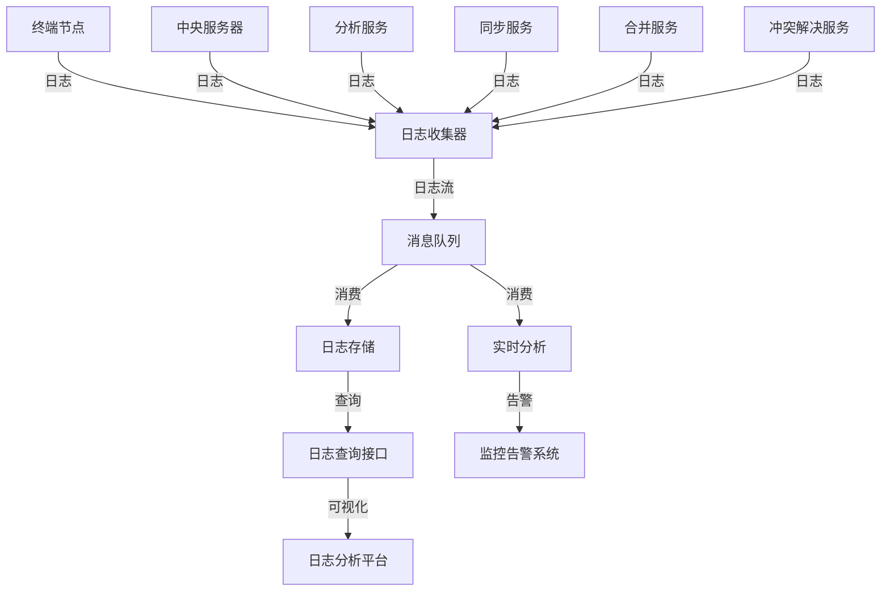
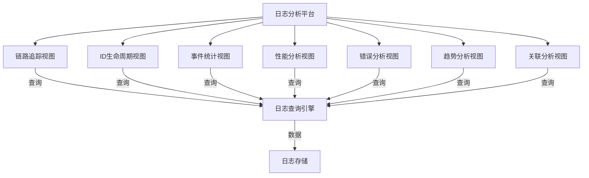

# 全链路日志记录实施文档

## 1. 概述

本文档详细说明视频分析系统中全链路日志记录的实施细节，旨在追踪每个ID的创建、修改、同步过程，确保系统操作的可追溯性和可审计性。

## 2. 设计原则与目标

### 2.1 设计原则

| 原则 | 描述 |
|------|------|
| **完整性** | 记录ID生命周期的所有关键事件 |
| **一致性** | 日志格式统一，便于查询和分析 |
| **可追溯性** | 支持通过ID追踪完整的操作链路 |
| **高性能** | 日志记录不影响系统性能 |
| **安全性** | 日志内容安全，防止敏感信息泄露 |
| **可扩展性** | 支持日志系统的横向扩展 |
| **实时性** | 日志记录和查询具有实时性 |

### 2.2 设计目标

1. 追踪每个ID从创建到删除的完整生命周期
2. 记录ID相关的所有关键操作（创建、修改、同步、合并、冲突解决等）
3. 支持通过ID快速查询完整的操作链路
4. 提供可视化的日志分析和链路追踪界面
5. 支持日志的实时监控和告警
6. 与现有系统架构无缝集成
7. 支持分布式环境下的日志收集和管理

## 3. 日志结构设计

### 3.1 日志元数据

| 字段 | 类型 | 描述 |
|------|------|------|
| **trace_id** | string | 全局唯一追踪ID，贯穿整个操作链路 |
| **span_id** | string | 局部唯一跨度ID，标识链路中的单个操作 |
| **parent_span_id** | string | 父跨度ID，用于构建调用关系树 |
| **event_time** | timestamp | 事件发生时间 |
| **event_type** | string | 事件类型（id_create, id_modify, id_sync, id_merge等） |
| **service_name** | string | 服务名称（analysis, sync, merge, conflict_resolution等） |
| **terminal_id** | string | 终端ID |
| **user_id** | string | 操作用户ID（如果有） |
| **level** | string | 日志级别（debug, info, warn, error, fatal） |
| **status** | string | 操作状态（success, failure, pending） |
| **error_code** | string | 错误码（如果有） |
| **error_message** | string | 错误信息（如果有） |
| **duration_ms** | integer | 操作持续时间（毫秒） |

### 3.2 ID相关字段

| 字段 | 类型 | 描述 |
|------|------|------|
| **id_type** | string | ID类型（video_id, analysis_id, conflict_id, version_id等） |
| **id_value** | string | ID值 |
| **old_value** | json | 操作前的值（修改操作时） |
| **new_value** | json | 操作后的值（修改操作时） |
| **source_id** | string | 来源ID（同步操作时） |
| **target_id** | string | 目标ID（同步操作时） |
| **related_ids** | array | 相关ID列表 |
| **version** | string | 版本号 |
| **parent_version** | string | 父版本号 |

### 3.3 自定义字段

| 字段 | 类型 | 描述 |
|------|------|------|
| **tags** | map | 自定义标签，用于快速查询和过滤 |
| **metadata** | map | 自定义元数据，存储额外的上下文信息 |

### 3.4 日志示例

```json
{
  "trace_id": "a1b2c3d4-e5f6-7890-abcd-ef1234567890",
  "span_id": "s123456",
  "parent_span_id": "p123456",
  "event_time": "2024-01-15T10:00:00.123Z",
  "event_type": "id_create",
  "service_name": "analysis_service",
  "terminal_id": "terminal_001",
  "level": "info",
  "status": "success",
  "duration_ms": 150,
  "id_type": "analysis_id",
  "id_value": "analysis_001",
  "new_value": {
    "video_id": "video_001",
    "content": {"tags": [{"tag": "person", "confidence": 0.95}]},
    "metadata": {"model_version": "v1.0.0"}
  },
  "version": "v1.0.0-terminal_001",
  "tags": {
    "env": "production",
    "region": "cn-north-1"
  },
  "metadata": {
    "model_version": "v1.0.0",
    "analysis_time": "2024-01-15T10:00:00Z"
  }
}
```

## 4. 日志事件类型

### 4.1 ID创建事件

| 事件类型 | 描述 |
|----------|------|
| **id_create** | 创建新ID |
| **version_create** | 创建新版本 |
| **conflict_create** | 创建冲突记录 |

### 4.2 ID修改事件

| 事件类型 | 描述 |
|----------|------|
| **id_modify** | 修改ID关联的数据 |
| **version_update** | 更新版本信息 |
| **conflict_update** | 更新冲突记录 |

### 4.3 ID同步事件

| 事件类型 | 描述 |
|----------|------|
| **sync_request** | 发起同步请求 |
| **sync_receive** | 接收同步请求 |
| **sync_success** | 同步成功 |
| **sync_failure** | 同步失败 |
| **sync_conflict** | 同步时检测到冲突 |

### 4.4 ID合并事件

| 事件类型 | 描述 |
|----------|------|
| **merge_start** | 开始合并操作 |
| **merge_success** | 合并成功 |
| **merge_failure** | 合并失败 |
| **merge_conflict** | 合并时检测到冲突 |

### 4.5 冲突解决事件

| 事件类型 | 描述 |
|----------|------|
| **conflict_detect** | 检测到冲突 |
| **conflict_resolve_start** | 开始冲突解决 |
| **conflict_resolve_auto** | 自动解决冲突 |
| **conflict_resolve_manual** | 人工解决冲突 |
| **conflict_resolve_success** | 冲突解决成功 |
| **conflict_resolve_failure** | 冲突解决失败 |

### 4.6 锁相关事件

| 事件类型 | 描述 |
|----------|------|
| **lock_acquire_attempt** | 尝试获取锁 |
| **lock_acquire_success** | 成功获取锁 |
| **lock_acquire_failure** | 获取锁失败 |
| **lock_release** | 释放锁 |
| **lock_renew** | 续约锁 |

## 5. 日志记录实现

### 5.1 日志记录核心组件

```python
import uuid
import time
from datetime import datetime
from typing import Dict, Optional, Any

class TraceContext:
    """追踪上下文"""
    
    def __init__(self, trace_id: Optional[str] = None, span_id: Optional[str] = None,
                 parent_span_id: Optional[str] = None):
        self.trace_id = trace_id or str(uuid.uuid4())
        self.span_id = span_id or str(uuid.uuid4())[:8]
        self.parent_span_id = parent_span_id
    
    def create_child_span(self) -> 'TraceContext':
        """创建子跨度"""
        return TraceContext(
            trace_id=self.trace_id,
            parent_span_id=self.span_id
        )

class Logger:
    """日志记录器"""
    
    def __init__(self, service_name: str):
        self.service_name = service_name
    
    def log(self, event_type: str, level: str = "info", **kwargs) -> None:
        """记录日志"""
        # 构建日志对象
        log_entry = self._build_log_entry(event_type, level, **kwargs)
        
        # 发送日志到日志收集系统
        self._send_log(log_entry)
    
    def _build_log_entry(self, event_type: str, level: str, **kwargs) -> Dict:
        """构建日志条目"""
        # 获取当前时间
        event_time = datetime.now().isoformat()
        
        # 获取追踪上下文
        trace_context = kwargs.pop("trace_context", TraceContext())
        
        # 构建日志条目
        log_entry = {
            "trace_id": trace_context.trace_id,
            "span_id": trace_context.span_id,
            "parent_span_id": trace_context.parent_span_id,
            "event_time": event_time,
            "event_type": event_type,
            "service_name": self.service_name,
            "level": level,
            **kwargs
        }
        
        # 添加默认状态
        if "status" not in log_entry:
            log_entry["status"] = "success"
        
        return log_entry
    
    def _send_log(self, log_entry: Dict) -> None:
        """发送日志到日志收集系统"""
        # 这里可以实现不同的日志发送方式，如：
        # 1. 写入本地文件
        # 2. 发送到消息队列（如Kafka）
        # 3. 发送到日志收集系统（如ELK Stack）
        # 4. 发送到分布式追踪系统（如Jaeger, Zipkin）
        
        # 示例：打印到控制台
        import json
        print(json.dumps(log_entry))
    
    # 便捷方法
    def info(self, event_type: str, **kwargs) -> None:
        """记录info级别日志"""
        self.log(event_type, "info", **kwargs)
    
    def error(self, event_type: str, **kwargs) -> None:
        """记录error级别日志"""
        kwargs.setdefault("status", "failure")
        self.log(event_type, "error", **kwargs)
    
    def warn(self, event_type: str, **kwargs) -> None:
        """记录warn级别日志"""
        self.log(event_type, "warn", **kwargs)
    
    def debug(self, event_type: str, **kwargs) -> None:
        """记录debug级别日志"""
        self.log(event_type, "debug", **kwargs)
```

### 5.2 ID创建日志记录

```python
class IDGeneratorService:
    """ID生成服务"""
    
    def __init__(self, logger):
        self.logger = logger
    
    def generate_analysis_id(self, trace_context: Optional[TraceContext] = None) -> str:
        """生成分析ID"""
        if trace_context is None:
            trace_context = TraceContext()
        
        start_time = time.time()
        
        try:
            # 生成ID
            analysis_id = str(uuid.uuid4())
            
            # 记录日志
            self.logger.info(
                "id_create",
                trace_context=trace_context,
                id_type="analysis_id",
                id_value=analysis_id,
                duration_ms=int((time.time() - start_time) * 1000)
            )
            
            return analysis_id
        except Exception as e:
            # 记录错误日志
            self.logger.error(
                "id_create",
                trace_context=trace_context,
                id_type="analysis_id",
                error_message=str(e),
                duration_ms=int((time.time() - start_time) * 1000)
            )
            raise
```

### 5.3 ID修改日志记录

```python
class AnalysisService:
    """分析服务"""
    
    def __init__(self, logger):
        self.logger = logger
    
    def update_analysis(self, analysis_id: str, update_data: Dict, 
                       trace_context: Optional[TraceContext] = None) -> Dict:
        """更新分析结果"""
        if trace_context is None:
            trace_context = TraceContext()
        
        start_time = time.time()
        
        try:
            # 获取当前分析结果
            current_analysis = self.db.get_analysis_by_id(analysis_id)
            
            # 执行更新
            updated_analysis = self.db.update_analysis(analysis_id, update_data)
            
            # 记录日志
            self.logger.info(
                "id_modify",
                trace_context=trace_context,
                id_type="analysis_id",
                id_value=analysis_id,
                old_value=current_analysis,
                new_value=updated_analysis,
                duration_ms=int((time.time() - start_time) * 1000)
            )
            
            return updated_analysis
        except Exception as e:
            # 记录错误日志
            self.logger.error(
                "id_modify",
                trace_context=trace_context,
                id_type="analysis_id",
                id_value=analysis_id,
                error_message=str(e),
                duration_ms=int((time.time() - start_time) * 1000)
            )
            raise
```

### 5.4 ID同步日志记录

```python
class SyncService:
    """同步服务"""
    
    def __init__(self, logger):
        self.logger = logger
    
    def sync_analysis(self, analysis_data: Dict, target_terminal: str,
                     trace_context: Optional[TraceContext] = None) -> Dict:
        """同步分析结果"""
        if trace_context is None:
            trace_context = TraceContext()
        
        start_time = time.time()
        analysis_id = analysis_data["analysis_id"]
        
        # 记录同步请求日志
        self.logger.info(
            "sync_request",
            trace_context=trace_context,
            id_type="analysis_id",
            id_value=analysis_id,
            source_terminal=analysis_data["metadata"]["terminal_id"],
            target_terminal=target_terminal
        )
        
        try:
            # 执行同步
            sync_result = self._perform_sync(analysis_data, target_terminal, trace_context)
            
            # 记录同步成功日志
            self.logger.info(
                "sync_success",
                trace_context=trace_context,
                id_type="analysis_id",
                id_value=analysis_id,
                source_terminal=analysis_data["metadata"]["terminal_id"],
                target_terminal=target_terminal,
                sync_result=sync_result,
                duration_ms=int((time.time() - start_time) * 1000)
            )
            
            return sync_result
        except Exception as e:
            # 记录同步失败日志
            self.logger.error(
                "sync_failure",
                trace_context=trace_context,
                id_type="analysis_id",
                id_value=analysis_id,
                source_terminal=analysis_data["metadata"]["terminal_id"],
                target_terminal=target_terminal,
                error_message=str(e),
                duration_ms=int((time.time() - start_time) * 1000)
            )
            raise
    
    def _perform_sync(self, analysis_data: Dict, target_terminal: str,
                     trace_context: TraceContext) -> Dict:
        """执行同步操作"""
        # 这里实现实际的同步逻辑
        # 例如：发送HTTP请求到目标终端
        return {"status": "success"}
```

## 6. 日志采集与存储

### 6.1 日志采集架构



### 6.2 日志采集方案

| 方案 | 描述 | 适用场景 |
|------|------|----------|
| **Filebeat** | 轻量级日志采集器，适合采集本地文件日志 | 服务器端日志采集 |
| **Fluentd** | 灵活的日志收集器，支持多种输入和输出 | 复杂日志采集场景 |
| **Logstash** | 功能强大的日志处理引擎，支持过滤和转换 | 日志处理和转换 |
| **直接发送** | 应用程序直接发送日志到消息队列 | 分布式应用场景 |

### 6.3 日志存储方案

| 方案 | 描述 | 适用场景 |
|------|------|----------|
| **Elasticsearch** | 分布式搜索引擎，适合日志存储和查询 | 大规模日志存储和实时查询 |
| **ClickHouse** | 列式数据库，适合大规模日志分析 | 日志分析和统计 |
| **HBase** | 分布式列式数据库，适合海量数据存储 | 海量日志存储 |
| **Cassandra** | 分布式NoSQL数据库，高可用高并发 | 高可用日志存储 |

### 6.4 日志索引设计

为了提高日志查询效率，需要设计合理的索引策略：

| 索引字段 | 类型 | 用途 |
|----------|------|------|
| **trace_id** | keyword | 按trace_id查询完整链路 |
| **id_value** | keyword | 按ID值查询相关日志 |
| **id_type** | keyword | 按ID类型过滤日志 |
| **event_type** | keyword | 按事件类型过滤日志 |
| **event_time** | date | 按时间范围查询日志 |
| **service_name** | keyword | 按服务名称过滤日志 |
| **terminal_id** | keyword | 按终端ID过滤日志 |
| **status** | keyword | 按状态过滤日志 |
| **level** | keyword | 按日志级别过滤日志 |

## 7. 日志分析与可视化

### 7.1 日志分析功能

| 功能 | 描述 |
|------|------|
| **链路追踪** | 通过trace_id追踪完整的操作链路 |
| **ID生命周期查询** | 通过ID值查询完整的生命周期 |
| **事件统计** | 统计不同事件类型的数量和趋势 |
| **性能分析** | 分析操作的响应时间和性能瓶颈 |
| **错误分析** | 分析系统错误和异常 |
| **趋势分析** | 分析系统操作的趋势变化 |
| **关联分析** | 分析不同事件之间的关联关系 |

### 7.2 可视化界面



### 7.3 监控告警

| 告警类型 | 触发条件 | 告警方式 |
|----------|----------|----------|
| **频繁错误** | 短时间内出现大量错误日志 | 邮件 + 短信 + 系统通知 |
| **性能异常** | 操作响应时间超过阈值 | 邮件 + 系统通知 |
| **同步失败** | 同步失败率超过阈值 | 邮件 + 短信 |
| **冲突激增** | 冲突数量超过阈值 | 邮件 + 系统通知 |
| **锁竞争激烈** | 锁等待时间超过阈值 | 系统通知 |

## 8. 与现有系统的集成

### 8.1 与分析服务集成

```python
class VideoAnalysisService:
    """视频分析服务"""
    
    def __init__(self, id_generator, version_service, logger):
        self.id_generator = id_generator
        self.version_service = version_service
        self.logger = logger
    
    def analyze_video(self, video_path: str, perceptual_hash: str) -> Dict:
        """分析视频并生成结果"""
        # 创建追踪上下文
        trace_context = TraceContext()
        
        try:
            # 记录分析开始日志
            self.logger.info(
                "analysis_start",
                trace_context=trace_context,
                video_path=video_path
            )
            
            # 执行视频分析
            analysis_result = self._perform_analysis(video_path)
            
            # 生成分析ID
            analysis_id = self.id_generator.generate_analysis_id(trace_context=trace_context)
            
            # 构建分析数据
            analysis_data = {
                "analysis_id": analysis_id,
                "video_id": self._generate_video_id(video_path, perceptual_hash),
                "content": analysis_result,
                "metadata": {
                    "model_version": "v1.0.0",
                    "analysis_time": datetime.now().isoformat(),
                    "confidence": 0.92,
                    "terminal_id": self._get_terminal_id()
                }
            }
            
            # 创建版本
            version_info = self.version_service.create_version(
                analysis_data, 
                "create", 
                "Initial analysis",
                trace_context=trace_context.create_child_span()
            )
            
            # 记录分析完成日志
            self.logger.info(
                "analysis_completed",
                trace_context=trace_context,
                id_type="analysis_id",
                id_value=analysis_id,
                video_id=analysis_data["video_id"]
            )
            
            return {
                **analysis_data,
                "version_info": version_info
            }
        except Exception as e:
            # 记录分析失败日志
            self.logger.error(
                "analysis_failed",
                trace_context=trace_context,
                video_path=video_path,
                error_message=str(e)
            )
            raise
```

### 8.2 与版本管理服务集成

```python
class VersionManagementService:
    """版本管理服务"""
    
    def __init__(self, db_client, version_generator, logger):
        self.db_client = db_client
        self.version_generator = version_generator
        self.logger = logger
    
    def create_version(self, analysis_data: Dict, change_type: str = "create", 
                      change_description: str = None, 
                      trace_context: Optional[TraceContext] = None) -> Dict:
        """创建新版本"""
        if trace_context is None:
            trace_context = TraceContext()
        
        analysis_id = analysis_data["analysis_id"]
        terminal_id = analysis_data["metadata"]["terminal_id"]
        
        # 记录版本创建开始日志
        self.logger.info(
            "version_create_start",
            trace_context=trace_context,
            id_type="analysis_id",
            id_value=analysis_id,
            change_type=change_type
        )
        
        try:
            # 生成版本号
            if change_type == "create":
                version = self.version_generator.generate_initial_version(terminal_id)
            else:
                current_analysis = self.db_client.get_analysis_by_id(analysis_id)
                current_version = current_analysis["current_version"]
                version = self.version_generator.generate_next_version(current_version, "patch", terminal_id)
            
            # 更新分析结果
            analysis_data["current_version"] = version
            analysis_data["parent_version"] = current_analysis["current_version"] if change_type != "create" else None
            analysis_data["updated_at"] = datetime.now().isoformat()
            
            # 保存分析结果
            self.db_client.update_analysis(analysis_data)
            
            # 保存版本历史
            history_data = {
                "history_id": str(uuid.uuid4()),
                "analysis_id": analysis_id,
                "version": version,
                "content": analysis_data["content"],
                "metadata": analysis_data["metadata"],
                "parent_version": analysis_data["parent_version"],
                "created_at": analysis_data["updated_at"],
                "created_by": terminal_id,
                "change_type": change_type,
                "change_description": change_description
            }
            
            self.db_client.save_version_history(history_data)
            
            # 记录版本创建成功日志
            self.logger.info(
                "version_create_success",
                trace_context=trace_context,
                id_type="analysis_id",
                id_value=analysis_id,
                version=version
            )
            
            return {
                "analysis_id": analysis_id,
                "version": version,
                "created_at": analysis_data["updated_at"],
                "change_type": change_type
            }
        except Exception as e:
            # 记录版本创建失败日志
            self.logger.error(
                "version_create_failed",
                trace_context=trace_context,
                id_type="analysis_id",
                id_value=analysis_id,
                error_message=str(e)
            )
            raise
```

## 9. 性能优化

### 9.1 日志记录性能优化

| 优化策略 | 实现方式 | 预期效果 |
|----------|----------|----------|
| **异步日志** | 使用异步方式记录日志，不阻塞主线程 | 提高系统响应速度 |
| **批量发送** | 批量发送日志，减少网络请求次数 | 提高日志发送效率 |
| **采样日志** | 对非关键日志进行采样，减少日志量 | 降低存储和网络开销 |
| **分级日志** | 根据环境和级别控制日志输出 | 减少不必要的日志记录 |
| **本地缓存** | 本地缓存日志，定期发送 | 提高日志发送效率 |

### 9.2 日志查询性能优化

| 优化策略 | 实现方式 | 预期效果 |
|----------|----------|----------|
| **合理索引** | 为常用查询字段创建索引 | 提高查询速度 |
| **分区存储** | 按时间或其他维度分区存储日志 | 提高查询和写入效率 |
| **缓存热点数据** | 缓存频繁查询的日志数据 | 提高查询速度 |
| **查询优化** | 优化查询语句，减少扫描数据量 | 提高查询速度 |
| **数据压缩** | 压缩日志数据，减少存储占用 | 降低存储成本 |

## 10. 安全与隐私

### 10.1 日志安全

| 安全措施 | 实现方式 |
|----------|----------|
| **日志加密** | 对敏感日志内容进行加密存储和传输 |
| **访问控制** | 实现细粒度的日志访问控制 |
| **审计日志** | 记录日志系统的访问和操作日志 |
| **日志脱敏** | 对敏感信息（如用户ID、终端ID）进行脱敏处理 |
| **权限管理** | 实现基于角色的日志访问权限管理 |

### 10.2 隐私保护

| 保护措施 | 实现方式 |
|----------|----------|
| **数据最小化** | 只记录必要的信息，避免过度收集 |
| **匿名化处理** | 对个人标识信息进行匿名化处理 |
| **数据保留策略** | 制定合理的数据保留期限，定期清理过期日志 |
| **合规性** | 符合相关数据保护法规（如GDPR、CCPA） |

## 11. 测试计划

### 11.1 单元测试

- 测试日志记录功能的正确性
- 测试日志格式的一致性
- 测试日志级别控制的正确性
- 测试异步日志的性能

### 11.2 集成测试

- 测试日志系统与各服务的集成
- 测试日志采集和传输的正确性
- 测试日志存储和查询的正确性
- 测试链路追踪的完整性

### 11.3 性能测试

- 测试高并发场景下的日志记录性能
- 测试大规模日志存储的性能
- 测试日志查询的响应时间
- 测试日志采集系统的吞吐量

### 11.4 可靠性测试

- 测试日志系统的高可用性
- 测试日志丢失情况下的恢复机制
- 测试网络中断情况下的日志处理
- 测试系统崩溃情况下的日志完整性

## 12. 结论

本全链路日志记录实施文档详细设计了视频分析系统中的全链路日志记录机制，包括日志结构、实现方案、日志采集和分析方法。该机制具有以下特点：

1. **完整的链路追踪**：支持通过trace_id追踪完整的操作链路
2. **ID生命周期管理**：记录ID从创建到删除的完整生命周期
3. **统一的日志格式**：采用结构化日志格式，便于查询和分析
4. **高性能设计**：采用异步日志和批量发送，减少对系统性能的影响
5. **可扩展的架构**：支持日志系统的横向扩展
6. **丰富的分析功能**：提供多种日志分析和可视化功能
7. **与现有系统集成**：与视频分析、版本管理、同步服务等无缝集成
8. **安全可靠**：实现了日志的安全存储和访问控制

该全链路日志记录机制能够有效追踪每个ID的创建、修改、同步过程，确保系统操作的可追溯性和可审计性，为视频分析系统的稳定运行提供有力保障。