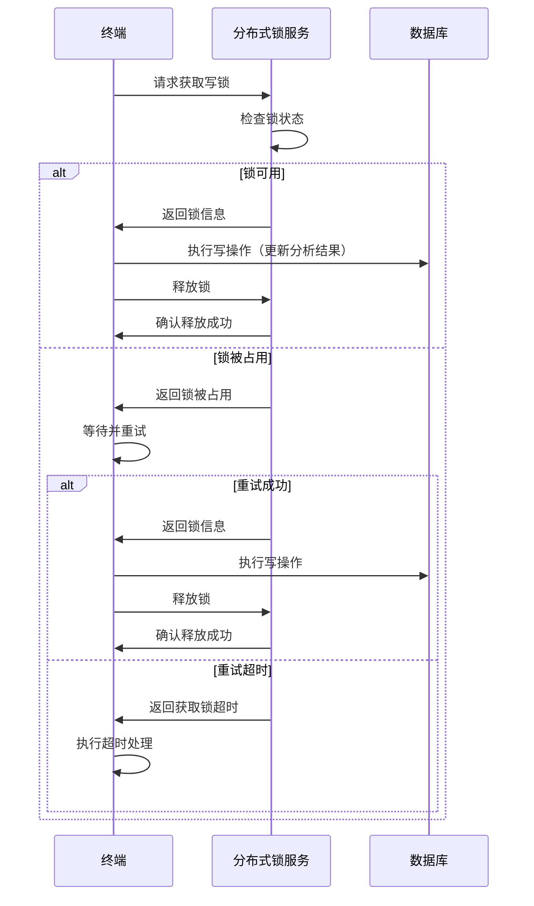
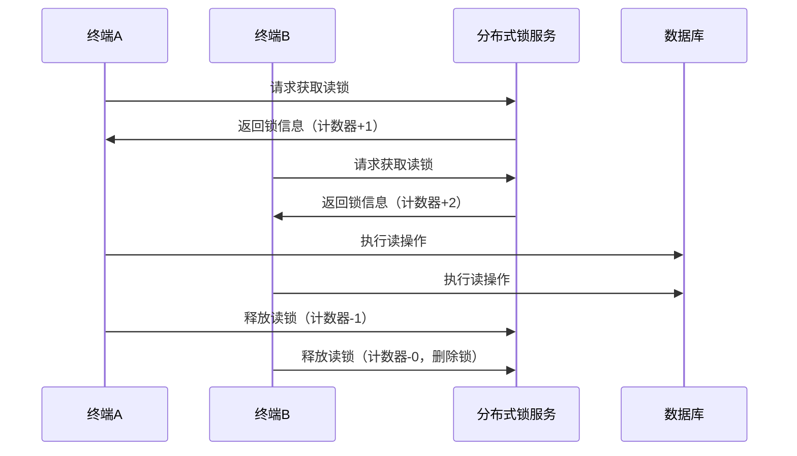
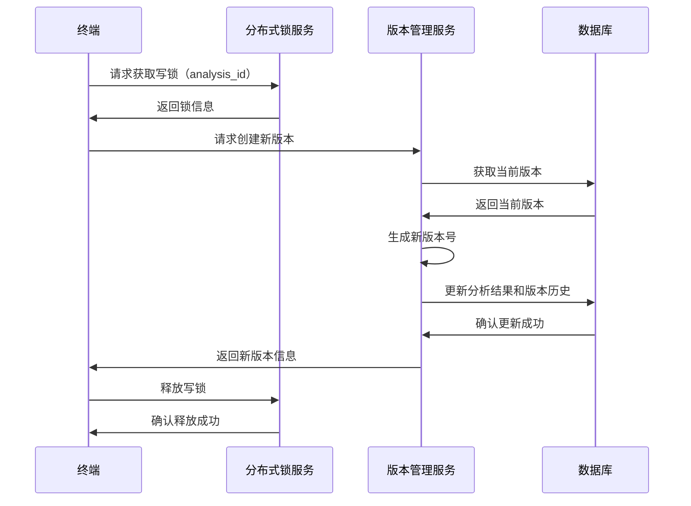

# 分布式锁机制实施文档

## 1. 概述

本文档详细说明视频分析系统中分布式锁机制的实施细节，旨在防止多终端同时修改同一ID对应的分析结果，确保分布式环境下的数据一致性和完整性。

## 2. 设计原则与目标

### 2.1 设计原则

| 原则 | 描述 |
|------|------|
| **互斥性** | 在任意时刻，只有一个终端能持有特定资源的锁 |
| **避免死锁** | 即使持有锁的终端崩溃，锁也能被释放 |
| **容错性** | 部分节点宕机不影响锁机制的正常运行 |
| **高性能** | 锁的获取和释放操作应具有低延迟 |
| **可重入性** | 同一终端可以多次获取同一把锁 |
| **公平性** | 锁的获取应遵循一定的公平性原则，避免饥饿 |

### 2.2 设计目标

1. 防止多终端同时修改同一分析结果ID
2. 支持不同类型的锁（读锁/写锁）
3. 提供锁超时机制，避免死锁
4. 支持锁的续约，适应长时间操作
5. 提供锁状态查询功能
6. 支持分布式环境下的锁同步
7. 与现有系统架构无缝集成

## 3. 锁的类型与适用场景

### 3.1 锁类型

| 锁类型 | 描述 | 适用场景 |
|--------|------|----------|
| **写锁（排他锁）** | 同一时间只允许一个终端持有，用于写入操作 | 分析结果创建、更新、删除操作 |
| **读锁（共享锁）** | 同一时间允许多个终端持有，用于读取操作 | 分析结果查询、版本比较操作 |
| **乐观锁** | 基于版本号的并发控制，适用于读多写少场景 | 低并发写入场景 |
| **悲观锁** | 基于显式锁定的并发控制，适用于写多读少场景 | 高并发写入场景 |

### 3.2 锁粒度

| 粒度级别 | 描述 | 优点 | 缺点 |
|----------|------|------|------|
| **分析结果级** | 为每个analysis_id分配独立的锁 | 锁冲突概率低，并发度高 | 锁数量多，管理复杂度高 |
| **视频级** | 为每个video_id分配独立的锁 | 锁数量少，管理简单 | 锁冲突概率高，并发度低 |
| **全局锁** | 整个系统共享一把锁 | 实现最简单 | 并发度极低，性能瓶颈 |

**推荐方案**：采用**分析结果级**锁粒度，为每个analysis_id分配独立的锁，平衡并发性能和管理复杂度。

## 4. 实现方案

### 4.1 技术选型

| 技术方案 | 优点 | 缺点 | 适用场景 |
|----------|------|------|----------|
| **Redis** | 高性能、高可用性、支持原子操作 | 依赖外部服务 | 高并发场景 |
| **ZooKeeper** | 可靠性高、支持顺序节点、天然支持分布式锁 | 性能较低、部署复杂 | 对可靠性要求极高的场景 |
| **etcd** | 高性能、强一致性、支持TTL | 部署复杂 | 云原生环境 |
| **数据库** | 实现简单、无需额外依赖 | 性能较低、容易成为瓶颈 | 低并发场景 |

**推荐方案**：采用**Redis**作为分布式锁的实现基础，利用其高性能和原子操作特性，满足视频分析系统的高并发需求。

### 4.2 核心实现

#### 4.2.1 锁数据结构

```python
class LockInfo:
    """锁信息数据结构"""
    def __init__(self, lock_id: str, resource_id: str, lock_type: str, 
                 terminal_id: str, expires_at: str):
        self.lock_id = lock_id  # 锁唯一标识
        self.resource_id = resource_id  # 资源ID（analysis_id）
        self.lock_type = lock_type  # 锁类型（read/write）
        self.terminal_id = terminal_id  # 持有锁的终端ID
        self.expires_at = expires_at  # 锁过期时间
        self.acquired_at = datetime.now().isoformat()  # 锁获取时间
```

#### 4.2.2 分布式锁服务实现

```python
import redis
import uuid
import time
from datetime import datetime, timedelta
from typing import Dict, Optional

class DistributedLockService:
    """分布式锁服务"""
    
    def __init__(self, redis_client: redis.Redis, default_lock_duration: int = 300):
        """初始化分布式锁服务
        
        Args:
            redis_client: Redis客户端
            default_lock_duration: 默认锁持有时间（秒）
        """
        self.redis = redis_client
        self.default_lock_duration = default_lock_duration
        self.script_lock = redis_client.lock("script_lock", timeout=10)  # 用于执行Lua脚本的锁
    
    def acquire_lock(self, resource_id: str, lock_type: str = "write", 
                    terminal_id: str = None, duration: int = None) -> Optional[Dict]:
        """获取分布式锁
        
        Args:
            resource_id: 资源ID（analysis_id）
            lock_type: 锁类型（read/write）
            terminal_id: 终端ID
            duration: 锁持有时间（秒）
            
        Returns:
            锁信息或None（获取失败）
        """
        if duration is None:
            duration = self.default_lock_duration
        
        if terminal_id is None:
            raise ValueError("terminal_id must be provided")
        
        lock_id = str(uuid.uuid4())
        lock_key = f"lock:{resource_id}:{lock_type}"
        
        if lock_type == "write":
            # 写锁：使用SETNX原子操作
            if self.redis.setnx(lock_key, lock_id):
                # 设置过期时间
                self.redis.expire(lock_key, duration)
                return self._create_lock_info(lock_id, resource_id, lock_type, terminal_id, duration)
            else:
                # 检查锁是否已过期
                current_lock_id = self.redis.get(lock_key)
                if current_lock_id:
                    # 尝试获取过期锁
                    with self.script_lock:
                        # 再次检查，防止竞态条件
                        current_lock_id = self.redis.get(lock_key)
                        if current_lock_id:
                            if not self.redis.ttl(lock_key) > 0:
                                # 锁已过期，尝试获取
                                old_lock_id = self.redis.getset(lock_key, lock_id)
                                if old_lock_id and old_lock_id.decode() == current_lock_id.decode():
                                    self.redis.expire(lock_key, duration)
                                    return self._create_lock_info(lock_id, resource_id, lock_type, terminal_id, duration)
        else:
            # 读锁：使用计数器实现
            self.redis.incr(lock_key)
            self.redis.expire(lock_key, duration)
            return self._create_lock_info(lock_id, resource_id, lock_type, terminal_id, duration)
        
        return None
    
    def release_lock(self, lock_info: Dict) -> bool:
        """释放分布式锁
        
        Args:
            lock_info: 锁信息
            
        Returns:
            True if released successfully, False otherwise
        """
        resource_id = lock_info["resource_id"]
        lock_type = lock_info["lock_type"]
        lock_id = lock_info["lock_id"]
        lock_key = f"lock:{resource_id}:{lock_type}"
        
        if lock_type == "write":
            # 写锁：验证锁ID并删除
            current_lock_id = self.redis.get(lock_key)
            if current_lock_id and current_lock_id.decode() == lock_id:
                return self.redis.delete(lock_key) > 0
        else:
            # 读锁：递减计数器
            count = self.redis.decr(lock_key)
            if count <= 0:
                self.redis.delete(lock_key)
            return True
        
        return False
    
    def renew_lock(self, lock_info: Dict, duration: int) -> bool:
        """续期分布式锁
        
        Args:
            lock_info: 锁信息
            duration: 续期时间（秒）
            
        Returns:
            True if renewed successfully, False otherwise
        """
        resource_id = lock_info["resource_id"]
        lock_type = lock_info["lock_type"]
        lock_id = lock_info["lock_id"]
        lock_key = f"lock:{resource_id}:{lock_type}"
        
        if lock_type == "write":
            # 验证锁ID
            current_lock_id = self.redis.get(lock_key)
            if current_lock_id and current_lock_id.decode() == lock_id:
                self.redis.expire(lock_key, duration)
                # 更新锁信息中的过期时间
                lock_info["expires_at"] = (datetime.now() + timedelta(seconds=duration)).isoformat()
                return True
        else:
            # 读锁直接续期
            if self.redis.exists(lock_key):
                self.redis.expire(lock_key, duration)
                # 更新锁信息中的过期时间
                lock_info["expires_at"] = (datetime.now() + timedelta(seconds=duration)).isoformat()
                return True
        
        return False
    
    def is_lock_acquired(self, resource_id: str, lock_type: str = "write") -> bool:
        """检查锁是否已被获取
        
        Args:
            resource_id: 资源ID
            lock_type: 锁类型
            
        Returns:
            True if lock is acquired, False otherwise
        """
        lock_key = f"lock:{resource_id}:{lock_type}"
        if lock_type == "write":
            # 写锁：检查是否存在
            return self.redis.exists(lock_key) > 0
        else:
            # 读锁：检查计数器是否大于0
            count = self.redis.get(lock_key)
            return count is not None and int(count.decode()) > 0
    
    def get_lock_info(self, resource_id: str, lock_type: str = "write") -> Optional[Dict]:
        """获取锁信息
        
        Args:
            resource_id: 资源ID
            lock_type: 锁类型
            
        Returns:
            锁信息或None
        """
        lock_key = f"lock:{resource_id}:{lock_type}"
        current_lock_id = self.redis.get(lock_key)
        if current_lock_id:
            ttl = self.redis.ttl(lock_key)
            if ttl < 0:
                ttl = self.default_lock_duration  # 永久锁
            
            lock_info = {
                "lock_id": current_lock_id.decode(),
                "resource_id": resource_id,
                "lock_type": lock_type,
                "expires_in": ttl,
                "is_expired": ttl <= 0
            }
            
            # 尝试获取锁持有者信息（如果有）
            holder_key = f"lock_holder:{current_lock_id.decode()}"
            holder_info = self.redis.get(holder_key)
            if holder_info:
                import json
                lock_info["holder_info"] = json.loads(holder_info.decode())
            
            return lock_info
        
        return None
    
    def try_acquire_lock(self, resource_id: str, lock_type: str = "write", 
                        terminal_id: str = None, duration: int = None, 
                        timeout: int = 10, interval: float = 0.1) -> Optional[Dict]:
        """尝试获取锁，支持超时重试
        
        Args:
            resource_id: 资源ID
            lock_type: 锁类型
            terminal_id: 终端ID
            duration: 锁持有时间
            timeout: 超时时间（秒）
            interval: 重试间隔（秒）
            
        Returns:
            锁信息或None（超时）
        """
        start_time = time.time()
        while time.time() - start_time < timeout:
            lock_info = self.acquire_lock(resource_id, lock_type, terminal_id, duration)
            if lock_info:
                return lock_info
            time.sleep(interval)
        return None
    
    def _create_lock_info(self, lock_id: str, resource_id: str, lock_type: str, 
                         terminal_id: str, duration: int) -> Dict:
        """创建锁信息
        
        Args:
            lock_id: 锁ID
            resource_id: 资源ID
            lock_type: 锁类型
            terminal_id: 终端ID
            duration: 锁持有时间
            
        Returns:
            锁信息
        """
        expires_at = (datetime.now() + timedelta(seconds=duration)).isoformat()
        
        lock_info = {
            "lock_id": lock_id,
            "resource_id": resource_id,
            "lock_type": lock_type,
            "terminal_id": terminal_id,
            "expires_at": expires_at,
            "acquired_at": datetime.now().isoformat(),
            "duration": duration
        }
        
        # 保存锁持有者信息
        holder_key = f"lock_holder:{lock_id}"
        import json
        self.redis.setex(holder_key, duration, json.dumps({
            "terminal_id": terminal_id,
            "resource_id": resource_id,
            "lock_type": lock_type,
            "acquired_at": lock_info["acquired_at"]
        }))
        
        return lock_info
    
    def force_release_lock(self, resource_id: str, lock_type: str = "write") -> bool:
        """强制释放锁（用于管理员操作）
        
        Args:
            resource_id: 资源ID
            lock_type: 锁类型
            
        Returns:
            True if released successfully, False otherwise
        """
        lock_key = f"lock:{resource_id}:{lock_type}"
        current_lock_id = self.redis.get(lock_key)
        if current_lock_id:
            # 删除锁
            self.redis.delete(lock_key)
            # 删除锁持有者信息
            holder_key = f"lock_holder:{current_lock_id.decode()}"
            self.redis.delete(holder_key)
            return True
        return False
```

### 4.3 乐观锁实现

```python
class OptimisticLockService:
    """乐观锁服务，基于版本号实现"""
    
    def __init__(self, db_client):
        self.db_client = db_client
    
    def update_with_optimistic_lock(self, analysis_id: str, update_func, terminal_id: str) -> Dict:
        """使用乐观锁更新分析结果
        
        Args:
            analysis_id: 分析结果ID
            update_func: 更新函数，接收当前分析结果并返回更新后的结果
            terminal_id: 终端ID
            
        Returns:
            更新后的分析结果
        """
        max_retries = 3
        for attempt in range(max_retries):
            # 获取当前分析结果和版本号
            current_analysis = self.db_client.get_analysis_by_id(analysis_id)
            current_version = current_analysis["current_version"]
            
            # 执行更新操作
            updated_analysis = update_func(current_analysis)
            
            # 验证版本号是否一致，并更新
            try:
                # 在数据库中执行原子更新，验证版本号
                result = self.db_client.update_analysis_with_version_check(
                    analysis_id, 
                    updated_analysis, 
                    current_version,
                    terminal_id
                )
                if result:
                    return result
            except Exception as e:
                # 版本冲突，重试
                if attempt == max_retries - 1:
                    raise Exception(f"Failed to update analysis after {max_retries} attempts") from e
        
        raise Exception(f"Failed to update analysis after {max_retries} attempts")
```

## 5. 锁的使用流程

### 5.1 写锁使用流程



### 5.2 读锁使用流程



### 5.3 与版本管理系统集成流程



## 6. 异常处理机制

### 6.1 锁超时处理

| 异常类型 | 处理策略 |
|----------|----------|
| **锁获取超时** | 实现指数退避重试机制（1s, 3s, 5s, 10s），记录超时日志，允许业务层选择降级策略 |
| **锁持有超时** | 自动释放锁，防止死锁；提供锁续约机制，支持长时间操作 |
| **锁释放失败** | 记录错误日志，定期清理过期锁；提供强制释放接口 |

### 6.2 系统故障处理

| 故障类型 | 处理策略 |
|----------|----------|
| **Redis宕机** | 实现Redis集群高可用；降级到本地锁（仅适用于单节点部署）；记录故障日志 |
| **网络中断** | 缓存锁操作，恢复连接后重试；实现本地锁作为备选方案 |
| **终端崩溃** | 依赖锁的过期机制自动释放；定期清理孤儿锁 |

### 6.3 锁冲突处理

```python
def handle_lock_conflict(resource_id: str, lock_type: str, terminal_id: str) -> Optional[Dict]:
    """处理锁冲突
    
    Args:
        resource_id: 资源ID
        lock_type: 锁类型
        terminal_id: 终端ID
        
    Returns:
        锁信息或None
    """
    # 获取当前锁信息
    lock_info = distributed_lock_service.get_lock_info(resource_id, lock_type)
    
    if lock_info and not lock_info["is_expired"]:
        # 锁被其他终端持有，尝试协商
        holder_info = lock_info.get("holder_info")
        if holder_info:
            logger.info({
                "event": "lock_conflict",
                "resource_id": resource_id,
                "lock_type": lock_type,
                "terminal_id": terminal_id,
                "holder_terminal": holder_info["terminal_id"],
                "acquired_at": holder_info["acquired_at"]
            })
        
        # 尝试等待锁释放
        return distributed_lock_service.try_acquire_lock(
            resource_id, 
            lock_type, 
            terminal_id, 
            timeout=30
        )
    else:
        # 锁已过期，强制释放并重新获取
        distributed_lock_service.force_release_lock(resource_id, lock_type)
        return distributed_lock_service.acquire_lock(resource_id, lock_type, terminal_id)
```

## 7. 性能优化

### 7.1 锁操作优化

| 优化策略 | 实现方式 | 预期效果 |
|----------|----------|----------|
| **批量锁操作** | 支持一次性获取或释放多个锁 | 减少网络请求次数，提高效率 |
| **异步锁操作** | 支持异步获取和释放锁 | 提高系统响应速度，避免阻塞 |
| **锁粒度优化** | 采用分析结果级锁粒度，避免粗粒度锁的性能瓶颈 | 提高并发度，减少锁冲突 |
| **锁缓存** | 缓存本地持有的锁信息，减少Redis查询 | 降低Redis负载，提高性能 |

### 7.2 Redis优化

| 优化策略 | 实现方式 | 预期效果 |
|----------|----------|----------|
| **Redis集群** | 部署Redis集群，提高可用性和性能 | 避免单点故障，提高并发处理能力 |
| **Pipeline** | 使用Redis Pipeline批量执行命令 | 减少网络往返时间，提高吞吐量 |
| **Lua脚本** | 使用Lua脚本执行原子操作 | 保证操作原子性，减少网络请求 |
| **连接池** | 使用Redis连接池管理连接 | 减少连接建立和关闭的开销 |

### 7.3 锁续约机制

```python
def start_lock_renewal(lock_info: Dict, renewal_interval: int = 60) -> None:
    """启动锁续约任务
    
    Args:
        lock_info: 锁信息
        renewal_interval: 续约间隔（秒）
    """
    def renew_task():
        while True:
            time.sleep(renewal_interval)
            # 检查锁是否过期
            if datetime.fromisoformat(lock_info["expires_at"]) - datetime.now() < timedelta(seconds=renewal_interval * 2):
                # 续约锁
                success = distributed_lock_service.renew_lock(lock_info)
                if success:
                    logger.info({
                        "event": "lock_renewed",
                        "lock_id": lock_info["lock_id"],
                        "resource_id": lock_info["resource_id"],
                        "new_expires_at": lock_info["expires_at"]
                    })
                else:
                    logger.warning({
                        "event": "lock_renewal_failed",
                        "lock_id": lock_info["lock_id"],
                        "resource_id": lock_info["resource_id"]
                    })
                    break
    
    # 启动后台线程
    import threading
    threading.Thread(target=renew_task, daemon=True).start()
```

## 8. 与现有系统的集成

### 8.1 与ID冲突检测机制集成

```python
class IDConflictDetectionService:
    """ID冲突检测服务"""
    
    def __init__(self, redis_client, distributed_lock_service):
        self.redis = redis_client
        self.distributed_lock_service = distributed_lock_service
    
    def detect_conflict(self, local_data: Dict, remote_data: Dict) -> Dict:
        """检测数据冲突"""
        analysis_id = local_data["analysis_id"]
        
        # 获取读锁，防止检测过程中数据被修改
        lock_info = self.distributed_lock_service.acquire_lock(analysis_id, "read", local_data["metadata"]["terminal_id"])
        
        try:
            # 执行冲突检测
            # ...
            conflict_result = self._perform_conflict_detection(local_data, remote_data)
            return conflict_result
        finally:
            # 释放读锁
            self.distributed_lock_service.release_lock(lock_info)
```

### 8.2 与版本管理系统集成

```python
class VersionManagementService:
    """版本管理服务"""
    
    def __init__(self, db_client, version_generator, distributed_lock_service):
        self.db_client = db_client
        self.version_generator = version_generator
        self.distributed_lock_service = distributed_lock_service
    
    def create_version(self, analysis_data: Dict, change_type: str = "create", 
                      change_description: str = None) -> Dict:
        """创建新版本"""
        analysis_id = analysis_data["analysis_id"]
        terminal_id = analysis_data["metadata"]["terminal_id"]
        
        # 获取写锁
        lock_info = self.distributed_lock_service.acquire_lock(analysis_id, "write", terminal_id)
        
        try:
            # 执行版本创建逻辑
            # ...
            version_info = self._create_version_internal(analysis_data, change_type, change_description)
            return version_info
        finally:
            # 释放写锁
            self.distributed_lock_service.release_lock(lock_info)
```

## 9. 监控与告警

### 9.1 监控指标

| 指标名称 | 描述 | 告警阈值 |
|----------|------|----------|
| 锁获取成功率 | 成功获取锁的比例 | < 99.9% |
| 锁等待时间 | 等待获取锁的平均时间 | > 500ms |
| 锁持有时间 | 锁持有时间的平均值 | > 300s |
| 锁冲突次数 | 发生锁冲突的次数 | > 100次/分钟 |
| 过期锁数量 | 已过期但未释放的锁数量 | > 50 |
| Redis连接池使用率 | Redis连接池的使用率 | > 80% |

### 9.2 日志记录

```python
def acquire_lock(self, resource_id: str, lock_type: str = "write", 
                terminal_id: str = None, duration: int = None) -> Optional[Dict]:
    """获取分布式锁"""
    logger.info({
        "event": "lock_acquire_attempt",
        "resource_id": resource_id,
        "lock_type": lock_type,
        "terminal_id": terminal_id,
        "timestamp": datetime.now().isoformat()
    })
    
    try:
        # 锁获取逻辑
        # ...
        
        if lock_info:
            logger.info({
                "event": "lock_acquire_success",
                "lock_id": lock_info["lock_id"],
                "resource_id": resource_id,
                "lock_type": lock_type,
                "terminal_id": terminal_id,
                "duration": duration,
                "timestamp": datetime.now().isoformat()
            })
            return lock_info
        else:
            logger.warning({
                "event": "lock_acquire_failed",
                "resource_id": resource_id,
                "lock_type": lock_type,
                "terminal_id": terminal_id,
                "timestamp": datetime.now().isoformat()
            })
            return None
    except Exception as e:
        logger.error({
            "event": "lock_acquire_error",
            "resource_id": resource_id,
            "lock_type": lock_type,
            "terminal_id": terminal_id,
            "error": str(e),
            "timestamp": datetime.now().isoformat()
        })
        raise
```

## 10. 测试计划

### 10.1 单元测试

- 测试锁的获取和释放功能
- 测试锁的超时机制
- 测试锁的续约功能
- 测试读锁和写锁的互斥性
- 测试锁的可重入性
- 测试乐观锁的版本控制

### 10.2 集成测试

- 测试分布式锁与ID冲突检测机制的集成
- 测试分布式锁与版本管理系统的集成
- 测试分布式锁与同步服务的集成
- 测试多终端并发获取锁的场景

### 10.3 性能测试

- 测试高并发场景下的锁获取性能
- 测试锁操作的延迟
- 测试Redis负载情况
- 测试不同锁粒度对性能的影响

### 10.4 可靠性测试

- 测试Redis宕机后的锁机制容错能力
- 测试网络中断后的锁恢复能力
- 测试终端崩溃后的锁释放机制
- 测试长时间运行的锁机制稳定性

### 10.5 压力测试

- 测试系统在1000+并发请求下的锁机制表现
- 测试持续高负载下的锁机制稳定性
- 测试锁冲突频繁发生时的系统表现

## 11. 结论

本分布式锁机制实施文档详细设计了视频分析系统中的分布式锁解决方案，基于Redis实现了高效、可靠的锁机制，支持读锁、写锁和乐观锁等多种锁类型。该机制具有以下特点：

1. **互斥性强**：确保同一时刻只有一个终端能修改同一分析结果
2. **避免死锁**：实现了完善的锁超时和自动释放机制
3. **高性能**：基于Redis实现，具有低延迟和高吞吐量
4. **容错性好**：支持Redis集群和故障恢复机制
5. **易于集成**：与现有系统架构无缝集成
6. **可监控**：提供了完善的监控指标和日志记录

该分布式锁机制能够有效防止多终端同时修改同一ID对应的分析结果，确保分布式环境下的数据一致性和完整性，为视频分析系统的稳定运行提供有力保障。