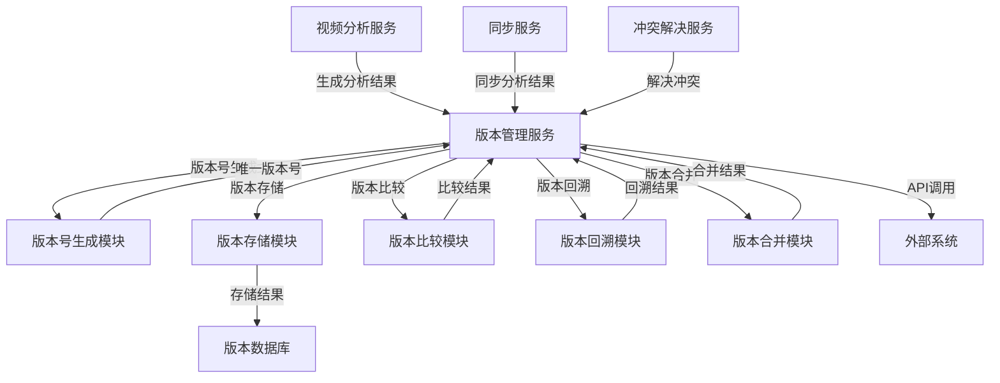

# 分析结果版本化管理实施文档

## 1. 概述

本文档详细说明视频分析系统中分析结果版本化管理的实施细节，包括版本号生成规则、版本历史记录、版本比较和回溯功能，确保每个分析结果都有唯一版本号并记录完整的修改历史。

## 2. 版本管理系统设计

### 2.1 系统架构



### 2.2 核心模块

| 模块名称 | 主要功能 |
|----------|----------|
| **版本管理服务** | 统一管理分析结果的版本信息，提供版本相关API |
| **版本号生成模块** | 生成唯一的版本号，遵循语义化版本控制规则 |
| **版本存储模块** | 存储分析结果的版本数据和版本历史 |
| **版本比较模块** | 比较不同版本的分析结果，展示差异 |
| **版本回溯模块** | 从历史版本恢复分析结果 |
| **版本合并模块** | 合并不同版本的分析结果 |

## 3. 版本号生成规则

### 3.1 版本号格式

采用语义化版本控制（Semantic Versioning）结合终端标识，格式为：

```
v<主版本号>.<次版本号>.<修订号>-<终端ID>
```

| 字段 | 含义 | 更新规则 |
|------|------|----------|
| **主版本号** | 重大功能变更或架构调整 | 当分析模型或核心算法发生重大变化时递增 |
| **次版本号** | 新功能添加或改进 | 当添加新的分析功能或改进现有功能时递增 |
| **修订号** | 错误修复或小改进 | 当修复分析结果中的错误或进行小改进时递增 |
| **终端ID** | 生成该版本的终端标识 | 始终包含生成该版本的终端ID |

### 3.2 特殊版本号

| 类型 | 格式 | 示例 | 用途 |
|------|------|------|------|
| **分支版本** | `v<主>.<次>.<修>-<分支名>-<终端ID>` | `v1.0.0-experiment-terminal001` | 实验性分支或特定场景版本 |
| **时间戳版本** | `<时间戳>-<终端ID>` | `20240115100000-terminal001` | 临时版本或快速迭代版本 |
| **合并版本** | `v<主>.<次>.<修>-merge-<源版本>-<终端ID>` | `v1.0.1-merge-v1.0.0-v1.0.0-alt-terminal001` | 合并多个版本后的结果版本 |

### 3.3 版本号生成算法

```python
import re
from typing import Tuple, Optional

class VersionGenerator:
    """版本号生成器"""
    
    def __init__(self):
        self.version_pattern = r'^v(\d+)\.(\d+)\.(\d+)(?:-(\w+))?(?:-(\w+))?$'
    
    def parse_version(self, version_str: str) -> Tuple[int, int, int, Optional[str], Optional[str]]:
        """解析版本号
        
        Args:
            version_str: 版本号字符串
            
        Returns:
            (主版本号, 次版本号, 修订号, 分支名, 终端ID)
        """
        match = re.match(self.version_pattern, version_str)
        if not match:
            raise ValueError(f"Invalid version format: {version_str}")
        
        major = int(match.group(1))
        minor = int(match.group(2))
        patch = int(match.group(3))
        branch = match.group(4)
        terminal_id = match.group(5)
        
        return major, minor, patch, branch, terminal_id
    
    def generate_next_version(self, current_version: str, change_type: str = "patch", 
                             terminal_id: str = None) -> str:
        """生成下一个版本号
        
        Args:
            current_version: 当前版本号
            change_type: 变更类型（major/minor/patch）
            terminal_id: 终端ID
            
        Returns:
            下一个版本号
        """
        major, minor, patch, _, current_terminal = self.parse_version(current_version)
        
        # 如果没有提供终端ID，使用当前版本的终端ID
        if terminal_id is None:
            terminal_id = current_terminal
        
        # 根据变更类型更新版本号
        if change_type == "major":
            major += 1
            minor = 0
            patch = 0
        elif change_type == "minor":
            minor += 1
            patch = 0
        elif change_type == "patch":
            patch += 1
        else:
            raise ValueError(f"Invalid change type: {change_type}")
        
        return f"v{major}.{minor}.{patch}-{terminal_id}"
    
    def generate_initial_version(self, terminal_id: str) -> str:
        """生成初始版本号
        
        Args:
            terminal_id: 终端ID
            
        Returns:
            初始版本号
        """
        return f"v1.0.0-{terminal_id}"
    
    def generate_merge_version(self, source_versions: list, terminal_id: str) -> str:
        """生成合并版本号
        
        Args:
            source_versions: 源版本列表
            terminal_id: 终端ID
            
        Returns:
            合并版本号
        """
        # 解析所有源版本，找出最高版本
        max_major, max_minor, max_patch = 0, 0, 0
        
        for version in source_versions:
            major, minor, patch, _, _ = self.parse_version(version)
            if major > max_major or \
               (major == max_major and minor > max_minor) or \
               (major == max_major and minor == max_minor and patch > max_patch):
                max_major, max_minor, max_patch = major, minor, patch
        
        # 合并版本号格式：v<主>.<次>.<修+1>-merge-<源版本列表>-<终端ID>
        source_versions_str = "-".join(source_versions)
        return f"v{max_major}.{max_minor}.{max_patch+1}-merge-{source_versions_str}-{terminal_id}"
```

## 4. 数据库设计

### 4.1 核心表结构

#### 4.1.1 分析结果表

```sql
CREATE TABLE IF NOT EXISTS video_analysis (
    analysis_id VARCHAR(36) PRIMARY KEY,  -- 分析结果唯一ID
    video_id VARCHAR(256) NOT NULL,       -- 视频唯一标识
    content JSON NOT NULL,                -- 分析结果内容
    metadata JSON NOT NULL,               -- 分析结果元数据
    current_version VARCHAR(64) NOT NULL, -- 当前版本号
    parent_version VARCHAR(64),           -- 父版本号
    created_at TIMESTAMP NOT NULL DEFAULT CURRENT_TIMESTAMP, -- 创建时间
    updated_at TIMESTAMP NOT NULL DEFAULT CURRENT_TIMESTAMP, -- 更新时间
    checksum VARCHAR(64) NOT NULL,        -- 内容校验和
    
    -- 索引
    INDEX idx_video_id (video_id),
    INDEX idx_current_version (current_version),
    INDEX idx_created_at (created_at)
);
```

#### 4.1.2 版本历史表

```sql
CREATE TABLE IF NOT EXISTS version_history (
    history_id VARCHAR(36) PRIMARY KEY,   -- 历史记录唯一ID
    analysis_id VARCHAR(36) NOT NULL,     -- 关联的分析结果ID
    version VARCHAR(64) NOT NULL,         -- 版本号
    content JSON NOT NULL,                -- 该版本的分析结果内容
    metadata JSON NOT NULL,               -- 该版本的元数据
    parent_version VARCHAR(64),           -- 父版本号
    created_at TIMESTAMP NOT NULL DEFAULT CURRENT_TIMESTAMP, -- 创建时间
    created_by VARCHAR(64) NOT NULL,      -- 创建该版本的终端ID
    change_type VARCHAR(32) NOT NULL,     -- 变更类型（create/update/merge/restore）
    change_description TEXT,              -- 变更描述
    checksum VARCHAR(64) NOT NULL,        -- 内容校验和
    
    -- 索引
    INDEX idx_analysis_id_version (analysis_id, version),
    INDEX idx_analysis_id_created_at (analysis_id, created_at),
    INDEX idx_version (version),
    
    -- 外键
    FOREIGN KEY (analysis_id) REFERENCES video_analysis(analysis_id) ON DELETE CASCADE
);
```

#### 4.1.3 版本关系表

```sql
CREATE TABLE IF NOT EXISTS version_relationships (
    relationship_id VARCHAR(36) PRIMARY KEY, -- 关系记录唯一ID
    source_version VARCHAR(64) NOT NULL,     -- 源版本号
    target_version VARCHAR(64) NOT NULL,     -- 目标版本号
    relationship_type VARCHAR(32) NOT NULL,  -- 关系类型（parent/child/merge_from/merge_to）
    analysis_id VARCHAR(36) NOT NULL,        -- 关联的分析结果ID
    created_at TIMESTAMP NOT NULL DEFAULT CURRENT_TIMESTAMP, -- 创建时间
    
    -- 索引
    INDEX idx_analysis_id_relationships (analysis_id),
    INDEX idx_source_version (source_version),
    INDEX idx_target_version (target_version),
    
    -- 外键
    FOREIGN KEY (analysis_id) REFERENCES video_analysis(analysis_id) ON DELETE CASCADE
);
```

### 4.2 数据模型

#### 4.2.1 分析结果数据模型

```json
{
  "analysis_id": "analysis_001",
  "video_id": "video_001",
  "content": {
    "tags": [{"tag": "person", "confidence": 0.95, "frame_range": [0, 100]}],
    "summary": "视频摘要",
    "key_frames": ["frame1.jpg", "frame2.jpg"]
  },
  "metadata": {
    "model_version": "v1.0.0",
    "analysis_time": "2024-01-15T10:00:00Z",
    "confidence": 0.92,
    "terminal_id": "terminal_001"
  },
  "current_version": "v1.0.1-terminal_001",
  "parent_version": "v1.0.0-terminal_001",
  "created_at": "2024-01-15T10:00:00Z",
  "updated_at": "2024-01-15T10:30:00Z",
  "checksum": "SHA-256哈希值"
}
```

#### 4.2.2 版本历史数据模型

```json
{
  "history_id": "history_001",
  "analysis_id": "analysis_001",
  "version": "v1.0.1-terminal_001",
  "content": {
    "tags": [{"tag": "person", "confidence": 0.95, "frame_range": [0, 100]}],
    "summary": "更新后的视频摘要",
    "key_frames": ["frame1.jpg", "frame2.jpg", "frame3.jpg"]
  },
  "metadata": {
    "model_version": "v1.0.0",
    "analysis_time": "2024-01-15T10:00:00Z",
    "confidence": 0.92,
    "terminal_id": "terminal_001"
  },
  "parent_version": "v1.0.0-terminal_001",
  "created_at": "2024-01-15T10:30:00Z",
  "created_by": "terminal_001",
  "change_type": "update",
  "change_description": "更新了视频摘要和关键帧",
  "checksum": "SHA-256哈希值"
}
```

## 5. 核心API实现

### 5.1 版本管理服务接口

```python
from typing import Dict, List, Optional
from datetime import datetime

class VersionManagementService:
    """版本管理服务"""
    
    def __init__(self, db_client, version_generator):
        self.db_client = db_client
        self.version_generator = version_generator
    
    def create_version(self, analysis_data: Dict, change_type: str = "create", 
                      change_description: str = None) -> Dict:
        """创建新版本
        
        Args:
            analysis_data: 分析结果数据
            change_type: 变更类型（create/update/merge/restore）
            change_description: 变更描述
            
        Returns:
            创建的版本信息
        """
        analysis_id = analysis_data["analysis_id"]
        terminal_id = analysis_data["metadata"]["terminal_id"]
        
        # 生成版本号
        if change_type == "create":
            # 创建初始版本
            version = self.version_generator.generate_initial_version(terminal_id)
        else:
            # 获取当前版本
            current_analysis = self.db_client.get_analysis_by_id(analysis_id)
            current_version = current_analysis["current_version"]
            
            # 生成下一个版本号
            version = self.version_generator.generate_next_version(current_version, "patch", terminal_id)
        
        # 更新分析结果的当前版本
        analysis_data["current_version"] = version
        analysis_data["parent_version"] = current_analysis["current_version"] if change_type != "create" else None
        analysis_data["updated_at"] = datetime.now().isoformat()
        
        # 计算内容校验和
        checksum = self._calculate_checksum(analysis_data["content"])
        analysis_data["checksum"] = checksum
        
        # 保存分析结果
        self.db_client.update_analysis(analysis_data)
        
        # 保存版本历史
        history_data = {
            "history_id": self._generate_uuid(),
            "analysis_id": analysis_id,
            "version": version,
            "content": analysis_data["content"],
            "metadata": analysis_data["metadata"],
            "parent_version": analysis_data["parent_version"],
            "created_at": analysis_data["updated_at"],
            "created_by": terminal_id,
            "change_type": change_type,
            "change_description": change_description,
            "checksum": checksum
        }
        
        self.db_client.save_version_history(history_data)
        
        # 保存版本关系
        if analysis_data["parent_version"]:
            relationship_data = {
                "relationship_id": self._generate_uuid(),
                "source_version": analysis_data["parent_version"],
                "target_version": version,
                "relationship_type": "parent",
                "analysis_id": analysis_id,
                "created_at": analysis_data["updated_at"]
            }
            self.db_client.save_version_relationship(relationship_data)
        
        return {
            "analysis_id": analysis_id,
            "version": version,
            "created_at": analysis_data["updated_at"],
            "change_type": change_type
        }
    
    def get_version_history(self, analysis_id: str, start_time: Optional[datetime] = None, 
                          end_time: Optional[datetime] = None) -> List[Dict]:
        """获取版本历史
        
        Args:
            analysis_id: 分析结果ID
            start_time: 开始时间
            end_time: 结束时间
            
        Returns:
            版本历史列表
        """
        return self.db_client.get_version_history(analysis_id, start_time, end_time)
    
    def get_specific_version(self, analysis_id: str, version: str) -> Dict:
        """获取特定版本
        
        Args:
            analysis_id: 分析结果ID
            version: 版本号
            
        Returns:
            特定版本的分析结果
        """
        return self.db_client.get_version_by_id(analysis_id, version)
    
    def restore_version(self, analysis_id: str, version: str) -> Dict:
        """恢复到特定版本
        
        Args:
            analysis_id: 分析结果ID
            version: 版本号
            
        Returns:
            恢复后的版本信息
        """
        # 获取要恢复的版本
        restore_version = self.db_client.get_version_by_id(analysis_id, version)
        
        # 获取当前版本
        current_analysis = self.db_client.get_analysis_by_id(analysis_id)
        
        # 生成新的版本号，基于当前版本
        terminal_id = current_analysis["metadata"]["terminal_id"]
        new_version = self.version_generator.generate_next_version(
            current_analysis["current_version"], 
            "patch", 
            terminal_id
        )
        
        # 构建恢复后的分析数据
        restored_analysis = {
            "analysis_id": analysis_id,
            "video_id": current_analysis["video_id"],
            "content": restore_version["content"],
            "metadata": restore_version["metadata"],
            "current_version": new_version,
            "parent_version": current_analysis["current_version"],
            "created_at": current_analysis["created_at"],
            "updated_at": datetime.now().isoformat(),
            "checksum": self._calculate_checksum(restore_version["content"])
        }
        
        # 保存恢复后的分析结果
        self.db_client.update_analysis(restored_analysis)
        
        # 保存版本历史
        history_data = {
            "history_id": self._generate_uuid(),
            "analysis_id": analysis_id,
            "version": new_version,
            "content": restored_analysis["content"],
            "metadata": restored_analysis["metadata"],
            "parent_version": restored_analysis["parent_version"],
            "created_at": restored_analysis["updated_at"],
            "created_by": terminal_id,
            "change_type": "restore",
            "change_description": f"Restored from version {version}",
            "checksum": restored_analysis["checksum"]
        }
        
        self.db_client.save_version_history(history_data)
        
        # 保存版本关系
        relationship_data = {
            "relationship_id": self._generate_uuid(),
            "source_version": restored_analysis["parent_version"],
            "target_version": new_version,
            "relationship_type": "parent",
            "analysis_id": analysis_id,
            "created_at": restored_analysis["updated_at"]
        }
        self.db_client.save_version_relationship(relationship_data)
        
        # 保存恢复关系
        restore_relationship_data = {
            "relationship_id": self._generate_uuid(),
            "source_version": version,
            "target_version": new_version,
            "relationship_type": "restore_from",
            "analysis_id": analysis_id,
            "created_at": restored_analysis["updated_at"]
        }
        self.db_client.save_version_relationship(restore_relationship_data)
        
        return {
            "analysis_id": analysis_id,
            "version": new_version,
            "restored_from": version,
            "created_at": restored_analysis["updated_at"]
        }
    
    def compare_versions(self, analysis_id: str, version1: str, version2: str) -> Dict:
        """比较两个版本的差异
        
        Args:
            analysis_id: 分析结果ID
            version1: 版本1
            version2: 版本2
            
        Returns:
            版本差异信息
        """
        # 获取两个版本
        v1 = self.db_client.get_version_by_id(analysis_id, version1)
        v2 = self.db_client.get_version_by_id(analysis_id, version2)
        
        # 比较内容差异
        content_diff = self._compare_content(v1["content"], v2["content"])
        
        # 比较元数据差异
        metadata_diff = self._compare_metadata(v1["metadata"], v2["metadata"])
        
        return {
            "analysis_id": analysis_id,
            "version1": version1,
            "version2": version2,
            "content_diff": content_diff,
            "metadata_diff": metadata_diff,
            "v1_created_at": v1["created_at"],
            "v2_created_at": v2["created_at"]
        }
    
    def merge_versions(self, analysis_id: str, source_versions: List[str], 
                      terminal_id: str, merged_content: Dict) -> Dict:
        """合并多个版本
        
        Args:
            analysis_id: 分析结果ID
            source_versions: 源版本列表
            terminal_id: 终端ID
            merged_content: 合并后的内容
            
        Returns:
            合并后的版本信息
        """
        # 生成合并版本号
        merge_version = self.version_generator.generate_merge_version(source_versions, terminal_id)
        
        # 获取当前版本
        current_analysis = self.db_client.get_analysis_by_id(analysis_id)
        
        # 构建合并后的分析数据
        merged_analysis = {
            "analysis_id": analysis_id,
            "video_id": current_analysis["video_id"],
            "content": merged_content,
            "metadata": current_analysis["metadata"],
            "current_version": merge_version,
            "parent_version": current_analysis["current_version"],
            "created_at": current_analysis["created_at"],
            "updated_at": datetime.now().isoformat(),
            "checksum": self._calculate_checksum(merged_content)
        }
        
        # 保存合并后的分析结果
        self.db_client.update_analysis(merged_analysis)
        
        # 保存版本历史
        history_data = {
            "history_id": self._generate_uuid(),
            "analysis_id": analysis_id,
            "version": merge_version,
            "content": merged_content,
            "metadata": merged_analysis["metadata"],
            "parent_version": merged_analysis["parent_version"],
            "created_at": merged_analysis["updated_at"],
            "created_by": terminal_id,
            "change_type": "merge",
            "change_description": f"Merged from versions: {', '.join(source_versions)}",
            "checksum": merged_analysis["checksum"]
        }
        
        self.db_client.save_version_history(history_data)
        
        # 保存版本关系
        # 1. 与当前版本的关系
        parent_relationship = {
            "relationship_id": self._generate_uuid(),
            "source_version": merged_analysis["parent_version"],
            "target_version": merge_version,
            "relationship_type": "parent",
            "analysis_id": analysis_id,
            "created_at": merged_analysis["updated_at"]
        }
        self.db_client.save_version_relationship(parent_relationship)
        
        # 2. 与所有源版本的关系
        for source_version in source_versions:
            merge_relationship = {
                "relationship_id": self._generate_uuid(),
                "source_version": source_version,
                "target_version": merge_version,
                "relationship_type": "merge_from",
                "analysis_id": analysis_id,
                "created_at": merged_analysis["updated_at"]
            }
            self.db_client.save_version_relationship(merge_relationship)
        
        return {
            "analysis_id": analysis_id,
            "version": merge_version,
            "merged_from": source_versions,
            "created_at": merged_analysis["updated_at"]
        }
    
    def _calculate_checksum(self, content: Dict) -> str:
        """计算内容校验和
        
        Args:
            content: 要计算校验和的内容
            
        Returns:
            SHA-256校验和
        """
        import hashlib
        import json
        
        # 将内容转换为有序JSON字符串
        content_str = json.dumps(content, sort_keys=True).encode('utf-8')
        return hashlib.sha256(content_str).hexdigest()
    
    def _generate_uuid(self) -> str:
        """生成UUID
        
        Returns:
            UUID字符串
        """
        import uuid
        return str(uuid.uuid4())
    
    def _compare_content(self, content1: Dict, content2: Dict) -> Dict:
        """比较内容差异
        
        Args:
            content1: 内容1
            content2: 内容2
            
        Returns:
            内容差异
        """
        # 实现内容比较逻辑
        # 比较tags、summary、key_frames等字段的差异
        diff = {}
        
        # 比较tags
        tags1 = set((tag["tag"], tuple(tag["frame_range"])) for tag in content1.get("tags", []))
        tags2 = set((tag["tag"], tuple(tag["frame_range"])) for tag in content2.get("tags", []))
        
        added_tags = [tag for tag in content2.get("tags", []) if (tag["tag"], tuple(tag["frame_range"])) in tags2 - tags1]
        removed_tags = [tag for tag in content1.get("tags", []) if (tag["tag"], tuple(tag["frame_range"])) in tags1 - tags2]
        
        if added_tags:
            diff["added_tags"] = added_tags
        if removed_tags:
            diff["removed_tags"] = removed_tags
        
        # 比较summary
        if content1.get("summary") != content2.get("summary"):
            diff["summary"] = {
                "old": content1.get("summary"),
                "new": content2.get("summary")
            }
        
        # 比较key_frames
        key_frames1 = set(content1.get("key_frames", []))
        key_frames2 = set(content2.get("key_frames", []))
        
        added_key_frames = list(key_frames2 - key_frames1)
        removed_key_frames = list(key_frames1 - key_frames2)
        
        if added_key_frames:
            diff["added_key_frames"] = added_key_frames
        if removed_key_frames:
            diff["removed_key_frames"] = removed_key_frames
        
        return diff
    
    def _compare_metadata(self, metadata1: Dict, metadata2: Dict) -> Dict:
        """比较元数据差异
        
        Args:
            metadata1: 元数据1
            metadata2: 元数据2
            
        Returns:
            元数据差异
        """
        diff = {}
        
        # 比较所有元数据字段
        all_keys = set(metadata1.keys()) | set(metadata2.keys())
        
        for key in all_keys:
            if metadata1.get(key) != metadata2.get(key):
                diff[key] = {
                    "old": metadata1.get(key),
                    "new": metadata2.get(key)
                }
        
        return diff
```

### 5.2 数据库客户端接口

```python
class DBClient:
    """数据库客户端"""
    
    def get_analysis_by_id(self, analysis_id: str) -> Dict:
        """根据ID获取分析结果"""
        pass
    
    def update_analysis(self, analysis_data: Dict) -> bool:
        """更新分析结果"""
        pass
    
    def save_version_history(self, history_data: Dict) -> bool:
        """保存版本历史"""
        pass
    
    def save_version_relationship(self, relationship_data: Dict) -> bool:
        """保存版本关系"""
        pass
    
    def get_version_by_id(self, analysis_id: str, version: str) -> Dict:
        """根据分析ID和版本号获取版本"""
        pass
    
    def get_version_history(self, analysis_id: str, start_time: Optional[datetime] = None, 
                          end_time: Optional[datetime] = None) -> List[Dict]:
        """获取版本历史"""
        pass
```

## 6. 版本比较和回溯功能

### 6.1 版本比较实现

```python
def compare_versions(self, analysis_id: str, version1: str, version2: str) -> Dict:
    """比较两个版本的差异
    
    Args:
        analysis_id: 分析结果ID
        version1: 版本1
        version2: 版本2
        
    Returns:
        版本差异信息
    """
    # 获取两个版本
    v1 = self.db_client.get_version_by_id(analysis_id, version1)
    v2 = self.db_client.get_version_by_id(analysis_id, version2)
    
    # 比较内容差异
    content_diff = {
        "tags": self._compare_tags(v1["content"].get("tags", []), v2["content"].get("tags", [])),
        "summary": self._compare_summary(v1["content"].get("summary"), v2["content"].get("summary")),
        "key_frames": self._compare_key_frames(v1["content"].get("key_frames", []), v2["content"].get("key_frames", []))
    }
    
    # 比较元数据差异
    metadata_diff = self._compare_metadata(v1["metadata"], v2["metadata"])
    
    return {
        "analysis_id": analysis_id,
        "version1": version1,
        "version2": version2,
        "content_diff": content_diff,
        "metadata_diff": metadata_diff,
        "v1_created_at": v1["created_at"],
        "v2_created_at": v2["created_at"],
        "v1_created_by": v1["created_by"],
        "v2_created_by": v2["created_by"]
    }
```

### 6.2 版本回溯实现

```python
def restore_version(self, analysis_id: str, version: str) -> Dict:
    """恢复到特定版本
    
    Args:
        analysis_id: 分析结果ID
        version: 版本号
        
    Returns:
        恢复后的版本信息
    """
    # 获取要恢复的版本
    restore_version = self.db_client.get_version_by_id(analysis_id, version)
    
    # 获取当前版本
    current_analysis = self.db_client.get_analysis_by_id(analysis_id)
    
    # 生成新的版本号
    terminal_id = current_analysis["metadata"]["terminal_id"]
    new_version = self.version_generator.generate_next_version(
        current_analysis["current_version"], 
        "patch", 
        terminal_id
    )
    
    # 构建恢复后的分析数据
    restored_analysis = {
        "analysis_id": analysis_id,
        "video_id": current_analysis["video_id"],
        "content": restore_version["content"],
        "metadata": restore_version["metadata"],
        "current_version": new_version,
        "parent_version": current_analysis["current_version"],
        "created_at": current_analysis["created_at"],
        "updated_at": datetime.now().isoformat(),
        "checksum": self._calculate_checksum(restore_version["content"])
    }
    
    # 保存恢复后的分析结果
    self.db_client.update_analysis(restored_analysis)
    
    # 保存版本历史
    history_data = {
        "history_id": self._generate_uuid(),
        "analysis_id": analysis_id,
        "version": new_version,
        "content": restored_analysis["content"],
        "metadata": restored_analysis["metadata"],
        "parent_version": restored_analysis["parent_version"],
        "created_at": restored_analysis["updated_at"],
        "created_by": terminal_id,
        "change_type": "restore",
        "change_description": f"Restored from version {version}",
        "checksum": restored_analysis["checksum"]
    }
    
    self.db_client.save_version_history(history_data)
    
    # 保存版本关系
    # 1. 与当前版本的父子关系
    parent_relationship = {
        "relationship_id": self._generate_uuid(),
        "source_version": restored_analysis["parent_version"],
        "target_version": new_version,
        "relationship_type": "parent",
        "analysis_id": analysis_id,
        "created_at": restored_analysis["updated_at"]
    }
    self.db_client.save_version_relationship(parent_relationship)
    
    # 2. 与被恢复版本的恢复关系
    restore_relationship = {
        "relationship_id": self._generate_uuid(),
        "source_version": version,
        "target_version": new_version,
        "relationship_type": "restore_from",
        "analysis_id": analysis_id,
        "created_at": restored_analysis["updated_at"]
    }
    self.db_client.save_version_relationship(restore_relationship)
    
    return {
        "analysis_id": analysis_id,
        "version": new_version,
        "restored_from": version,
        "created_at": restored_analysis["updated_at"],
        "message": f"Successfully restored from version {version}"
    }
```

## 7. 与其他系统的集成

### 7.1 与视频分析服务集成

```python
class VideoAnalysisService:
    """视频分析服务"""
    
    def __init__(self, version_service):
        self.version_service = version_service
    
    def analyze_video(self, video_path: str, perceptual_hash: str) -> Dict:
        """分析视频并生成结果"""
        # 执行视频分析
        analysis_result = self._perform_analysis(video_path)
        
        # 构建分析数据
        analysis_data = {
            "analysis_id": self._generate_uuid(),
            "video_id": self._generate_video_id(video_path, perceptual_hash),
            "content": analysis_result,
            "metadata": {
                "model_version": "v1.0.0",
                "analysis_time": datetime.now().isoformat(),
                "confidence": 0.92,
                "terminal_id": self._get_terminal_id()
            }
        }
        
        # 创建版本
        version_info = self.version_service.create_version(analysis_data, "create", "Initial analysis")
        
        return {
            **analysis_data,
            "version_info": version_info
        }
```

### 7.2 与同步服务集成

```python
class SyncService:
    """同步服务"""
    
    def __init__(self, version_service):
        self.version_service = version_service
    
    def sync_analysis_result(self, analysis_data: Dict) -> Dict:
        """同步分析结果"""
        # 检查是否已存在该分析结果
        existing_analysis = self._get_existing_analysis(analysis_data["video_id"])
        
        if existing_analysis:
            # 比较版本
            if analysis_data["current_version"] > existing_analysis["current_version"]:
                # 更新现有分析结果
                updated_analysis = {
                    **existing_analysis,
                    "content": analysis_data["content"],
                    "metadata": analysis_data["metadata"]
                }
                
                # 创建新版本
                version_info = self.version_service.create_version(
                    updated_analysis, 
                    "update", 
                    "Synced from remote terminal"
                )
                
                return {
                    "status": "updated",
                    "version_info": version_info
                }
            else:
                return {
                    "status": "skipped",
                    "message": "Local version is newer"
                }
        else:
            # 创建新的分析结果
            version_info = self.version_service.create_version(
                analysis_data, 
                "create", 
                "Synced from remote terminal"
            )
            
            return {
                "status": "created",
                "version_info": version_info
            }
```

## 8. 性能优化

### 8.1 版本存储优化

| 优化策略 | 实现方式 | 预期效果 |
|----------|----------|----------|
| **增量存储** | 仅存储版本间的差异，而非完整内容 | 减少存储空间占用50%-90% |
| **压缩存储** | 使用GZIP或LZ4压缩版本数据 | 进一步减少存储空间 |
| **分区存储** | 按视频ID或时间分区存储版本历史 | 提高查询效率 |
| **缓存热点数据** | 缓存频繁访问的版本数据 | 减少数据库查询次数 |

### 8.2 版本查询优化

| 优化策略 | 实现方式 | 预期效果 |
|----------|----------|----------|
| **索引优化** | 为常用查询字段创建索引 | 提高查询速度 |
| **分页查询** | 支持分页获取版本历史 | 减少单次查询的数据量 |
| **异步查询** | 异步处理复杂的版本比较请求 | 提高系统响应速度 |
| **预计算差异** | 预先计算并存储版本间的差异 | 减少实时比较的计算开销 |

## 9. 监控与告警

### 9.1 监控指标

| 指标名称 | 描述 | 告警阈值 |
|----------|------|----------|
| 版本创建成功率 | 成功创建版本的比例 | < 99.9% |
| 版本查询响应时间 | 版本查询的平均响应时间 | > 500ms |
| 版本存储使用率 | 版本存储的磁盘使用率 | > 80% |
| 版本历史记录数 | 单个分析结果的版本历史记录数 | > 100 |
| 版本合并成功率 | 成功合并版本的比例 | < 99% |

### 9.2 日志记录

```python
def create_version(self, analysis_data: Dict, change_type: str = "create", 
                  change_description: str = None) -> Dict:
    """创建新版本"""
    # 日志记录
    logger.info({
        "event": "version_create_start",
        "analysis_id": analysis_data["analysis_id"],
        "change_type": change_type,
        "timestamp": datetime.now().isoformat()
    })
    
    try:
        # 版本创建逻辑
        # ...
        
        # 成功日志
        logger.info({
            "event": "version_create_success",
            "analysis_id": analysis_id,
            "version": version,
            "change_type": change_type,
            "timestamp": datetime.now().isoformat()
        })
        
        return version_info
    except Exception as e:
        # 错误日志
        logger.error({
            "event": "version_create_failed",
            "analysis_id": analysis_data["analysis_id"],
            "change_type": change_type,
            "error": str(e),
            "timestamp": datetime.now().isoformat()
        })
        raise
```

## 10. 测试计划

### 10.1 单元测试

- 测试版本号生成算法
- 测试版本创建、查询、恢复功能
- 测试版本比较功能
- 测试版本合并功能
- 测试API接口的正确性

### 10.2 集成测试

- 测试版本管理服务与视频分析服务的集成
- 测试版本管理服务与同步服务的集成
- 测试版本管理服务与数据库的集成

### 10.3 性能测试

- 测试高并发场景下的版本创建性能
- 测试大量版本历史记录的查询性能
- 测试版本比较的性能
- 测试版本回溯的性能

### 10.4 可靠性测试

- 测试数据库故障后的版本恢复能力
- 测试网络中断后的版本同步能力
- 测试系统崩溃后的版本数据完整性

## 11. 结论

本分析结果版本化管理实施文档详细设计了视频分析系统中分析结果的版本化管理机制，包括版本号生成规则、版本历史记录、版本比较和回溯功能。该机制具有以下特点：

1. **语义化版本控制**：采用语义化版本号格式，清晰反映版本变更类型
2. **完整的版本历史**：记录每个分析结果的完整修改历史，支持追溯和审计
3. **强大的版本管理功能**：支持版本比较、回溯、合并等高级功能
4. **良好的系统集成**：与视频分析服务、同步服务等系统无缝集成
5. **高性能设计**：通过增量存储、压缩、索引等优化，确保系统性能
6. **完善的监控和告警**：实时监控版本管理系统的运行状态

该实施文档为视频分析系统的版本化管理提供了完整的技术方案和实现细节，能够确保不同终端间分析结果的一致性和准确性，支持多终端协同分析场景的需求。