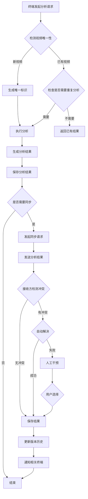

# 多终端信息同步与版本管理技术方案

## 1. 引言

### 1.1 背景
随着多媒体内容分析技术的发展，多终端协同分析同一视频内容的场景日益增多。如何确保不同终端的分析结果一致，处理数据冲突，管理版本历史，成为系统设计的关键挑战。

### 1.2 目标
本方案旨在设计一套完整的多终端信息同步与版本管理机制，解决视频内容分析中的数据冲突问题，确保系统在大量视频分析场景下的高效运行。

## 2. 多终端冲突处理机制

### 2.1 冲突判定标准

| 判定维度 | 具体规则 | 阈值建议 |
|----------|----------|----------|
| **时间戳差异** | 比较数据最后修改时间，超过阈值判定为冲突 | 30秒 |
| **分析结果置信度** | 比较分析结果的置信度，差异超过阈值判定为冲突 | 10% |
| **关键特征匹配度** | 比较视频关键特征的匹配度，低于阈值判定为冲突 | 80% |
| **元数据差异** | 比较视频元数据（时长、分辨率等），差异超过阈值判定为冲突 | 5% |
| **操作类型冲突** | 同一资源的并发写操作判定为冲突 | - |

### 2.2 冲突解决策略

#### 2.2.1 自动解决策略

| 策略类型 | 适用场景 | 实现方式 |
|----------|----------|----------|
| **时间戳优先** | 无明确优先级的场景 | 保留最新修改的数据 |
| **置信度加权** | 内容分析结果冲突 | 基于置信度加权合并结果 |
| **来源优先级** | 不同可信度终端的冲突 | 根据终端可信度设置优先级 |
| **字段级合并** | 不同字段的冲突 | 合并不同字段，保留相同字段 |
| **CRDTs自动合并** | 支持CRDT的数据类型 | 使用CRDTs自动收敛到一致状态 |

#### 2.2.2 人工干预策略

| 触发条件 | 处理流程 |
|----------|----------|
| 高置信度冲突 | 自动合并失败，提示用户手动选择 |
| 重要数据冲突 | 涉及关键分析结果的冲突 |
| 复杂字段冲突 | 多字段并发修改的冲突 |

### 2.3 同步后信息显示规则

#### 2.3.1 合并显示
- 相同字段：显示合并后的结果
- 不同字段：同时显示多个来源的结果
- 冲突字段：标记冲突，显示所有版本

#### 2.3.2 优先级显示
- 高可信度结果优先显示
- 最新结果优先显示
- 用户可手动切换显示版本

#### 2.3.3 冲突标记
- 冲突数据用特殊颜色标记
- 鼠标悬停显示冲突详情
- 提供冲突解决入口

### 2.4 版本管理机制

#### 2.4.1 版本标识规则

| 版本类型 | 标识格式 | 示例 |
|----------|----------|------|
| **基础版本** | `v<主版本号>.<次版本号>` | `v1.0` |
| **增量版本** | `v<主版本号>.<次版本号>.<修订号>` | `v1.0.1` |
| **分支版本** | `v<主版本号>.<次版本号>-<分支名>` | `v1.0-experiment` |
| **时间戳版本** | `<时间戳>-<终端ID>` | `20240115100000-termA` |

#### 2.4.2 版本历史记录

| 记录字段 | 描述 |
|----------|------|
| 版本ID | 唯一版本标识 |
| 父版本ID | 父版本标识，支持分支管理 |
| 创建时间 | 版本创建时间 |
| 创建终端 | 生成该版本的终端 |
| 修改内容 | 版本变更的具体内容 |
| 置信度 | 分析结果的置信度 |
| 操作类型 | 创建、修改、删除等 |

#### 2.4.3 版本回溯功能

| 功能 | 实现方式 |
|------|----------|
| **版本切换** | 支持切换到任意历史版本 |
| **差异比较** | 显示不同版本间的差异 |
| **版本恢复** | 从历史版本恢复数据 |
| **分支管理** | 支持创建、合并、删除分支 |

#### 2.4.4 冲突解决审计日志

| 日志字段 | 描述 |
|----------|------|
| 冲突ID | 唯一冲突标识 |
| 冲突时间 | 冲突发生时间 |
| 冲突类型 | 冲突的具体类型 |
| 冲突详情 | 冲突数据的详细信息 |
| 解决方式 | 自动解决或人工解决 |
| 解决结果 | 最终保留的数据 |
| 解决时间 | 冲突解决时间 |
| 解决终端 | 解决冲突的终端 |

## 3. 业界标准处理方式调研与应用

### 3.1 分布式系统数据同步解决方案

#### 3.1.1 CRDTs（无冲突复制数据类型）

**原理**：CRDTs是一种设计模式，确保在分布式系统中多个副本可以独立更新，最终自动收敛到一致状态，无需复杂的冲突解决机制。

**应用场景**：视频分析结果的自动合并

**实现方式**：
- 使用状态基CRDTs管理视频分析结果
- 为每个分析结果分配唯一ID和版本号
- 采用合并算法自动解决冲突

**优势**：
- 最终一致性保证
- 无需中央协调器
- 支持离线操作

#### 3.1.2 OT（操作转换）算法

**原理**：OT通过转换操作的顺序和内容，确保多个用户同时编辑同一文档时，最终结果一致。

**应用场景**：实时协同分析场景

**实现方式**：
- 捕获用户的分析操作
- 转换操作以适应并发更改
- 应用转换后的操作到分析结果

**优势**：
- 实时性好
- 适合协同编辑场景

### 3.2 内容分析领域最佳实践

#### 3.2.1 多源数据冲突处理

| 最佳实践 | 应用 |
|----------|------|
| **置信度加权合并** | 合并不同终端的分析结果，根据置信度加权 |
| **多模型融合** | 使用多个模型的分析结果，减少单一模型的偏差 |
| **人工审核机制** | 高置信度冲突引入人工审核 |
| **结果溯源** | 记录每个分析结果的来源和模型版本 |

#### 3.2.2 企业级应用架构模式

| 架构模式 | 特点 | 应用 |
|----------|------|------|
| **主从复制** | 主节点负责写操作，从节点负责读操作 | 适合服务器端集中管理的场景 |
| **对等复制** | 所有节点地位平等，支持读写操作 | 适合分布式部署场景 |
| **混合架构** | 结合主从复制和对等复制的优势 | 适合大规模部署场景 |

### 3.3 Git在非代码数据管理中的应用

#### 3.3.1 核心应用

| 应用场景 | 实现方式 |
|----------|----------|
| **版本管理** | 使用Git管理视频分析结果的版本历史 |
| **分支管理** | 支持不同分析模型的并行开发 |
| **合并机制** | 利用Git的合并工具处理冲突 |
| **变更追踪** | 记录分析结果的所有变更 |

#### 3.3.2 优化方案

| 挑战 | 解决方案 |
|------|----------|
| **大文件处理** | 使用Git LFS存储视频文件和分析结果 |
| **二进制文件合并** | 实现自定义合并驱动 |
| **性能优化** | 定期清理历史记录，优化仓库大小 |

## 4. 单终端重复分析处理策略

### 4.1 视频内容唯一性标识机制

#### 4.1.1 标识生成算法

| 标识类型 | 生成方式 | 特点 |
|----------|----------|------|
| **内容哈希** | 计算视频文件的SHA-256哈希 | 精确，对文件内容敏感 |
| **感知哈希** | 提取视频关键帧的感知哈希 | 对格式转换鲁棒 |
| **复合标识** | 结合内容哈希和感知哈希 | 兼顾精确性和鲁棒性 |
| **元数据标识** | 结合视频元数据生成标识 | 快速，适合初步筛选 |

#### 4.1.2 标识存储结构

```json
{
  "video_id": "复合标识",
  "content_hash": "SHA-256哈希",
  "perceptual_hash": "感知哈希",
  "metadata": {
    "duration": 120,
    "resolution": "1920x1080",
    "format": "MP4"
  }
}
```

### 4.2 重复分析触发条件

| 触发条件 | 适用场景 | 实现方式 |
|----------|----------|----------|
| **强制重新分析** | 用户手动触发 | 提供重新分析按钮 |
| **定时更新分析** | 定期更新分析结果 | 配置定时任务 |
| **内容变化触发** | 视频内容发生变化 | 比较内容哈希 |
| **模型更新触发** | 分析模型更新 | 检测模型版本变化 |
| **置信度不足触发** | 原分析结果置信度低 | 自动触发重新分析 |

### 4.3 分析结果存储策略

| 存储策略 | 特点 | 适用场景 |
|----------|------|----------|
| **完全覆盖** | 新结果直接覆盖旧结果 | 模型更新导致的重新分析 |
| **增量更新** | 仅更新变化的字段 | 部分字段更新场景 |
| **版本叠加** | 保留所有版本，形成版本历史 | 需要追溯历史变化的场景 |
| **分支存储** | 不同模型版本的结果分支存储 | 多模型并行分析场景 |

### 4.4 分析历史记录管理

#### 4.4.1 保留策略

| 策略类型 | 适用场景 | 实现方式 |
|----------|----------|----------|
| **时间保留** | 按时间保留历史记录 | 保留最近30天或90天的记录 |
| **数量保留** | 按数量保留历史记录 | 保留最近10个版本 |
| **质量保留** | 按质量保留历史记录 | 保留置信度高于阈值的版本 |
| **自定义保留** | 用户自定义保留规则 | 提供配置选项 |

#### 4.4.2 查询接口

| 接口名称 | 功能 | 参数 |
|----------|------|------|
| `get_analysis_history` | 获取分析历史记录 | video_id, start_time, end_time |
| `compare_analysis_versions` | 比较不同版本的分析结果 | video_id, version1, version2 |
| `restore_analysis_version` | 恢复特定版本的分析结果 | video_id, version |
| `delete_analysis_version` | 删除特定版本的分析结果 | video_id, version |

#### 4.4.3 结果对比功能

| 对比维度 | 实现方式 |
|----------|----------|
| **内容对比** | 比较分析结果的具体内容 |
| **置信度对比** | 比较不同版本的置信度 |
| **时间线对比** | 展示分析结果的时间线变化 |
| **可视化对比** | 提供可视化的对比界面 |

## 5. 技术实现细节

### 5.1 冲突处理流程图



### 5.2 核心数据结构

#### 5.2.1 视频分析结果结构

```json
{
  "analysis_id": "分析结果ID",
  "video_id": "视频唯一标识",
  "content": {
    "tags": [
      {
        "tag": "标签名称",
        "confidence": 0.95,
        "frame_range": [0, 100]
      }
    ],
    "summary": "视频摘要",
    "key_frames": ["帧1路径", "帧2路径"]
  },
  "metadata": {
    "model_version": "模型版本",
    "analysis_time": "分析时间",
    "confidence": 0.92,
    "terminal_id": "终端ID"
  },
  "version": "v1.0.1",
  "parent_version": "v1.0.0",
  "created_at": "2024-01-15T10:00:00Z",
  "updated_at": "2024-01-15T10:15:00Z"
}
```

#### 5.2.2 冲突记录结构

```json
{
  "conflict_id": "冲突ID",
  "video_id": "视频ID",
  "analysis_id": "分析ID",
  "conflict_type": "时间戳冲突",
  "conflict_data": [
    {
      "version": "v1.0.0",
      "terminal_id": "终端A",
      "updated_at": "2024-01-15T10:00:00Z",
      "confidence": 0.9
    },
    {
      "version": "v1.0.1",
      "terminal_id": "终端B",
      "updated_at": "2024-01-15T10:01:00Z",
      "confidence": 0.95
    }
  ],
  "resolution": {
    "status": "resolved",
    "resolved_version": "v1.0.2",
    "resolved_by": "自动解决",
    "resolved_at": "2024-01-15T10:02:00Z",
    "resolved_terminal": "终端A"
  }
}
```

### 5.3 核心接口规范

#### 5.3.1 冲突检测接口

```python
class ConflictDetectionService:
    def detect_conflict(self, local_data: Dict, remote_data: Dict) -> Dict:
        """检测数据冲突
        
        Args:
            local_data: 本地数据
            remote_data: 远程数据
            
        Returns:
            冲突检测结果
        """
        pass
    
    def get_conflict_resolution_strategy(self, conflict: Dict) -> str:
        """获取冲突解决策略
        
        Args:
            conflict: 冲突数据
            
        Returns:
            解决策略
        """
        pass
```

#### 5.3.2 冲突解决接口

```python
class ConflictResolutionService:
    def resolve_conflict(self, conflict: Dict) -> Dict:
        """解决数据冲突
        
        Args:
            conflict: 冲突数据
            
        Returns:
            解决后的结果
        """
        pass
    
    def merge_data(self, data_list: List[Dict]) -> Dict:
        """合并多个数据版本
        
        Args:
            data_list: 数据版本列表
            
        Returns:
            合并后的结果
        """
        pass
```

#### 5.3.3 版本管理接口

```python
class VersionManagementService:
    def create_version(self, data: Dict, parent_version: str = None) -> str:
        """创建新版本
        
        Args:
            data: 数据内容
            parent_version: 父版本ID
            
        Returns:
            新版本ID
        """
        pass
    
    def get_version_history(self, video_id: str) -> List[Dict]:
        """获取版本历史
        
        Args:
            video_id: 视频ID
            
        Returns:
            版本历史列表
        """
        pass
    
    def restore_version(self, video_id: str, version: str) -> Dict:
        """恢复版本
        
        Args:
            video_id: 视频ID
            version: 版本ID
            
        Returns:
            恢复后的结果
        """
        pass
```

### 5.4 性能优化方案

#### 5.4.1 冲突检测优化

| 优化策略 | 实现方式 | 效果 |
|----------|----------|------|
| **分层检测** | 先检测基本字段，再检测复杂字段 | 减少检测时间 |
| **增量检测** | 仅检测变化的字段 | 减少检测数据量 |
| **并行检测** | 多线程并行检测 | 提高检测效率 |
| **缓存检测结果** | 缓存近期检测结果 | 避免重复检测 |

#### 5.4.2 同步性能优化

| 优化策略 | 实现方式 | 效果 |
|----------|----------|------|
| **增量同步** | 仅同步变化的数据 | 减少网络传输量 |
| **批量同步** | 批量处理同步请求 | 减少网络请求次数 |
| **异步同步** | 异步处理同步任务 | 提高系统响应速度 |
| **压缩传输** | 压缩同步数据 | 减少传输时间 |

#### 5.4.3 存储性能优化

| 优化策略 | 实现方式 | 效果 |
|----------|----------|------|
| **索引优化** | 为查询字段创建索引 | 提高查询速度 |
| **分区存储** | 按视频ID或时间分区存储 | 提高读写效率 |
| **缓存热点数据** | 缓存频繁访问的数据 | 减少数据库访问 |
| **延迟写入** | 批量延迟写入 | 提高写入效率 |

## 6. 异常处理机制

### 6.1 网络中断处理

| 异常类型 | 处理方式 |
|----------|----------|
| **临时网络中断** | 缓存同步请求，恢复连接后自动重试 |
| **长时间网络中断** | 保存本地操作日志，恢复连接后批量同步 |
| **连接超时** | 实现指数退避重试机制 |

### 6.2 数据损坏处理

| 异常类型 | 处理方式 |
|----------|----------|
| **数据完整性损坏** | 使用校验和检测，自动恢复或重建数据 |
| **版本链断裂** | 检测版本链完整性，自动修复 |
| **元数据丢失** | 从视频文件重新提取元数据 |

### 6.3 系统故障处理

| 异常类型 | 处理方式 |
|----------|----------|
| **服务崩溃** | 实现服务高可用，自动故障转移 |
| **数据库故障** | 实现数据库备份和恢复机制 |
| **存储容量不足** | 实现自动扩容或清理策略 |

## 7. 总结

本方案设计了一套完整的多终端信息同步与版本管理机制，涵盖了冲突检测、解决、版本管理等核心功能。方案结合了业界主流的分布式数据同步技术（如CRDTs、OT算法），并针对视频内容分析领域的特点进行了优化。

主要特点包括：

1. **完整的冲突处理流程**：从冲突检测到解决，再到版本管理，形成闭环
2. **多样化的冲突解决策略**：支持自动解决和人工干预，适应不同场景
3. **强大的版本管理功能**：支持版本历史记录、回溯、对比等功能
4. **高性能设计**：针对大量视频分析场景进行了性能优化
5. **完善的异常处理机制**：应对各种异常情况，确保系统可靠性

本方案可作为多终端视频分析系统的基础架构，为后续功能扩展提供支持。