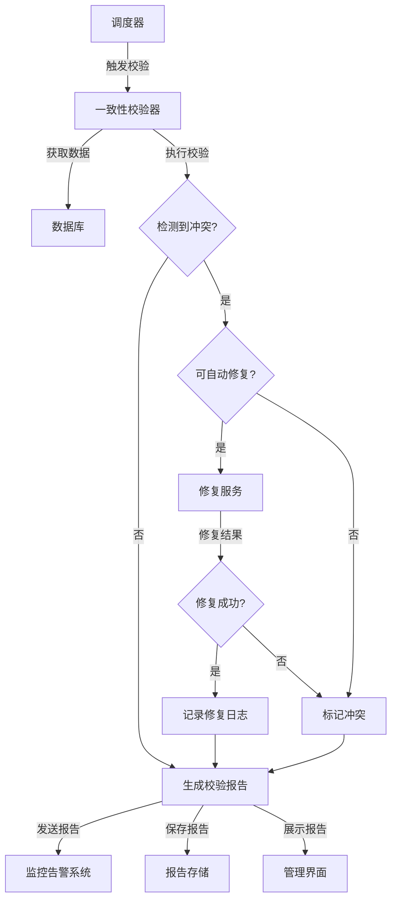

# 定期数据一致性校验机制实施文档

## 1. 概述

本文档详细说明视频分析系统中定期数据一致性校验机制的实施细节，旨在主动发现并修复潜在的ID冲突和数据不一致问题，确保系统数据的完整性和一致性。

## 2. 设计原则与目标

### 2.1 设计原则

| 原则 | 描述 |
|------|------|
| **全面性** | 覆盖所有关键数据和ID类型 |
| **准确性** | 准确检测数据不一致问题 |
| **自动化** | 自动化执行校验和修复，减少人工干预 |
| **可靠性** | 校验过程可靠，不会引入新的问题 |
| **性能友好** | 校验过程不影响系统正常运行 |
| **可配置性** | 支持不同场景下的校验配置 |
| **可扩展性** | 支持新增数据类型和校验规则 |

### 2.2 设计目标

1. 定期检测系统中的ID冲突和数据不一致问题
2. 自动修复可修复的不一致问题
3. 标记不可自动修复的问题，供人工干预
4. 提供详细的校验报告和修复记录
5. 支持多种校验策略和配置选项
6. 与现有系统架构无缝集成
7. 支持分布式环境下的数据校验

## 3. 一致性校验策略

### 3.1 校验类型

| 校验类型 | 描述 |
|----------|------|
| **ID唯一性校验** | 检测系统中是否存在重复ID |
| **数据完整性校验** | 检测数据是否完整，无缺失字段 |
| **数据一致性校验** | 检测不同终端或副本间的数据是否一致 |
| **版本链完整性校验** | 检测版本历史记录是否完整，无断裂 |
| **引用完整性校验** | 检测数据间的引用关系是否正确 |
| **业务规则校验** | 检测数据是否符合业务规则 |

### 3.2 校验频率

| 校验对象 | 推荐频率 | 说明 |
|----------|----------|------|
| **ID唯一性** | 每小时一次 | 快速检测潜在冲突 |
| **数据完整性** | 每日一次 | 确保数据完整性 |
| **数据一致性** | 每4小时一次 | 检测跨终端数据一致性 |
| **版本链完整性** | 每日一次 | 确保版本历史完整 |
| **引用完整性** | 每日一次 | 确保引用关系正确 |
| **业务规则** | 每日一次 | 确保数据符合业务规则 |

### 3.3 校验范围

| 范围 | 描述 | 适用场景 |
|------|------|----------|
| **全量校验** | 校验所有数据 | 系统初始化或重大变更后 |
| **增量校验** | 仅校验新增或变更的数据 | 日常定期校验 |
| **抽样校验** | 随机抽样校验部分数据 | 快速检测和监控 |
| **定向校验** | 校验特定范围或类型的数据 | 针对性问题排查 |

## 4. 实现方案

### 4.1 核心组件

```python
from typing import Dict, List, Optional
from datetime import datetime

class ConsistencyChecker:
    """数据一致性校验器"""
    
    def __init__(self, db_client, repair_service, logger):
        self.db_client = db_client
        self.repair_service = repair_service
        self.logger = logger
    
    def check_consistency(self, check_type: str, scope: str = "incremental", 
                        config: Optional[Dict] = None) -> Dict:
        """执行数据一致性校验
        
        Args:
            check_type: 校验类型
            scope: 校验范围
            config: 校验配置
            
        Returns:
            校验结果
        """
        if config is None:
            config = {}
        
        # 记录校验开始日志
        self.logger.info(
            "consistency_check_start",
            check_type=check_type,
            scope=scope,
            config=config
        )
        
        # 根据校验类型执行不同的校验逻辑
        if check_type == "id_uniqueness":
            result = self._check_id_uniqueness(scope, config)
        elif check_type == "data_integrity":
            result = self._check_data_integrity(scope, config)
        elif check_type == "data_consistency":
            result = self._check_data_consistency(scope, config)
        elif check_type == "version_chain":
            result = self._check_version_chain(scope, config)
        elif check_type == "reference_integrity":
            result = self._check_reference_integrity(scope, config)
        elif check_type == "business_rules":
            result = self._check_business_rules(scope, config)
        else:
            raise ValueError(f"Unknown check type: {check_type}")
        
        # 记录校验完成日志
        self.logger.info(
            "consistency_check_completed",
            check_type=check_type,
            scope=scope,
            result=result
        )
        
        return result
    
    def _check_id_uniqueness(self, scope: str, config: Dict) -> Dict:
        """检查ID唯一性"""
        # 获取需要检查的ID类型
        id_types = config.get("id_types", ["analysis_id", "video_id", "conflict_id"])
        
        conflicts = []
        for id_type in id_types:
            # 根据范围获取需要检查的数据
            if scope == "full":
                data = self.db_client.get_all_data_by_id_type(id_type)
            elif scope == "incremental":
                last_check_time = config.get("last_check_time", datetime.min)
                data = self.db_client.get_changed_data_since(id_type, last_check_time)
            elif scope == "sample":
                sample_size = config.get("sample_size", 1000)
                data = self.db_client.get_sample_data(id_type, sample_size)
            else:
                raise ValueError(f"Unknown scope: {scope}")
            
            # 检测重复ID
            id_counts = {}
            for item in data:
                id_value = item[id_type]
                id_counts[id_value] = id_counts.get(id_value, 0) + 1
            
            # 收集重复ID
            for id_value, count in id_counts.items():
                if count > 1:
                    conflicts.append({
                        "id_type": id_type,
                        "id_value": id_value,
                        "count": count,
                        "type": "duplicate_id"
                    })
        
        return {
            "check_type": "id_uniqueness",
            "scope": scope,
            "total_conflicts": len(conflicts),
            "conflicts": conflicts,
            "checked_ids": sum(len(data) for data in data_list) if 'data_list' in locals() else 0
        }
    
    def _check_data_integrity(self, scope: str, config: Dict) -> Dict:
        """检查数据完整性"""
        # 实现数据完整性检查逻辑
        pass
    
    def _check_data_consistency(self, scope: str, config: Dict) -> Dict:
        """检查数据一致性"""
        # 实现数据一致性检查逻辑
        pass
    
    def _check_version_chain(self, scope: str, config: Dict) -> Dict:
        """检查版本链完整性"""
        # 实现版本链完整性检查逻辑
        pass
    
    def _check_reference_integrity(self, scope: str, config: Dict) -> Dict:
        """检查引用完整性"""
        # 实现引用完整性检查逻辑
        pass
    
    def _check_business_rules(self, scope: str, config: Dict) -> Dict:
        """检查业务规则"""
        # 实现业务规则检查逻辑
        pass

class RepairService:
    """数据修复服务"""
    
    def __init__(self, db_client, logger):
        self.db_client = db_client
        self.logger = logger
    
    def repair(self, conflict: Dict) -> Dict:
        """修复数据不一致问题
        
        Args:
            conflict: 冲突信息
            
        Returns:
            修复结果
        """
        # 根据冲突类型执行不同的修复逻辑
        conflict_type = conflict["type"]
        
        if conflict_type == "duplicate_id":
            return self._repair_duplicate_id(conflict)
        elif conflict_type == "missing_field":
            return self._repair_missing_field(conflict)
        elif conflict_type == "version_chain_break":
            return self._repair_version_chain_break(conflict)
        elif conflict_type == "reference_error":
            return self._repair_reference_error(conflict)
        elif conflict_type == "business_rule_violation":
            return self._repair_business_rule_violation(conflict)
        else:
            return {
                "status": "failed",
                "reason": f"Unknown conflict type: {conflict_type}"
            }
    
    def _repair_duplicate_id(self, conflict: Dict) -> Dict:
        """修复重复ID问题"""
        id_type = conflict["id_type"]
        id_value = conflict["id_value"]
        
        # 获取所有重复的记录
        duplicate_records = self.db_client.get_records_by_id(id_type, id_value)
        
        if not duplicate_records:
            return {
                "status": "success",
                "message": "No duplicate records found"
            }
        
        # 保留最新的记录，重新生成其他记录的ID
        duplicate_records.sort(key=lambda x: x["updated_at"], reverse=True)
        
        # 保留第一条记录（最新），修复其他记录
        for i, record in enumerate(duplicate_records[1:], 1):
            # 生成新ID
            new_id = self._generate_new_id(id_type)
            
            # 更新记录ID
            self.db_client.update_record_id(record["id"], new_id, id_type)
            
            # 更新相关引用
            self.db_client.update_references(id_type, id_value, new_id)
        
        return {
            "status": "success",
            "message": f"Repaired {len(duplicate_records) - 1} duplicate records",
            "original_id": id_value,
            "duplicate_count": len(duplicate_records),
            "repaired_count": len(duplicate_records) - 1
        }
    
    def _generate_new_id(self, id_type: str) -> str:
        """生成新ID"""
        import uuid
        return str(uuid.uuid4())
    
    def _repair_missing_field(self, conflict: Dict) -> Dict:
        """修复缺失字段问题"""
        # 实现缺失字段修复逻辑
        pass
    
    def _repair_version_chain_break(self, conflict: Dict) -> Dict:
        """修复版本链断裂问题"""
        # 实现版本链断裂修复逻辑
        pass
    
    def _repair_reference_error(self, conflict: Dict) -> Dict:
        """修复引用错误问题"""
        # 实现引用错误修复逻辑
        pass
    
    def _repair_business_rule_violation(self, conflict: Dict) -> Dict:
        """修复业务规则违反问题"""
        # 实现业务规则违反修复逻辑
        pass
```

### 4.2 校验执行流程



### 4.3 修复策略

| 冲突类型 | 修复策略 |
|----------|----------|
| **重复ID** | 保留最新记录，重新生成其他记录的ID |
| **缺失字段** | 根据业务规则填充默认值或从其他来源获取 |
| **数据不一致** | 基于冲突解决规则合并或选择最优数据 |
| **版本链断裂** | 重建版本链或标记为异常 |
| **引用错误** | 修复或删除无效引用 |
| **业务规则违反** | 根据业务规则修正数据或标记为异常 |

## 4.4 校验调度器

```python
import schedule
import time
from datetime import datetime

class ConsistencyCheckScheduler:
    """一致性校验调度器"""
    
    def __init__(self, consistency_checker, repair_service, logger):
        self.consistency_checker = consistency_checker
        self.repair_service = repair_service
        self.logger = logger
        self.config = {
            "id_uniqueness": {
                "frequency": "hourly",
                "scope": "incremental",
                "auto_repair": True
            },
            "data_integrity": {
                "frequency": "daily",
                "scope": "full",
                "auto_repair": True
            },
            "data_consistency": {
                "frequency": "every_4_hours",
                "scope": "incremental",
                "auto_repair": True
            },
            "version_chain": {
                "frequency": "daily",
                "scope": "full",
                "auto_repair": True
            },
            "reference_integrity": {
                "frequency": "daily",
                "scope": "full",
                "auto_repair": True
            },
            "business_rules": {
                "frequency": "daily",
                "scope": "full",
                "auto_repair": False
            }
        }
    
    def start(self):
        """启动调度器"""
        # 配置不同类型的校验任务
        for check_type, config in self.config.items():
            frequency = config["frequency"]
            
            if frequency == "hourly":
                schedule.every().hour.do(self._run_check, check_type)
            elif frequency == "daily":
                schedule.every().day.at("02:00").do(self._run_check, check_type)
            elif frequency == "every_4_hours":
                schedule.every(4).hours.do(self._run_check, check_type)
            elif frequency == "weekly":
                schedule.every().week.do(self._run_check, check_type)
        
        # 开始执行调度
        self.logger.info("Consistency check scheduler started")
        while True:
            schedule.run_pending()
            time.sleep(60)
    
    def _run_check(self, check_type: str):
        """执行校验任务"""
        config = self.config[check_type]
        
        # 执行校验
        result = self.consistency_checker.check_consistency(
            check_type,
            scope=config["scope"]
        )
        
        # 自动修复
        if config["auto_repair"] and result["total_conflicts"] > 0:
            self._auto_repair(check_type, result["conflicts"])
    
    def _auto_repair(self, check_type: str, conflicts: List[Dict]):
        """自动修复冲突"""
        for conflict in conflicts:
            repair_result = self.repair_service.repair(conflict)
            
            self.logger.info(
                "auto_repair_result",
                check_type=check_type,
                conflict=conflict,
                repair_result=repair_result
            )
```

## 5. 与现有系统的集成

### 5.1 与ID冲突检测机制集成

```python
class IDConflictDetectionService:
    """ID冲突检测服务"""
    
    def __init__(self, db_client, consistency_checker):
        self.db_client = db_client
        self.consistency_checker = consistency_checker
    
    def detect_conflict(self, local_data: Dict, remote_data: Dict) -> Dict:
        """检测数据冲突"""
        # 现有冲突检测逻辑
        # ...
        
        # 触发一致性校验
        self.consistency_checker.check_consistency("id_uniqueness", scope="incremental")
        
        return conflict_result
```

### 5.2 与版本管理系统集成

```python
class VersionManagementService:
    """版本管理服务"""
    
    def __init__(self, db_client, version_generator, consistency_checker):
        self.db_client = db_client
        self.version_generator = version_generator
        self.consistency_checker = consistency_checker
    
    def create_version(self, analysis_data: Dict, change_type: str = "create", 
                      change_description: str = None) -> Dict:
        """创建新版本"""
        # 现有版本创建逻辑
        # ...
        
        # 触发版本链完整性校验
        self.consistency_checker.check_consistency("version_chain", scope="incremental")
        
        return version_info
```

### 5.3 与同步服务集成

```python
class SyncService:
    """同步服务"""
    
    def __init__(self, db_client, merge_service, consistency_checker):
        self.db_client = db_client
        self.merge_service = merge_service
        self.consistency_checker = consistency_checker
    
    def sync_analysis(self, analysis_data: Dict, target_terminal: str) -> Dict:
        """同步分析结果"""
        # 现有同步逻辑
        # ...
        
        # 触发数据一致性校验
        self.consistency_checker.check_consistency("data_consistency", scope="incremental")
        
        return sync_result
```

## 6. 监控与告警

### 6.1 监控指标

| 指标名称 | 描述 | 告警阈值 |
|----------|------|----------|
| 校验成功率 | 成功执行的校验任务比例 | < 95% |
| 冲突检测率 | 检测到的冲突数量 | > 100次/天 |
| 自动修复成功率 | 成功修复的冲突比例 | < 90% |
| 人工干预率 | 需要人工干预的冲突比例 | > 20% |
| 校验执行时间 | 校验任务的执行时间 | > 30分钟 |
| 数据不一致率 | 数据不一致的比例 | > 5% |

### 6.2 告警规则

| 告警类型 | 触发条件 | 告警方式 |
|----------|----------|----------|
| **校验失败告警** | 校验任务执行失败 | 邮件 + 系统通知 |
| **冲突激增告警** | 检测到的冲突数量超过阈值 | 邮件 + 短信 |
| **修复失败告警** | 自动修复失败率超过阈值 | 邮件 + 系统通知 |
| **人工干预积压告警** | 需要人工干预的冲突超过阈值 | 邮件 + 系统通知 |
| **校验超时告警** | 校验任务执行时间超过阈值 | 系统通知 |

### 6.3 校验报告

| 报告类型 | 内容 | 生成频率 |
|----------|------|----------|
| **校验摘要报告** | 校验任务执行情况、冲突数量、修复情况 | 每日一次 |
| **详细冲突报告** | 所有冲突的详细信息 | 每日一次 |
| **修复记录报告** | 修复操作的详细记录 | 每日一次 |
| **趋势分析报告** | 冲突数量和类型的趋势分析 | 每周一次 |

## 7. 测试计划

### 7.1 单元测试

- 测试各类型校验逻辑的正确性
- 测试修复策略的有效性
- 测试调度器的准确性
- 测试报告生成的完整性

### 7.2 集成测试

- 测试与ID冲突检测机制的集成
- 测试与版本管理系统的集成
- 测试与同步服务的集成
- 测试与监控告警系统的集成

### 7.3 性能测试

- 测试高并发场景下的校验性能
- 测试大规模数据的校验时间
- 测试自动修复的性能开销
- 测试对系统正常运行的影响

### 7.4 可靠性测试

- 测试校验任务的容错能力
- 测试修复操作的安全性
- 测试系统故障后的恢复能力
- 测试网络中断情况下的校验机制

### 7.5 场景测试

- 测试ID冲突场景下的检测和修复
- 测试数据不一致场景下的检测和修复
- 测试版本链断裂场景下的检测和修复
- 测试引用错误场景下的检测和修复

## 8. 结论

本定期数据一致性校验机制实施文档详细设计了视频分析系统中的定期数据一致性校验机制，包括校验策略、实现方案、修复策略和监控告警机制。该机制具有以下特点：

1. **全面的校验覆盖**：覆盖所有关键数据和ID类型
2. **自动化执行**：自动执行校验和修复，减少人工干预
3. **灵活的配置选项**：支持不同场景下的校验配置
4. **可靠的修复策略**：针对不同类型的不一致问题采用不同的修复策略
5. **完善的监控告警**：实时监控校验过程和结果，及时告警
6. **与现有系统集成**：与其他服务无缝集成
7. **可扩展的架构**：支持新增数据类型和校验规则

该定期数据一致性校验机制能够主动发现并修复潜在的ID冲突和数据不一致问题，确保系统数据的完整性和一致性，为视频分析系统的稳定运行提供有力保障。