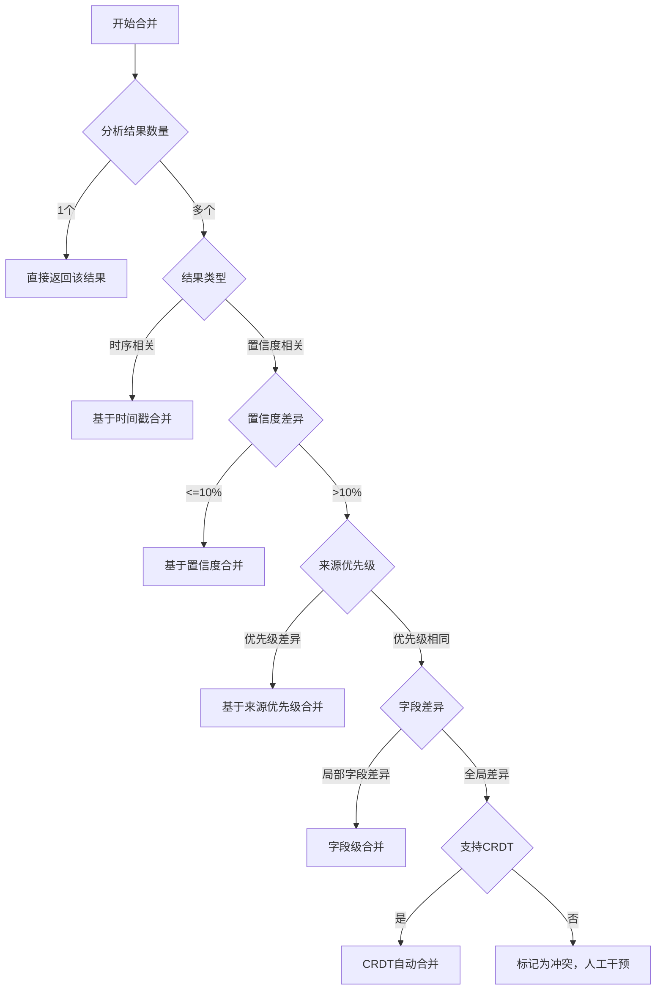
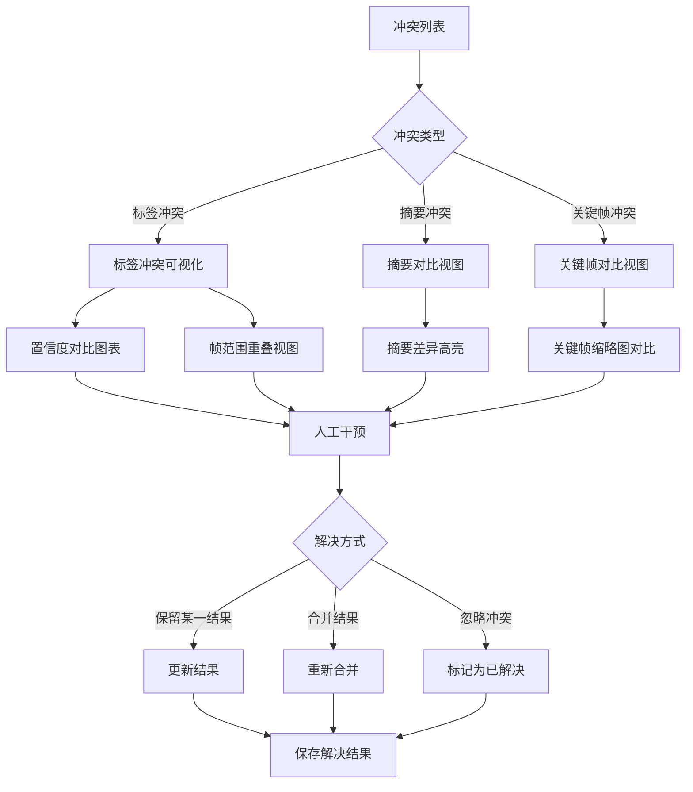
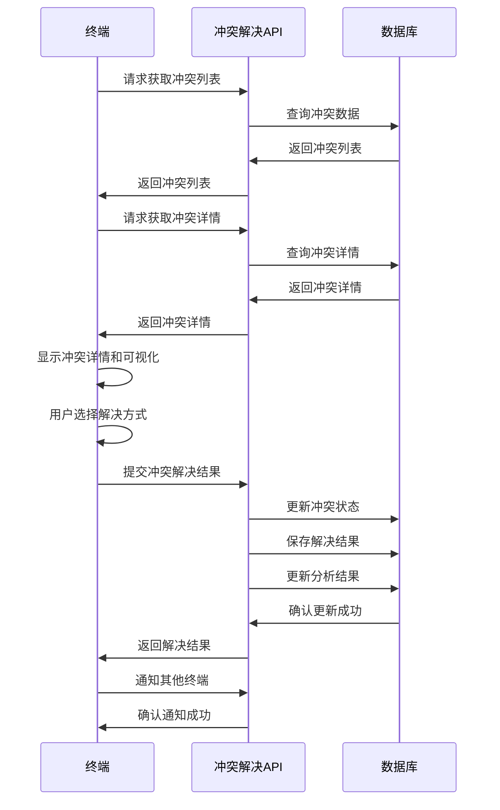

# 数据合并策略实施文档

## 1. 概述

本文档详细说明视频分析系统中数据合并策略的实施细节，旨在当不同终端对同一ID产生不同分析结果时，能够智能合并或标记冲突供人工干预，确保分析结果的准确性和一致性。

## 2. 设计原则与目标

### 2.1 设计原则

| 原则 | 描述 |
|------|------|
| **准确性优先** | 合并结果应尽可能准确反映视频内容的真实情况 |
| **完整性** | 合并结果应包含所有有效信息，避免信息丢失 |
| **一致性** | 合并结果应在不同终端间保持一致 |
| **可追溯性** | 合并结果应能追溯到原始数据来源 |
| **自动化优先** | 优先使用自动化合并，仅在必要时才需要人工干预 |
| **透明度** | 合并过程和结果应清晰可见，便于理解和验证 |
| **灵活性** | 支持不同场景下的合并需求，可配置合并策略 |

### 2.2 设计目标

1. 智能合并不同终端的分析结果，减少人工干预
2. 准确标记无法自动解决的冲突，提供丰富的冲突信息
3. 支持多种合并策略，适应不同场景需求
4. 提供直观的冲突可视化界面，便于人工干预
5. 记录完整的合并历史，支持追溯和审计
6. 与现有系统架构无缝集成
7. 支持实时和离线合并场景

## 3. 合并策略分类

### 3.1 基于置信度的合并

**适用场景**：不同终端对同一视频内容生成了不同的分析结果，且结果包含置信度信息

**实现方式**：
1. 提取每个分析结果的置信度信息
2. 对相同标签或检测结果进行置信度加权平均
3. 保留置信度高于阈值的结果
4. 对于置信度差异较大的结果，标记为冲突

**算法示例**：
```python
def merge_by_confidence(analysis_results: List[Dict]) -> Dict:
    """基于置信度的合并策略
    
    Args:
        analysis_results: 多个终端的分析结果列表
        
    Returns:
        合并后的分析结果
    """
    merged_content = {}
    
    # 合并标签
    tag_map = {}
    for result in analysis_results:
        tags = result["content"].get("tags", [])
        for tag in tags:
            tag_name = tag["tag"]
            confidence = tag["confidence"]
            frame_range = tag["frame_range"]
            
            if tag_name not in tag_map:
                tag_map[tag_name] = {
                    "confidences": [],
                    "frame_ranges": []
                }
            
            tag_map[tag_name]["confidences"].append(confidence)
            tag_map[tag_name]["frame_ranges"].append(frame_range)
    
    # 计算加权平均置信度
    merged_tags = []
    for tag_name, data in tag_map.items():
        avg_confidence = sum(data["confidences"]) / len(data["confidences"])
        
        # 合并帧范围
        merged_frame_range = merge_frame_ranges(data["frame_ranges"])
        
        merged_tags.append({
            "tag": tag_name,
            "confidence": avg_confidence,
            "frame_range": merged_frame_range
        })
    
    merged_content["tags"] = merged_tags
    
    # 合并其他字段（如summary、key_frames等）
    # ...
    
    return {
        "content": merged_content,
        "merge_strategy": "confidence_based",
        "sources": [result["metadata"]["terminal_id"] for result in analysis_results]
    }
```

### 3.2 基于时间戳的合并

**适用场景**：不同终端对同一视频内容生成了时序相关的分析结果

**实现方式**：
1. 提取每个分析结果的时间戳信息
2. 按照时间顺序合并结果
3. 保留最新的分析结果
4. 对于时间戳相近的结果，进行智能合并

### 3.3 基于来源优先级的合并

**适用场景**：不同终端的可信度存在差异

**实现方式**：
1. 为每个终端配置优先级
2. 优先采用高优先级终端的分析结果
3. 仅在高优先级终端未覆盖的情况下，使用低优先级终端的结果
4. 对于优先级相同的结果，使用其他合并策略

### 3.4 字段级合并

**适用场景**：不同终端的分析结果在不同字段上存在差异

**实现方式**：
1. 对分析结果进行字段级分解
2. 对每个字段分别应用合并策略
3. 合并所有字段的结果
4. 仅标记存在冲突的字段

**算法示例**：
```python
def merge_by_field(analysis_results: List[Dict]) -> Dict:
    """字段级合并策略
    
    Args:
        analysis_results: 多个终端的分析结果列表
        
    Returns:
        合并后的分析结果和冲突信息
    """
    merged_content = {}
    conflicts = []
    
    # 获取所有结果的字段
    all_fields = set()
    for result in analysis_results:
        all_fields.update(result["content"].keys())
    
    for field in all_fields:
        field_values = []
        for result in analysis_results:
            if field in result["content"]:
                field_values.append({
                    "value": result["content"][field],
                    "terminal_id": result["metadata"]["terminal_id"],
                    "confidence": result["metadata"].get("confidence", 0.5)
                })
        
        if not field_values:
            continue
        
        # 对不同字段应用不同的合并策略
        if field == "tags":
            merged_value, field_conflicts = merge_tags(field_values)
        elif field == "summary":
            merged_value, field_conflicts = merge_summary(field_values)
        elif field == "key_frames":
            merged_value, field_conflicts = merge_key_frames(field_values)
        else:
            merged_value, field_conflicts = merge_generic_field(field_values)
        
        merged_content[field] = merged_value
        conflicts.extend(field_conflicts)
    
    return {
        "content": merged_content,
        "merge_strategy": "field_level",
        "sources": [result["metadata"]["terminal_id"] for result in analysis_results],
        "conflicts": conflicts
    }
```

### 3.5 CRDT自动合并

**适用场景**：支持无冲突复制数据类型的分析结果

**实现方式**：
1. 使用状态基CRDTs管理分析结果
2. 为每个分析结果分配唯一ID和版本号
3. 采用合并算法自动解决冲突
4. 确保最终一致性

## 4. 合并策略决策流程



## 5. 合并策略实现

### 5.1 标签合并算法

```python
def merge_tags(tag_values: List[Dict]) -> Tuple[List, List]:
    """合并标签字段
    
    Args:
        tag_values: 标签值列表
        
    Returns:
        合并后的标签列表和冲突列表
    """
    merged_tags = []
    conflicts = []
    
    # 按标签名分组
    tag_map = {}
    for item in tag_values:
        tags = item["value"]
        terminal_id = item["terminal_id"]
        confidence = item["confidence"]
        
        for tag in tags:
            tag_name = tag["tag"]
            if tag_name not in tag_map:
                tag_map[tag_name] = []
            
            tag_map[tag_name].append({
                "tag": tag,
                "terminal_id": terminal_id,
                "source_confidence": confidence
            })
    
    # 合并每个标签
    for tag_name, tag_items in tag_map.items():
        if len(tag_items) == 1:
            # 只有一个终端的结果，直接保留
            merged_tags.append(tag_items[0]["tag"])
        else:
            # 多个终端的结果，计算加权平均置信度
            total_confidence = 0
            weighted_confidences = []
            frame_ranges = []
            
            for item in tag_items:
                tag = item["tag"]
                source_confidence = item["source_confidence"]
                tag_confidence = tag["confidence"]
                
                weighted_confidence = tag_confidence * source_confidence
                weighted_confidences.append(weighted_confidence)
                total_confidence += source_confidence
                frame_ranges.append(tag["frame_range"])
            
            # 计算加权平均置信度
            avg_confidence = sum(weighted_confidences) / total_confidence
            
            # 合并帧范围
            merged_frame_range = merge_frame_ranges(frame_ranges)
            
            # 检查置信度差异
            tag_confidences = [item["tag"]["confidence"] for item in tag_items]
            max_confidence = max(tag_confidences)
            min_confidence = min(tag_confidences)
            
            if max_confidence - min_confidence > 0.2:
                # 置信度差异较大，标记为冲突
                conflicts.append({
                    "type": "tag_conflict",
                    "tag_name": tag_name,
                    "confidence_diff": max_confidence - min_confidence,
                    "sources": [item["terminal_id"] for item in tag_items],
                    "tag_values": [item["tag"] for item in tag_items]
                })
            
            # 创建合并后的标签
            merged_tag = {
                "tag": tag_name,
                "confidence": avg_confidence,
                "frame_range": merged_frame_range,
                "sources": [item["terminal_id"] for item in tag_items]
            }
            merged_tags.append(merged_tag)
    
    return merged_tags, conflicts
```

### 5.2 帧范围合并算法

```python
def merge_frame_ranges(frame_ranges: List[List[int]]) -> List[int]:
    """合并帧范围
    
    Args:
        frame_ranges: 帧范围列表，每个元素为[start_frame, end_frame]
        
    Returns:
        合并后的帧范围
    """
    if not frame_ranges:
        return [0, 0]
    
    # 按起始帧排序
    sorted_ranges = sorted(frame_ranges, key=lambda x: x[0])
    
    merged = [sorted_ranges[0]]
    
    for current in sorted_ranges[1:]:
        last = merged[-1]
        
        # 检查是否重叠或相邻
        if current[0] <= last[1] + 1:
            # 合并范围
            merged[-1] = [last[0], max(last[1], current[1])]
        else:
            # 添加新范围
            merged.append(current)
    
    # 如果有多个范围，返回最小起始帧和最大结束帧
    if len(merged) > 1:
        return [merged[0][0], merged[-1][1]]
    else:
        return merged[0]
```

### 5.3 摘要合并算法

```python
def merge_summary(summary_values: List[Dict]) -> Tuple[str, List]:
    """合并摘要字段
    
    Args:
        summary_values: 摘要值列表
        
    Returns:
        合并后的摘要和冲突列表
    """
    conflicts = []
    
    # 获取所有摘要
    summaries = [item["value"] for item in summary_values]
    
    # 检查摘要差异
    if all(s == summaries[0] for s in summaries):
        # 所有摘要相同，直接返回
        return summaries[0], conflicts
    else:
        # 摘要不同，检查长度差异
        max_len = max(len(s) for s in summaries)
        min_len = min(len(s) for s in summaries)
        
        if max_len - min_len > len(summaries[0]) * 0.3:
            # 长度差异超过30%，标记为冲突
            conflicts.append({
                "type": "summary_conflict",
                "sources": [item["terminal_id"] for item in summary_values],
                "summaries": summaries
            })
        
        # 合并摘要：取最长的摘要
        return max(summaries, key=len), conflicts
```

## 6. 冲突标记机制

### 6.1 冲突类型

| 冲突类型 | 描述 |
|----------|------|
| **标签冲突** | 不同终端对同一标签的置信度差异较大 |
| **摘要冲突** | 不同终端生成的摘要内容差异较大 |
| **关键帧冲突** | 不同终端提取的关键帧差异较大 |
| **元数据冲突** | 不同终端生成的元数据差异较大 |
| **结构冲突** | 不同终端生成的分析结果结构差异较大 |

### 6.2 冲突级别

| 冲突级别 | 描述 | 处理方式 |
|----------|------|----------|
| **低** | 差异较小，不影响整体结果 | 自动合并，记录冲突 |
| **中** | 差异中等，可能影响部分结果 | 自动合并并标记，建议人工审核 |
| **高** | 差异较大，严重影响结果准确性 | 标记为冲突，必须人工干预 |

### 6.3 冲突标记格式

```json
{
  "conflict_id": "UUID",
  "analysis_id": "分析结果ID",
  "conflict_type": "标签冲突",
  "conflict_level": "高",
  "conflict_details": {
    "tag_name": "person",
    "confidence_diff": 0.35,
    "sources": ["terminal_001", "terminal_002"],
    "tag_values": [
      {"tag": "person", "confidence": 0.95, "frame_range": [0, 100]},
      {"tag": "person", "confidence": 0.60, "frame_range": [0, 100]}
    ]
  },
  "suggested_resolution": "保留高置信度标签",
  "created_at": "2024-01-15T10:00:00Z",
  "status": "pending"  // pending, resolving, resolved
}
```

### 6.4 冲突可视化



## 7. 人工干预流程

### 7.1 冲突通知

```python
def notify_conflict(conflict: Dict) -> bool:
    """通知相关终端处理冲突
    
    Args:
        conflict: 冲突信息
        
    Returns:
        通知是否成功
    """
    # 生成冲突通知
    notification = {
        "type": "conflict_notification",
        "conflict_id": conflict["conflict_id"],
        "analysis_id": conflict["analysis_id"],
        "conflict_type": conflict["conflict_type"],
        "conflict_level": conflict["conflict_level"],
        "created_at": conflict["created_at"],
        "resolved_by": None,
        "resolved_at": None
    }
    
    # 发送通知到相关终端
    for terminal_id in conflict["conflict_details"]["sources"]:
        send_notification(terminal_id, notification)
    
    return True
```

### 7.2 冲突解决接口

```python
class ConflictResolutionAPI:
    """冲突解决API"""
    
    def get_conflict(self, conflict_id: str) -> Dict:
        """获取冲突详情"""
        pass
    
    def list_conflicts(self, status: str = "pending") -> List[Dict]:
        """列出冲突列表"""
        pass
    
    def resolve_conflict(self, conflict_id: str, resolution: Dict) -> Dict:
        """解决冲突"""
        pass
    
    def merge_conflict(self, conflict_id: str, merged_content: Dict) -> Dict:
        """合并冲突"""
        pass
    
    def ignore_conflict(self, conflict_id: str) -> Dict:
        """忽略冲突"""
        pass
```

### 7.3 冲突解决流程



## 8. 与现有系统的集成

### 8.1 与版本管理系统集成

```python
class VersionManagementService:
    """版本管理服务"""
    
    def __init__(self, db_client, version_generator, merge_service):
        self.db_client = db_client
        self.version_generator = version_generator
        self.merge_service = merge_service
    
    def merge_versions(self, analysis_id: str, source_versions: List[str], 
                      terminal_id: str, merged_content: Dict = None) -> Dict:
        """合并多个版本
        
        Args:
            analysis_id: 分析结果ID
            source_versions: 源版本列表
            terminal_id: 终端ID
            merged_content: 手动合并后的内容
            
        Returns:
            合并后的版本信息
        """
        # 获取源版本数据
        source_results = []
        for version in source_versions:
            version_data = self.db_client.get_version_by_id(analysis_id, version)
            source_results.append(version_data)
        
        if merged_content is None:
            # 自动合并
            merge_result = self.merge_service.merge(source_results)
            merged_content = merge_result["content"]
            conflicts = merge_result.get("conflicts", [])
            
            if conflicts:
                # 存在冲突，需要人工干预
                for conflict in conflicts:
                    self._create_conflict(analysis_id, conflict)
                
                raise Exception("Merge conflicts detected, require manual resolution")
        
        # 生成合并版本号
        merge_version = self.version_generator.generate_merge_version(source_versions, terminal_id)
        
        # 保存合并结果
        merged_analysis = {
            "analysis_id": analysis_id,
            "content": merged_content,
            "metadata": {
                "merge_strategy": "manual" if merged_content else "auto",
                "merged_from": source_versions,
                "merged_by": terminal_id,
                "merged_at": datetime.now().isoformat()
            },
            "current_version": merge_version,
            "parent_version": source_versions[-1]  # 取最后一个版本作为父版本
        }
        
        # 创建新版本
        return self.create_version(merged_analysis, "merge", f"Merged from versions: {', '.join(source_versions)}")
```

### 8.2 与同步服务集成

```python
class SyncService:
    """同步服务"""
    
    def __init__(self, db_client, merge_service, conflict_service):
        self.db_client = db_client
        self.merge_service = merge_service
        self.conflict_service = conflict_service
    
    def sync_analysis_result(self, analysis_data: Dict) -> Dict:
        """同步分析结果"""
        # 检查是否已存在该分析结果
        existing_analysis = self.db_client.get_analysis_by_video_id(analysis_data["video_id"])
        
        if existing_analysis:
            # 存在现有结果，需要合并
            merge_results = [existing_analysis, analysis_data]
            merge_result = self.merge_service.merge(merge_results)
            
            if merge_result.get("conflicts"):
                # 存在冲突，标记冲突
                for conflict in merge_result["conflicts"]:
                    self.conflict_service.create_conflict({
                        "analysis_id": existing_analysis["analysis_id"],
                        "conflict_details": conflict
                    })
            
            # 更新分析结果
            updated_analysis = self.db_client.update_analysis(merge_result["content"])
            return {
                "status": "merged",
                "analysis_id": updated_analysis["analysis_id"],
                "conflicts": merge_result.get("conflicts", [])
            }
        else:
            # 不存在现有结果，直接保存
            return {
                "status": "created",
                "analysis_id": self.db_client.save_analysis(analysis_data)["analysis_id"],
                "conflicts": []
            }
```

## 9. 性能优化

### 9.1 合并性能优化

| 优化策略 | 实现方式 | 预期效果 |
|----------|----------|----------|
| **增量合并** | 仅合并变化的字段，而非整个结果 | 减少合并计算量 |
| **并行合并** | 对不同字段进行并行合并 | 提高合并速度 |
| **缓存合并结果** | 缓存近期合并结果，避免重复合并 | 减少重复计算 |
| **合并策略预计算** | 预先计算合并策略，提高决策速度 | 减少合并决策时间 |

### 9.2 冲突处理优化

| 优化策略 | 实现方式 | 预期效果 |
|----------|----------|----------|
| **冲突分级处理** | 根据冲突级别采用不同的处理方式 | 减少人工干预工作量 |
| **批量冲突处理** | 支持批量处理多个冲突 | 提高冲突处理效率 |
| **冲突优先级排序** | 根据冲突严重程度和影响范围排序 | 优先处理重要冲突 |
| **智能冲突预测** | 预测可能发生的冲突，提前预防 | 减少冲突发生概率 |

## 10. 监控与告警

### 10.1 监控指标

| 指标名称 | 描述 | 告警阈值 |
|----------|------|----------|
| 合并成功率 | 成功合并的比例 | < 95% |
| 冲突发生率 | 发生冲突的比例 | > 20% |
| 人工干预率 | 需要人工干预的冲突比例 | > 10% |
| 合并耗时 | 合并操作的平均耗时 | > 1s |
| 冲突解决耗时 | 冲突解决的平均耗时 | > 24h |

### 10.2 告警规则

| 告警类型 | 触发条件 | 告警方式 |
|----------|----------|----------|
| **合并失败告警** | 合并成功率 < 95% | 邮件 + 系统通知 |
| **冲突激增告警** | 冲突发生率 > 20% | 邮件 + 短信 |
| **人工干预积压告警** | 未解决冲突 > 50 | 邮件 + 系统通知 |
| **合并耗时过长告警** | 合并耗时 > 1s | 系统通知 |

## 11. 测试计划

### 11.1 单元测试

- 测试每种合并策略的正确性
- 测试冲突检测算法的准确性
- 测试冲突标记机制的完整性
- 测试人工干预流程的正确性

### 11.2 集成测试

- 测试与版本管理系统的集成
- 测试与同步服务的集成
- 测试与冲突解决服务的集成
- 测试多终端并发合并场景

### 11.3 性能测试

- 测试高并发场景下的合并性能
- 测试大规模数据合并的性能
- 测试冲突处理的性能
- 测试人工干预流程的性能

### 11.4 可靠性测试

- 测试合并失败后的恢复机制
- 测试冲突处理失败后的恢复机制
- 测试系统崩溃后的合并数据完整性
- 测试网络中断后的合并数据一致性

## 12. 结论

本数据合并策略实施文档详细设计了视频分析系统中的数据合并机制，包括多种合并策略、冲突标记机制和人工干预流程。该机制具有以下特点：

1. **智能合并**：支持多种合并策略，能够根据不同情况自动选择最佳合并方式
2. **冲突标记**：准确标记无法自动解决的冲突，提供丰富的冲突信息
3. **人工干预**：提供完整的人工干预流程，支持冲突查看、解决和确认
4. **可追溯性**：记录完整的合并历史和冲突解决过程
5. **与现有系统集成**：与版本管理系统、同步服务等无缝集成
6. **高性能**：通过多种优化策略提高合并和冲突处理性能
7. **可监控**：提供完善的监控指标和告警机制

该数据合并策略能够有效处理不同终端对同一ID产生的不同分析结果，智能合并或标记冲突供人工干预，确保分析结果的准确性和一致性，为视频分析系统的稳定运行提供有力保障。