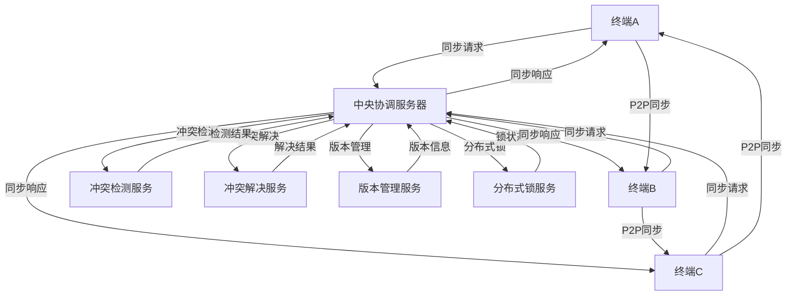
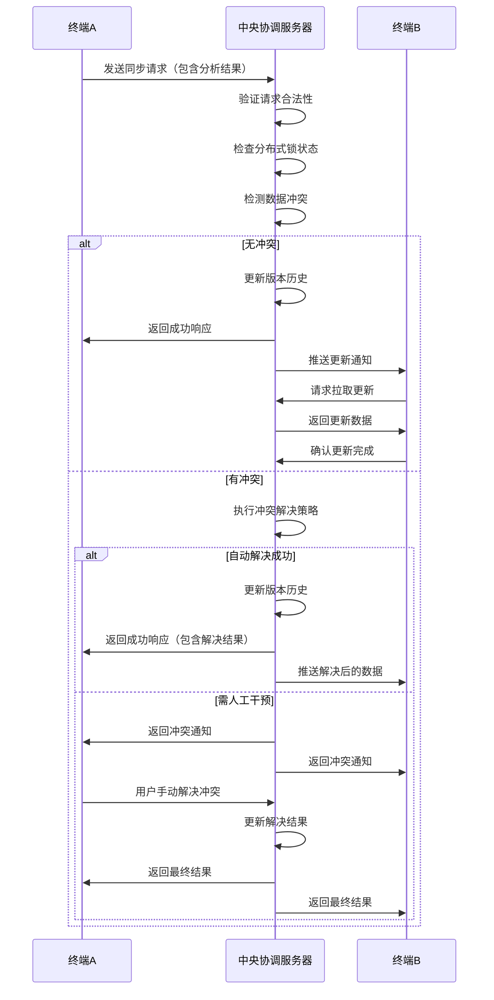
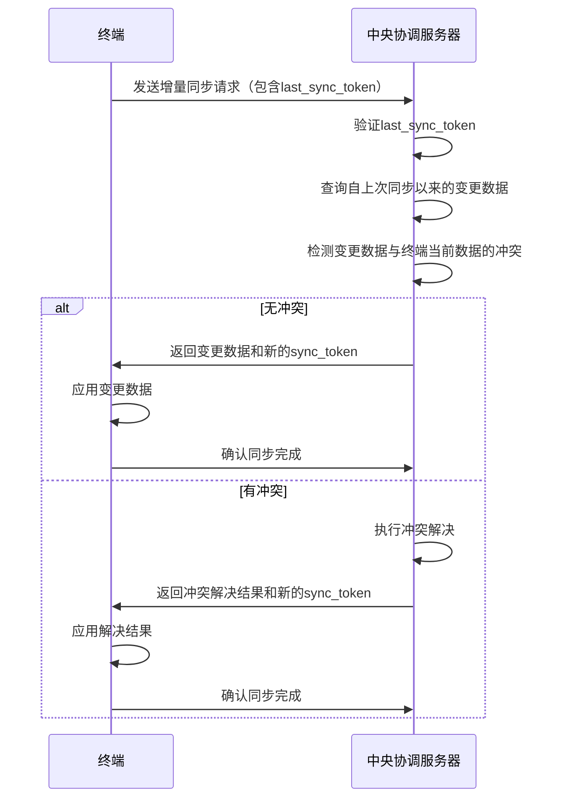
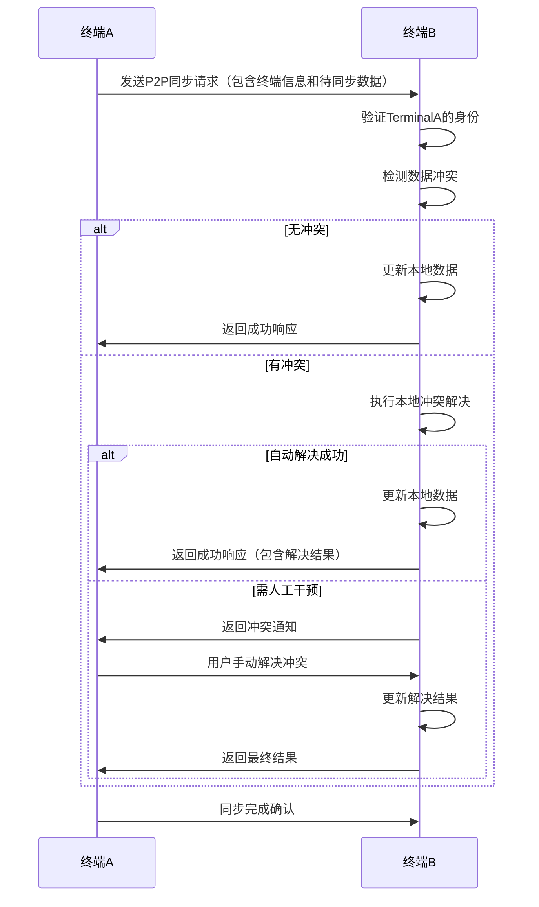
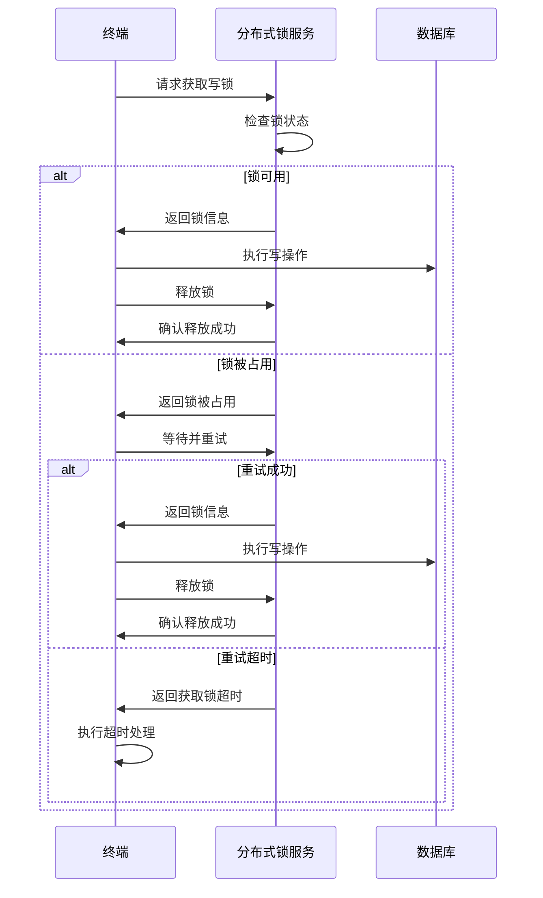

# 终端间数据同步协议设计文档

## 1. 概述

本文档详细设计视频分析系统中终端间数据同步协议，明确冲突解决规则，确保不同终端间分析结果的一致性和准确性。该协议基于现有多终端信息同步与版本管理技术方案，结合分布式系统设计原则，支持高效、可靠的数据同步和冲突处理。

## 2. 协议架构

### 2.1 系统架构



### 2.2 核心组件

| 组件名称 | 主要功能 |
|----------|----------|
| 中央协调服务器 | 处理终端同步请求，协调冲突解决，管理版本信息 |
| 冲突检测服务 | 检测数据冲突，确定冲突类型和严重程度 |
| 冲突解决服务 | 根据冲突解决规则处理冲突，生成最终结果 |
| 版本管理服务 | 管理分析结果的版本信息，记录版本历史 |
| 分布式锁服务 | 提供分布式锁机制，防止并发修改冲突 |
| 终端节点 | 生成分析结果，发起同步请求，处理同步响应 |

## 3. 消息格式

### 3.1 基础消息格式

所有同步消息采用JSON格式，包含以下基础字段：

```json
{
  "protocol_version": "1.0",
  "message_id": "UUID",
  "message_type": "sync_request|sync_response|conflict_notification|lock_request|lock_response",
  "timestamp": "2024-01-15T10:00:00Z",
  "sender_id": "终端ID",
  "recipient_id": "目标终端ID|central_server",
  "payload": {}
}
```

### 3.2 同步请求消息

```json
{
  "protocol_version": "1.0",
  "message_id": "a1b2c3d4-e5f6-7890-abcd-ef1234567890",
  "message_type": "sync_request",
  "timestamp": "2024-01-15T10:00:00Z",
  "sender_id": "terminal_001",
  "recipient_id": "central_server",
  "payload": {
    "sync_type": "full|incremental",
    "last_sync_time": "2024-01-14T10:00:00Z",
    "data_batch": [
      {
        "analysis_id": "analysis_001",
        "video_id": "video_001",
        "content": {
          "tags": [{"tag": "person", "confidence": 0.95, "frame_range": [0, 100]}],
          "summary": "视频摘要",
          "key_frames": ["frame1.jpg", "frame2.jpg"]
        },
        "metadata": {
          "model_version": "v1.0.0",
          "analysis_time": "2024-01-15T10:00:00Z",
          "confidence": 0.92,
          "terminal_id": "terminal_001"
        },
        "version": "v1.0.0",
        "parent_version": null,
        "created_at": "2024-01-15T10:00:00Z",
        "updated_at": "2024-01-15T10:00:00Z",
        "checksum": "SHA-256哈希值"
      }
    ],
    "batch_size": 10
  }
}
```

### 3.3 同步响应消息

```json
{
  "protocol_version": "1.0",
  "message_id": "b2c3d4e5-f678-90ab-cdef-1234567890ab",
  "message_type": "sync_response",
  "timestamp": "2024-01-15T10:01:00Z",
  "sender_id": "central_server",
  "recipient_id": "terminal_001",
  "payload": {
    "status": "success|conflict|error",
    "message": "同步结果描述",
    "conflicts": [
      {
        "conflict_id": "conflict_001",
        "analysis_id": "analysis_001",
        "conflict_type": "time_conflict|confidence_conflict|feature_conflict",
        "local_data": {...},
        "remote_data": {...},
        "resolution_strategy": "timestamp_priority|confidence_priority|manual_resolution",
        "resolved_data": {...}
      }
    ],
    "synced_data": [...],
    "next_sync_token": "sync_token_001",
    "sync_stats": {
      "total_items": 10,
      "synced_items": 8,
      "conflicted_items": 2,
      "sync_duration_ms": 500
    }
  }
}
```

### 3.4 冲突通知消息

```json
{
  "protocol_version": "1.0",
  "message_id": "c3d4e5f6-7890-abcd-ef12-34567890abcd",
  "message_type": "conflict_notification",
  "timestamp": "2024-01-15T10:02:00Z",
  "sender_id": "central_server",
  "recipient_id": "terminal_001",
  "payload": {
    "conflict_id": "conflict_001",
    "analysis_id": "analysis_001",
    "conflict_type": "time_conflict",
    "conflict_details": {
      "local_timestamp": "2024-01-15T10:00:00Z",
      "remote_timestamp": "2024-01-15T10:01:00Z",
      "confidence_diff": 0.05,
      "feature_match_score": 0.75
    },
    "suggested_resolution": "timestamp_priority",
    "resolution_deadline": "2024-01-15T11:00:00Z"
  }
}
```

### 3.5 分布式锁相关消息

```json
{
  "protocol_version": "1.0",
  "message_id": "d4e5f678-90ab-cdef-1234-567890abcd12",
  "message_type": "lock_request",
  "timestamp": "2024-01-15T10:03:00Z",
  "sender_id": "terminal_001",
  "recipient_id": "central_server",
  "payload": {
    "resource_id": "analysis_001",
    "lock_type": "read|write",
    "lock_duration": 300,  // 5分钟
    "transaction_id": "txn_001"
  }
}

{
  "protocol_version": "1.0",
  "message_id": "e5f67890-abcd-ef12-3456-7890abcd1234",
  "message_type": "lock_response",
  "timestamp": "2024-01-15T10:03:01Z",
  "sender_id": "central_server",
  "recipient_id": "terminal_001",
  "payload": {
    "status": "granted|denied|timeout",
    "lock_id": "lock_001",
    "resource_id": "analysis_001",
    "lock_type": "write",
    "expires_at": "2024-01-15T10:08:01Z",
    "transaction_id": "txn_001"
  }
}
```

## 4. 同步流程

### 4.1 完整同步流程



### 4.2 增量同步流程



### 4.3 P2P同步流程



## 5. 冲突解决规则

### 5.1 冲突判定标准

| 判定维度 | 具体规则 | 阈值建议 |
|----------|----------|----------|
| **时间戳差异** | 比较数据最后修改时间，超过阈值判定为冲突 | 30秒 |
| **分析结果置信度** | 比较分析结果的置信度，差异超过阈值判定为冲突 | 10% |
| **关键特征匹配度** | 比较视频关键特征的匹配度，低于阈值判定为冲突 | 80% |
| **元数据差异** | 比较视频元数据（时长、分辨率等），差异超过阈值判定为冲突 | 5% |
| **操作类型冲突** | 同一资源的并发写操作判定为冲突 | - |

### 5.2 冲突解决策略

#### 5.2.1 基于时间戳的冲突仲裁

```python
def resolve_by_timestamp(local_data: Dict, remote_data: Dict) -> Dict:
    """基于时间戳的冲突解决
    
    Args:
        local_data: 本地数据
        remote_data: 远程数据
        
    Returns:
        解决后的结果
    """
    local_time = datetime.fromisoformat(local_data["updated_at"])
    remote_time = datetime.fromisoformat(remote_data["updated_at"])
    
    # 保留最新修改的数据
    if remote_time > local_time:
        return remote_data
    else:
        return local_data
```

#### 5.2.2 基于优先级的冲突仲裁

```python
def resolve_by_priority(local_data: Dict, remote_data: Dict, priority_map: Dict) -> Dict:
    """基于优先级的冲突解决
    
    Args:
        local_data: 本地数据
        remote_data: 远程数据
        priority_map: 终端优先级映射表
        
    Returns:
        解决后的结果
    """
    local_terminal = local_data["metadata"]["terminal_id"]
    remote_terminal = remote_data["metadata"]["terminal_id"]
    
    local_priority = priority_map.get(local_terminal, 0)
    remote_priority = priority_map.get(remote_terminal, 0)
    
    # 保留优先级高的终端数据
    if remote_priority > local_priority:
        return remote_data
    elif local_priority > remote_priority:
        return local_data
    else:
        # 优先级相同时，基于时间戳
        return resolve_by_timestamp(local_data, remote_data)
```

#### 5.2.3 基于内容校验的冲突仲裁

```python
def resolve_by_content_validation(local_data: Dict, remote_data: Dict) -> Dict:
    """基于内容校验的冲突解决
    
    Args:
        local_data: 本地数据
        remote_data: 远程数据
        
    Returns:
        解决后的结果
    """
    # 比较置信度
    local_confidence = local_data["metadata"]["confidence"]
    remote_confidence = remote_data["metadata"]["confidence"]
    
    # 置信度差异超过阈值，保留置信度高的
    if abs(remote_confidence - local_confidence) > 0.1:
        return remote_data if remote_confidence > local_confidence else local_data
    
    # 比较关键特征匹配度
    local_features = extract_key_features(local_data["content"])
    remote_features = extract_key_features(remote_data["content"])
    match_score = calculate_feature_match(local_features, remote_features)
    
    # 特征匹配度低，需要人工干预
    if match_score < 0.8:
        return {
            "conflict_type": "feature_conflict",
            "local_data": local_data,
            "remote_data": remote_data,
            "resolution_required": "manual"
        }
    
    # 特征匹配度高，合并结果
    merged_data = merge_feature_data(local_data, remote_data)
    return merged_data
```

#### 5.2.4 字段级冲突解决

```python
def resolve_field_level_conflict(local_data: Dict, remote_data: Dict) -> Dict:
    """字段级冲突解决
    
    Args:
        local_data: 本地数据
        remote_data: 远程数据
        
    Returns:
        解决后的结果
    """
    merged_data = {}
    
    # 合并元数据
    merged_data["metadata"] = {**local_data["metadata"], **remote_data["metadata"]}
    
    # 合并内容字段
    merged_content = {}
    
    # 合并标签：去重并保留高置信度标签
    local_tags = local_data["content"].get("tags", [])
    remote_tags = remote_data["content"].get("tags", [])
    tag_map = {}
    
    for tag in local_tags + remote_tags:
        tag_name = tag["tag"]
        if tag_name not in tag_map or tag["confidence"] > tag_map[tag_name]["confidence"]:
            tag_map[tag_name] = tag
    
    merged_content["tags"] = list(tag_map.values())
    
    # 合并摘要：保留最新的摘要
    if datetime.fromisoformat(local_data["updated_at"]) > datetime.fromisoformat(remote_data["updated_at"]):
        merged_content["summary"] = local_data["content"].get("summary", "")
    else:
        merged_content["summary"] = remote_data["content"].get("summary", "")
    
    # 合并关键帧：去重
    local_keyframes = set(local_data["content"].get("key_frames", []))
    remote_keyframes = set(remote_data["content"].get("key_frames", []))
    merged_content["key_frames"] = list(local_keyframes.union(remote_keyframes))
    
    merged_data["content"] = merged_content
    
    # 保留其他公共字段
    merged_data["analysis_id"] = local_data["analysis_id"]
    merged_data["video_id"] = local_data["video_id"]
    merged_data["version"] = generate_new_version(local_data["version"], remote_data["version"])
    merged_data["parent_version"] = f"{local_data['version']},{remote_data['version']}"
    merged_data["created_at"] = local_data["created_at"]
    merged_data["updated_at"] = datetime.now().isoformat()
    
    return merged_data
```

## 6. 分布式锁机制

### 6.1 锁类型

| 锁类型 | 用途 | 特性 |
|--------|------|------|
| **读锁** | 防止读取时数据被修改 | 支持多个终端同时持有 |
| **写锁** | 防止并发修改同一数据 | 同一时间只允许一个终端持有 |
| **乐观锁** | 基于版本号的并发控制 | 适用于读多写少场景 |
| **悲观锁** | 基于显式锁定的并发控制 | 适用于写多读少场景 |

### 6.2 锁实现

```python
import redis
import uuid
from datetime import datetime, timedelta

class DistributedLockService:
    """分布式锁服务"""
    
    def __init__(self, redis_client: redis.Redis):
        self.redis = redis_client
        self.default_lock_duration = 300  # 5分钟
    
    def acquire_lock(self, resource_id: str, lock_type: str = "write", duration: int = None) -> Dict:
        """获取分布式锁
        
        Args:
            resource_id: 资源ID
            lock_type: 锁类型（read/write）
            duration: 锁持有时间（秒）
            
        Returns:
            锁信息或None（获取失败）
        """
        if duration is None:
            duration = self.default_lock_duration
        
        lock_id = str(uuid.uuid4())
        lock_key = f"lock:{resource_id}:{lock_type}"
        
        if lock_type == "write":
            # 写锁：使用SETNX原子操作
            if self.redis.setnx(lock_key, lock_id):
                self.redis.expire(lock_key, duration)
                return {
                    "lock_id": lock_id,
                    "resource_id": resource_id,
                    "lock_type": lock_type,
                    "expires_at": (datetime.now() + timedelta(seconds=duration)).isoformat()
                }
        else:
            # 读锁：使用计数器实现
            self.redis.incr(lock_key)
            self.redis.expire(lock_key, duration)
            return {
                "lock_id": lock_id,
                "resource_id": resource_id,
                "lock_type": lock_type,
                "expires_at": (datetime.now() + timedelta(seconds=duration)).isoformat()
            }
        
        return None
    
    def release_lock(self, lock_info: Dict) -> bool:
        """释放分布式锁
        
        Args:
            lock_info: 锁信息
            
        Returns:
            True if released successfully, False otherwise
        """
        lock_key = f"lock:{lock_info['resource_id']}:{lock_info['lock_type']}"
        
        if lock_info["lock_type"] == "write":
            # 写锁：验证锁ID并删除
            current_lock_id = self.redis.get(lock_key)
            if current_lock_id and current_lock_id.decode() == lock_info["lock_id"]:
                return self.redis.delete(lock_key) > 0
        else:
            # 读锁：递减计数器
            count = self.redis.decr(lock_key)
            if count <= 0:
                self.redis.delete(lock_key)
            return True
        
        return False
    
    def renew_lock(self, lock_info: Dict, duration: int) -> bool:
        """续期分布式锁
        
        Args:
            lock_info: 锁信息
            duration: 续期时间（秒）
            
        Returns:
            True if renewed successfully, False otherwise
        """
        lock_key = f"lock:{lock_info['resource_id']}:{lock_info['lock_type']}"
        
        if lock_info["lock_type"] == "write":
            # 验证锁ID
            current_lock_id = self.redis.get(lock_key)
            if current_lock_id and current_lock_id.decode() == lock_info["lock_id"]:
                self.redis.expire(lock_key, duration)
                return True
        else:
            # 读锁直接续期
            if self.redis.exists(lock_key):
                self.redis.expire(lock_key, duration)
                return True
        
        return False
```

### 6.3 锁使用流程



## 7. 异常处理

### 7.1 网络异常处理

| 异常类型 | 处理策略 |
|----------|----------|
| **网络中断** | 缓存同步请求，实现指数退避重试机制（1s, 3s, 5s, 10s, 30s） |
| **连接超时** | 增加超时阈值，实现智能重试，记录超时日志 |
| **服务不可用** | 切换到备用服务器，或启用P2P同步模式 |

### 7.2 数据异常处理

| 异常类型 | 处理策略 |
|----------|----------|
| **数据损坏** | 使用校验和检测，自动恢复或重建数据 |
| **版本链断裂** | 检测版本链完整性，自动修复或请求重新同步 |
| **ID冲突** | 触发ID冲突检测机制，重新生成唯一ID |

### 7.3 系统异常处理

| 异常类型 | 处理策略 |
|----------|----------|
| **服务崩溃** | 实现服务高可用，自动故障转移 |
| **数据库故障** | 实现数据库备份和恢复机制，启用本地缓存 |
| **存储容量不足** | 实现自动扩容或清理策略，优先保留高价值数据 |

## 8. 性能优化

### 8.1 同步性能优化

| 优化策略 | 实现方式 | 预期效果 |
|----------|----------|----------|
| **增量同步** | 仅同步自上次同步以来的变更数据 | 减少网络传输量50%-90% |
| **批量同步** | 批量处理同步请求，减少网络请求次数 | 提高同步效率30%-60% |
| **异步同步** | 异步处理同步任务，不阻塞主线程 | 提高系统响应速度 |
| **压缩传输** | 使用GZIP或LZ4压缩同步数据 | 减少传输时间40%-70% |
| **智能同步调度** | 根据网络状况和系统负载动态调整同步频率 | 优化资源利用率 |

### 8.2 冲突检测优化

| 优化策略 | 实现方式 | 预期效果 |
|----------|----------|----------|
| **分层检测** | 先检测基本字段，再检测复杂字段 | 减少检测时间30%-50% |
| **增量检测** | 仅检测变化的字段 | 减少检测数据量60%-80% |
| **并行检测** | 多线程并行检测 | 提高检测效率50%-100% |
| **缓存检测结果** | 缓存近期检测结果 | 避免重复检测，提高效率 |

## 9. 安全性考虑

### 9.1 身份认证

- 终端使用预分配的API密钥进行身份认证
- 支持OAuth 2.0或JWT令牌认证
- 实现双向SSL/TLS加密通信

### 9.2 数据加密

- 传输过程使用TLS 1.3加密
- 存储过程使用AES-256加密敏感数据
- 支持端到端加密选项

### 9.3 访问控制

- 基于角色的访问控制（RBAC）
- 细粒度的权限管理
- 审计日志记录所有访问操作

### 9.4 数据完整性

- 使用SHA-256校验和验证数据完整性
- 实现数字签名机制
- 防止数据篡改和伪造

## 10. 测试计划

### 10.1 单元测试

- 测试消息序列化和反序列化
- 测试冲突检测算法
- 测试冲突解决策略
- 测试分布式锁实现
- 测试异常处理机制

### 10.2 集成测试

- 测试终端与中央服务器的集成
- 测试多个终端间的同步流程
- 测试冲突检测和解决的端到端流程
- 测试分布式锁的协作机制

### 10.3 性能测试

- 测试高并发场景下的同步性能
- 测试不同网络条件下的同步效率
- 测试大规模数据同步的性能
- 测试冲突检测和解决的性能开销

### 10.4 可靠性测试

- 测试网络中断后的恢复能力
- 测试服务故障后的容错能力
- 测试数据损坏后的恢复能力
- 测试长时间运行的稳定性

### 10.5 安全性测试

- 测试身份认证和授权机制
- 测试数据加密和完整性保护
- 测试访问控制机制
- 测试常见安全攻击的防护能力

## 11. 结论

本终端间数据同步协议设计通过明确的消息格式、高效的同步流程、灵活的冲突解决规则和可靠的分布式锁机制，确保了视频分析系统中不同终端间分析结果的一致性和准确性。该协议具有以下特点：

1. **高效性**：支持增量同步、批量同步和异步同步，优化网络传输和处理效率
2. **可靠性**：完善的异常处理机制，确保在各种异常情况下的数据一致性
3. **灵活性**：多种冲突解决策略，适应不同场景需求
4. **安全性**：全面的身份认证、数据加密和访问控制机制
5. **扩展性**：模块化设计，支持系统规模扩展和功能扩展

该协议设计能够满足大规模视频分析系统的需求，为多终端协同分析提供可靠的数据同步基础。