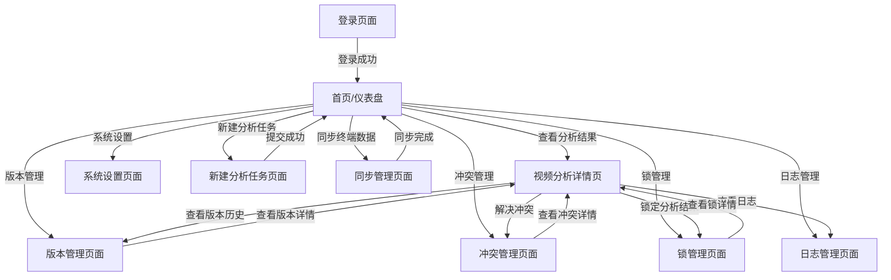

# 视频分析系统界面原型设计文档

## 1. 设计概述

### 1.1 设计目标

根据视频分析系统的核心功能模块，设计一套完整的界面原型，包含PC端和移动端两个版本：

- **PC端**：充分利用大屏幕优势，采用多栏布局，确保信息展示的完整性和操作的便捷性
- **移动端**：遵循移动优先原则，采用单列布局，优化触控交互体验，适配不同尺寸移动设备
- **一致性**：保持两端设计风格的一致性与视觉统一性
- **功能性**：包含所有核心功能模块、页面跳转逻辑及交互状态

### 1.2 核心功能模块

1. ID冲突检测机制
2. 终端间数据同步协议
3. 分析结果版本化管理
4. 分布式锁机制
5. 数据合并策略
6. 全链路日志记录
7. 定期数据一致性校验

## 2. 设计规范

### 2.1 色彩方案

| 色彩名称 | 色值 | 用途 |
|----------|------|------|
| 主色调 | #2563EB | 按钮、导航栏、高亮元素 |
| 辅助色 | #10B981 | 成功状态、积极操作 |
| 警告色 | #F59E0B | 警告状态、需要注意的操作 |
| 错误色 | #EF4444 | 错误状态、危险操作 |
| 中性色-100 | #F3F4F6 | 背景色 |
| 中性色-200 | #E5E7EB | 边框色、分隔线 |
| 中性色-800 | #1F2937 | 主文本色 |
| 中性色-600 | #4B5563 | 次要文本色 |

### 2.2 字体规范

| 设备类型 | 字体大小 | 行高 | 用途 |
|----------|----------|------|------|
| PC端 | 16px | 1.5 | 正文 |
| PC端 | 18px | 1.6 | 标题 |
| 移动端 | 14px | 1.5 | 正文 |
| 移动端 | 16px | 1.6 | 标题 |

### 2.3 图标规范

- 使用统一的图标库（如Material Icons或Font Awesome）
- 确保图标在不同尺寸下清晰可见
- 保持图标风格一致

## 3. PC端界面设计

### 3.1 整体布局

采用经典的三栏布局：

1. **左侧导航栏**：固定宽度，包含主要功能模块入口
2. **中间内容区**：自适应宽度，展示核心业务数据
3. **右侧辅助区**：固定宽度，展示辅助信息和快捷操作

### 3.2 页面设计

#### 3.2.1 登录页面

```
┌───────────────────────────────────────────────────────────────────────────┐
│                                                                           │
│                              视频分析系统                                 │
│                                                                           │
├───────────────────────────────────────────────────────────────────────────┤
│                                                                           │
│                          [ 登录表单 ]                                     │
│                                                                           │
│  ┌───────────────────────────────────────────────────────────────┐       │
│  │                                                               │       │
│  │  用户名: [                ]                                   │       │
│  │                                                               │       │
│  │  密码:   [                ]                                   │       │
│  │                                                               │       │
│  │  [ 记住我 ]  [ 忘记密码? ]                                    │       │
│  │                                                               │       │
│  │  ┌───────────────────────────────────────────────────────┐     │       │
│  │  │                       登录                            │     │       │
│  │  └───────────────────────────────────────────────────────┘     │       │
│  │                                                               │       │
│  │  还没有账号? [ 立即注册 ]                                    │       │
│  │                                                               │       │
│  └───────────────────────────────────────────────────────────────┘       │
│                                                                           │
└───────────────────────────────────────────────────────────────────────────┘
```

#### 3.2.2 首页/仪表盘

```
┌───────────────────────────────────────────────────────────────────────────────────────────────────────────────────────────────────────────┐
│  导航栏：logo | 首页 | 视频管理 | 分析结果 | 版本管理 | 冲突管理 | 锁管理 | 日志管理 | 系统设置 | 用户信息                               │
├───────────────────────────────────────────────────────────────────────────────────────────────────────────────────────────────────────────┤
│                                                                                                         │  快捷操作                    │
│  ┌─────────────────────────────────────────────────────────────────────────────────────────────────────┐ │                              │
│  │                                             系统概览                                              │ │  ┌───────────────────────┐ │
│  └─────────────────────────────────────────────────────────────────────────────────────────────────────┘ │  │  新建分析任务          │ │
│                                                                                                         │  ├───────────────────────┤ │
│  ┌───────────────────┐  ┌───────────────────┐  ┌───────────────────┐  ┌───────────────────┐             │  │  同步终端数据          │ │
│  │  待处理分析任务   │  │  今日分析完成     │  │  待解决冲突       │  │  系统健康状态     │             │  │  手动触发校验          │ │
│  │  12              │  │  35              │  │  5               │  │  正常             │             │  ├───────────────────────┤ │
│  └───────────────────┘  └───────────────────┘  └───────────────────┘  └───────────────────┘             │  │  查看系统日志          │ │
│                                                                                                         │  └───────────────────────┘ │
│  ┌─────────────────────────────────────────────────────────────────────────────────────────────────────┐ │                              │
│  │                                             最新分析结果                                          │ │  系统状态                    │
│  │  ┌─────────────┬─────────────┬─────────────┬─────────────┬─────────────┬─────────────┬───────────┐ │  ┌───────────────────────┐ │
│  │  │  视频名称   │  分析ID     │  终端ID     │  当前版本   │  分析状态   │  置信度     │  操作     │ │  │  CPU使用率: 45%        │ │
│  │  ├─────────────┼─────────────┼─────────────┼─────────────┼─────────────┼─────────────┼───────────┤ │  │  内存使用率: 68%        │ │
│  │  │  视频1      │  an123      │  term001    │  v1.2.0     │  完成       │  0.92       │  详情/删除 │ │  │  磁盘使用率: 72%        │ │
│  │  │  视频2      │  an124      │  term002    │  v1.0.1     │  完成       │  0.88       │  详情/删除 │ │  │  在线终端数: 8         │ │
│  │  └─────────────┴─────────────┴─────────────┴─────────────┴─────────────┴─────────────┴───────────┘ │  └───────────────────────┘ │
│  └─────────────────────────────────────────────────────────────────────────────────────────────────────┘ │                              │
│                                                                                                         │  最近告警                    │
│  ┌─────────────────────────────────────────────────────────────────────────────────────────────────────┐ │  ┌───────────────────────┐ │
│  │                                             待解决冲突                                            │ │  │  ID冲突: 2个           │ │
│  │  ┌─────────────┬─────────────┬─────────────┬─────────────┬─────────────┬───────────┐               │ │  │  锁超时: 1个           │ │
│  │  │  冲突ID     │  分析ID     │  冲突类型   │  冲突级别   │  涉及终端   │  操作     │               │ │  │  同步失败: 0个         │ │
│  │  ├─────────────┼─────────────┼─────────────┼─────────────┼─────────────┼───────────┤               │ │  └───────────────────────┘ │
│  │  │  cf456      │  an123      │  标签冲突   │  高         │  term001/002│  解决/忽略 │               │ │                              │
│  │  │  cf457      │  an125      │  摘要冲突   │  中         │  term003/004│  解决/忽略 │               │ │                              │
│  │  └─────────────┴─────────────┴─────────────┴─────────────┴─────────────┴───────────┘               │ │                              │
│  └─────────────────────────────────────────────────────────────────────────────────────────────────────┘ │                              │
└───────────────────────────────────────────────────────────────────────────────────────────────────────────────────────────────────────────┘
```

#### 3.2.3 视频分析结果详情页

```
┌───────────────────────────────────────────────────────────────────────────────────────────────────────────────────────────────────────────┐
│  导航栏：logo | 首页 | 视频管理 | 分析结果 > 视频分析详情 | 版本管理 | 冲突管理 | 锁管理 | 日志管理 | 系统设置 | 用户信息                   │
├───────────────────────────────────────────────────────────────────────────────────────────────────────────────────────────────────────────┤
│                                                                                                         │  分析信息                    │
│  ┌─────────────────────────────────────────────────────────────────────────────────────────────────────┐ │  ┌───────────────────────┐ │
│  │                                             视频播放区                                              │ │  │  视频名称: 视频1      │ │
│  │                                                                                                     │ │  │  分析ID: an123        │ │
│  │  [ 视频播放器 ]                                                                                     │ │  │  终端ID: term001      │ │
│  │                                                                                                     │ │  │  当前版本: v1.2.0     │ │
│  └─────────────────────────────────────────────────────────────────────────────────────────────────────┘ │  │  分析状态: 完成       │ │
│                                                                                                         │  │  置信度: 0.92         │ │
│  ┌─────────────────────────────────────────────────────────────────────────────────────────────────────┐ │  │  创建时间: 2026-01-17 │ │
│  │                                             分析结果                                              │ │  │  更新时间: 2026-01-17 │ │
│  │  ┌─────────────────────┐  ┌─────────────────────┐  ┌─────────────────────┐                           │  └───────────────────────┘ │
│  │  │  标签               │  │  摘要               │  │  关键帧             │                           │                              │
│  │  │                     │  │                     │  │                     │                           │  操作面板                    │
│  │  │  • 人物 (0.95)      │  │  视频中包含一个人   │  │  [ 帧1 ] [ 帧2 ]     │                           │  ┌───────────────────────┐ │
│  │  │  • 汽车 (0.88)      │  │  物在行走，背景有   │  │  [ 帧3 ] [ 帧4 ]     │                           │  │  查看版本历史          │ │
│  │  │  • 道路 (0.92)      │  │  一辆汽车经过。     │  │                     │                           │  ├───────────────────────┤ │
│  │  │                     │  │                     │  │                     │                           │  │  对比版本差异          │ │
│  │  └─────────────────────┘  └─────────────────────┘  └─────────────────────┘                           │  ├───────────────────────┤ │
│  └─────────────────────────────────────────────────────────────────────────────────────────────────────┘ │  │  解决冲突              │ │
│                                                                                                         │  ├───────────────────────┤ │
│  ┌─────────────────────────────────────────────────────────────────────────────────────────────────────┐ │  │  锁定分析结果          │ │
│  │                                             版本历史                                              │ │  ├───────────────────────┤ │
│  │  ┌─────────────┬─────────────┬─────────────┬─────────────┬─────────────┬───────────┐               │ │  │  同步到其他终端        │ │
│  │  │  版本号     │  终端ID     │  变更类型   │  变更描述   │  创建时间   │  操作     │               │ │  └───────────────────────┘ │
│  │  ├─────────────┼─────────────┼─────────────┼─────────────┼─────────────┼───────────┤               │ │                              │
│  │  │  v1.2.0     │  term001    │  更新       │  更新标签   │  2026-01-17 │  恢复/查看 │               │ │                              │
│  │  │  v1.1.0     │  term002    │  合并       │  合并终端数据│  2026-01-16 │  恢复/查看 │               │ │                              │
│  │  │  v1.0.0     │  term001    │  创建       │  初始分析   │  2026-01-15 │  恢复/查看 │               │ │                              │
│  │  └─────────────┴─────────────┴─────────────┴─────────────┴─────────────┴───────────┘               │ │                              │
│  └─────────────────────────────────────────────────────────────────────────────────────────────────────┘ │                              │
└───────────────────────────────────────────────────────────────────────────────────────────────────────────────────────────────────────────┘
```

#### 3.2.4 版本管理页面

```
┌───────────────────────────────────────────────────────────────────────────────────────────────────────────────────────────────────────────┐
│  导航栏：logo | 首页 | 视频管理 | 分析结果 | 版本管理 | 冲突管理 | 锁管理 | 日志管理 | 系统设置 | 用户信息                               │
├───────────────────────────────────────────────────────────────────────────────────────────────────────────────────────────────────────────┤
│  ┌─────────────────────────────────────────────────────────────────────────────────────────────────────┐                              │
│  │                                             版本管理                                              │                              │
│  │  ┌─────────────────────────────────────────────────────────────────────────────────────────────┐    │                              │
│  │  │  搜索: [                ]  筛选: [ 所有终端 ]  [ 所有分析ID ]  [ 所有状态 ]                │    │                              │
│  │  └─────────────────────────────────────────────────────────────────────────────────────────────┘    │                              │
│  │                                                                                                     │                              │
│  │  ┌─────────────┬─────────────┬─────────────┬─────────────┬─────────────┬─────────────┬─────────────┐ │                              │
│  │  │  版本号     │  分析ID     │  终端ID     │  父版本     │  变更类型   │  创建时间   │  操作       │ │                              │
│  │  ├─────────────┼─────────────┼─────────────┼─────────────┼─────────────┼─────────────┼─────────────┤ │                              │
│  │  │  v1.2.0     │  an123      │  term001    │  v1.1.0     │  更新       │  2026-01-17 │  查看/恢复  │ │                              │
│  │  │  v1.1.0     │  an123      │  term002    │  v1.0.0     │  合并       │  2026-01-16 │  查看/恢复  │ │                              │
│  │  │  v1.0.1     │  an124      │  term003    │  v1.0.0     │  更新       │  2026-01-16 │  查看/恢复  │ │                              │
│  │  │  v1.0.0     │  an123      │  term001    │  -          │  创建       │  2026-01-15 │  查看/恢复  │ │                              │
│  │  │  v1.0.0     │  an124      │  term003    │  -          │  创建       │  2026-01-15 │  查看/恢复  │ │                              │
│  │  └─────────────┴─────────────┴─────────────┴─────────────┴─────────────┴─────────────┴─────────────┘ │                              │
│  │                                                                                                     │                              │
│  │  ┌─────────────────────────────────────────────────────────────────────────────────────────────┐    │                              │
│  │  │  版本对比                                                                                  │    │                              │
│  │  │  选择版本1: [ v1.0.0 ]  选择版本2: [ v1.1.0 ]                                                │    │                              │
│  │  │                                                                                             │    │                              │
│  │  │  ┌─────────────┐  ┌─────────────┐                                                           │    │                              │
│  │  │  │  版本1差异  │  │  版本2差异  │                                                           │    │                              │
│  │  │  │             │  │             │                                                           │    │                              │
│  │  │  │  • 标签: +汽车│  │  • 标签: 无 │                                                           │    │                              │
│  │  │  │  • 摘要: 更新 │  │  • 摘要: 原 │                                                           │    │                              │
│  │  │  │             │  │             │                                                           │    │                              │
│  │  │  └─────────────┘  └─────────────┘                                                           │    │                              │
│  │  └─────────────────────────────────────────────────────────────────────────────────────────────┘    │                              │
│  └─────────────────────────────────────────────────────────────────────────────────────────────────────┘                              │
└───────────────────────────────────────────────────────────────────────────────────────────────────────────────────────────────────────────┘
```

#### 3.2.5 冲突管理页面

```
┌───────────────────────────────────────────────────────────────────────────────────────────────────────────────────────────────────────────┐
│  导航栏：logo | 首页 | 视频管理 | 分析结果 | 版本管理 | 冲突管理 | 锁管理 | 日志管理 | 系统设置 | 用户信息                               │
├───────────────────────────────────────────────────────────────────────────────────────────────────────────────────────────────────────────┤
│  ┌─────────────────────────────────────────────────────────────────────────────────────────────────────┐                              │
│  │                                             冲突管理                                              │                              │
│  │  ┌─────────────────────────────────────────────────────────────────────────────────────────────┐    │                              │
│  │  │  搜索: [                ]  筛选: [ 所有冲突类型 ]  [ 所有冲突级别 ]  [ 所有状态 ]            │    │                              │
│  │  └─────────────────────────────────────────────────────────────────────────────────────────────┘    │                              │
│  │                                                                                                     │                              │
│  │  ┌─────────────┬─────────────┬─────────────┬─────────────┬─────────────┬─────────────┬───────────┐   │                              │
│  │  │  冲突ID     │  分析ID     │  冲突类型   │  冲突级别   │  涉及终端   │  创建时间   │  状态/操作 │   │                              │
│  │  ├─────────────┼─────────────┼─────────────┼─────────────┼─────────────┼─────────────┼───────────┤   │                              │
│  │  │  cf456      │  an123      │  标签冲突   │  高         │  term001/002│  2026-01-17 │  待解决/解决 │   │                              │
│  │  │  cf457      │  an125      │  摘要冲突   │  中         │  term003/004│  2026-01-17 │  待解决/解决 │   │                              │
│  │  │  cf458      │  an124      │  关键帧冲突 │  低         │  term005    │  2026-01-16 │  已解决/查看 │   │                              │
│  │  └─────────────┴─────────────┴─────────────┴─────────────┴─────────────┴─────────────┴───────────┘   │                              │
│  │                                                                                                     │                              │
│  │  ┌─────────────────────────────────────────────────────────────────────────────────────────────┐    │                              │
│  │  │                                             冲突详情                                      │    │                              │
│  │  │  ┌─────────────┐  ┌─────────────┐                                                           │    │                              │
│  │  │  │  终端A (term001) │  │  终端B (term002) │                                                           │    │                              │
│  │  │  │                 │  │                 │                                                           │    │                              │
│  │  │  │  • 标签: 人物(0.95) │  │  • 标签: 人物(0.70) │                                                           │    │                              │
│  │  │  │  • 标签: 汽车(0.88) │  │  • 标签: 自行车(0.85) │                                                           │    │                              │
│  │  │  │  • 摘要: 视频中包含 │  │  • 摘要: 视频中包含 │                                                           │    │                              │
│  │  │  │     一个人和一辆汽 │  │     一个人和一辆自 │                                                           │    │                              │
│  │  │  │     车。           │  │     行车。           │                                                           │    │                              │
│  │  │  │                 │  │                 │                                                           │    │                              │
│  │  │  └─────────────┘  └─────────────┘                                                           │    │                              │
│  │  │                                                                                             │    │                              │
│  │  │  解决方式:                                                                                  │    │                              │
│  │  │  [ ] 保留终端A结果  [ ] 保留终端B结果  [ ] 合并结果  [ ] 手动编辑                               │    │                              │
│  │  │                                                                                             │    │                              │
│  │  │  [ 确认解决 ]  [ 取消 ]                                                                     │    │                              │
│  │  └─────────────────────────────────────────────────────────────────────────────────────────────┘    │                              │
│  └─────────────────────────────────────────────────────────────────────────────────────────────────────┘                              │
└───────────────────────────────────────────────────────────────────────────────────────────────────────────────────────────────────────────┘
```

#### 3.2.6 锁管理页面

```
┌───────────────────────────────────────────────────────────────────────────────────────────────────────────────────────────────────────────┐
│  导航栏：logo | 首页 | 视频管理 | 分析结果 | 版本管理 | 冲突管理 | 锁管理 | 日志管理 | 系统设置 | 用户信息                               │
├───────────────────────────────────────────────────────────────────────────────────────────────────────────────────────────────────────────┤
│  ┌─────────────────────────────────────────────────────────────────────────────────────────────────────┐                              │
│  │                                             锁管理                                                │                              │
│  │  ┌─────────────────────────────────────────────────────────────────────────────────────────────┐    │                              │
│  │  │  搜索: [                ]  筛选: [ 所有锁类型 ]  [ 所有状态 ]  [ 所有资源 ]                  │    │                              │
│  │  └─────────────────────────────────────────────────────────────────────────────────────────────┘    │                              │
│  │                                                                                                     │                              │
│  │  ┌─────────────┬─────────────┬─────────────┬─────────────┬─────────────┬─────────────┬─────────────┐ │                              │
│  │  │  锁ID       │  资源ID     │  锁类型     │  终端ID     │  获取时间   │  过期时间   │  状态/操作   │ │                              │
│  │  ├─────────────┼─────────────┼─────────────┼─────────────┼─────────────┼─────────────┼─────────────┤ │                              │
│  │  │  lock789    │  an123      │  写锁       │  term001    │  2026-01-17 │  2026-01-17 │  活跃/释放   │ │                              │
│  │  │  lock790    │  an124      │  读锁       │  term002    │  2026-01-17 │  2026-01-17 │  活跃/释放   │ │                              │
│  │  │  lock791    │  an123      │  读锁       │  term003    │  2026-01-17 │  2026-01-17 │  活跃/释放   │ │                              │
│  │  └─────────────┴─────────────┴─────────────┴─────────────┴─────────────┴─────────────┴─────────────┘ │                              │
│  │                                                                                                     │                              │
│  │  ┌─────────────────────────────────────────────────────────────────────────────────────────────┐    │                              │
│  │  │                                             锁统计                                      │    │                              │
│  │  │  ┌─────────────┐  ┌─────────────┐  ┌─────────────┐  ┌─────────────┐                          │    │                              │
│  │  │  │  活跃锁总数 │  │  写锁数量   │  │  读锁数量   │  │  过期锁数量 │                          │    │                              │
│  │  │  │  15         │  │  3          │  │  12         │  │  2          │                          │    │                              │
│  │  │  └─────────────┘  └─────────────┘  └─────────────┘  └─────────────┘                          │    │                              │
│  │  └─────────────────────────────────────────────────────────────────────────────────────────────┘    │                              │
│  └─────────────────────────────────────────────────────────────────────────────────────────────────────┘                              │
└───────────────────────────────────────────────────────────────────────────────────────────────────────────────────────────────────────────┘
```

#### 3.2.7 日志管理页面

```
┌───────────────────────────────────────────────────────────────────────────────────────────────────────────────────────────────────────────┐
│  导航栏：logo | 首页 | 视频管理 | 分析结果 | 版本管理 | 冲突管理 | 锁管理 | 日志管理 | 系统设置 | 用户信息                               │
├───────────────────────────────────────────────────────────────────────────────────────────────────────────────────────────────────────────┤
│  ┌─────────────────────────────────────────────────────────────────────────────────────────────────────┐                              │
│  │                                             日志管理                                              │                              │
│  │  ┌─────────────────────────────────────────────────────────────────────────────────────────────┐    │                              │
│  │  │  搜索: [                ]  筛选: [ 所有日志级别 ]  [ 所有模块 ]  [ 时间范围 ]                │    │                              │
│  │  └─────────────────────────────────────────────────────────────────────────────────────────────┘    │                              │
│  │                                                                                                     │                              │
│  │  ┌─────────────┬─────────────┬─────────────┬─────────────┬─────────────┬─────────────────────────┐ │                              │
│  │  │  时间戳     │  日志级别   │  模块       │  Trace ID   │  Span ID    │  日志内容                │ │                              │
│  │  ├─────────────┼─────────────┼─────────────┼─────────────┼─────────────┼─────────────────────────┤ │                              │
│  │  │  2026-01-17 │  INFO       │  ID生成     │  tr123      │  sp456      │  成功生成analysis_id:    │ │                              │
│  │  │             │             │             │             │             │  an123                   │ │                              │
│  │  │  2026-01-17 │  WARN       │  冲突检测   │  tr124      │  sp457      │  检测到标签冲突: cf456   │ │                              │
│  │  │  2026-01-17 │  ERROR      │  同步服务   │  tr125      │  sp458      │  终端term002同步失败:    │ │                              │
│  │  │             │             │             │             │             │  网络超时                │ │                              │
│  │  └─────────────┴─────────────┴─────────────┴─────────────┴─────────────┴─────────────────────────┘ │                              │
│  │                                                                                                     │                              │
│  │  ┌─────────────────────────────────────────────────────────────────────────────────────────────┐    │                              │
│  │  │                                             日志详情                                      │    │                              │
│  │  │  ┌─────────────┐  ┌─────────────────────────────────────────────────────────────────────┐    │    │                              │
│  │  │  │  Trace ID:  │  │  完整调用链:                                                       │    │    │                              │
│  │  │  │  tr123      │  │  • ID生成服务 > 成功生成ID                                          │    │    │                              │
│  │  │  │  时间: 2026-│  │  • 分析服务 > 开始分析视频                                          │    │    │                              │
│  │  │  │  01-17 10:00│  │  • 分析服务 > 完成分析，置信度0.92                                  │    │    │                              │
│  │  │  │             │  │  • 版本管理 > 创建初始版本v1.0.0                                     │    │    │                              │
│  │  │  └─────────────┘  └─────────────────────────────────────────────────────────────────────┘    │    │                              │
│  │  └─────────────────────────────────────────────────────────────────────────────────────────────┘    │                              │
│  └─────────────────────────────────────────────────────────────────────────────────────────────────────┘                              │
└───────────────────────────────────────────────────────────────────────────────────────────────────────────────────────────────────────────┘
```

## 4. 移动端界面设计

### 4.1 整体布局

采用单列布局，适配不同尺寸的移动设备：

1. **顶部导航栏**：固定在顶部，包含logo、标题和菜单按钮
2. **内容区域**：自适应高度，垂直滚动展示内容
3. **底部导航栏**：固定在底部，包含主要功能入口

### 4.2 页面设计

#### 4.2.1 登录页面

```
┌───────────────────────────────────────────────────┐
│                                                   │
│                      视频分析系统                 │
│                                                   │
├───────────────────────────────────────────────────┤
│                                                   │
│  ┌───────────────────────────────────────────┐     │
│  │                                           │     │
│  │  用户名: [                          ]     │     │
│  │                                           │     │
│  │  密码:   [                          ]     │     │
│  │                                           │     │
│  │  [ 记住我 ]  [ 忘记密码? ]                │     │
│  │                                           │     │
│  │  ┌───────────────────────────────────┐     │     │
│  │  │              登录                  │     │     │
│  │  └───────────────────────────────────┘     │     │
│  │                                           │     │
│  │  还没有账号? [ 立即注册 ]                │     │
│  │                                           │     │
│  └───────────────────────────────────────────┘     │
│                                                   │
└───────────────────────────────────────────────────┘
```

#### 4.2.2 首页/仪表盘

```
┌───────────────────────────────────────────────────┐
│  视频分析系统  [ 菜单图标 ]                       │
├───────────────────────────────────────────────────┤
│  ┌───────────────────────────────────────────┐     │
│  │               快捷操作                     │     │
│  │                                           │     │
│  │  ┌─────────┐  ┌─────────┐  ┌─────────┐     │     │
│  │  │  新建分析│  │  同步数据│  │  触发校验│     │     │
│  │  └─────────┘  └─────────┘  └─────────┘     │     │
│  └───────────────────────────────────────────┘     │
│                                                   │
│  ┌───────────────────────────────────────────┐     │
│  │               系统概览                     │     │
│  │                                           │     │
│  │  ┌─────────┐  ┌─────────┐  ┌─────────┐     │     │
│  │  │  待处理: │  │  已完成: │  │  冲突:   │     │     │
│  │  │  12     │  │  35     │  │  5      │     │     │
│  │  └─────────┘  └─────────┘  └─────────┘     │     │
│  │                                           │     │
│  │  ┌─────────┐  ┌─────────┐  ┌─────────┐     │     │
│  │  │  CPU:   │  │  内存:   │  │  终端数: │     │     │
│  │  │  45%    │  │  68%    │  │  8      │     │     │
│  │  └─────────┘  └─────────┘  └─────────┘     │     │
│  └───────────────────────────────────────────┘     │
│                                                   │
│  ┌───────────────────────────────────────────┐     │
│  │               最新分析结果                 │     │
│  │                                           │     │
│  │  [ 视频1 ]  an123  term001  v1.2.0  完成   │     │
│  │  置信度: 0.92                              │     │
│  │  ───────────────────────────────────────── │     │
│  │  [ 视频2 ]  an124  term002  v1.0.1  完成   │     │
│  │  置信度: 0.88                              │     │
│  │  ───────────────────────────────────────── │     │
│  │  [ 视频3 ]  an125  term003  v1.0.0  进行中 │     │
│  │  置信度: 0.75                              │     │
│  └───────────────────────────────────────────┘     │
│                                                   │
│  ┌───────────────────────────────────────────┐     │
│  │               待解决冲突                   │     │
│  │                                           │     │
│  │  [ 标签冲突 ]  cf456  an123  高  term001/002│     │
│  │  ───────────────────────────────────────── │     │
│  │  [ 摘要冲突 ]  cf457  an125  中  term003/004│     │
│  └───────────────────────────────────────────┘     │
├───────────────────────────────────────────────────┤
│  [ 首页 ] [ 分析 ] [ 版本 ] [ 冲突 ] [ 设置 ]     │
└───────────────────────────────────────────────────┘
```

#### 4.2.3 视频分析结果详情页

```
┌───────────────────────────────────────────────────┐
│  视频分析详情  [ 返回 ]                            │
├───────────────────────────────────────────────────┤
│                                                   │
│  ┌───────────────────────────────────────────┐     │
│  │               视频播放区                     │     │
│  │  [ 视频播放器 ]                              │     │
│  └───────────────────────────────────────────┘     │
│                                                   │
│  ┌───────────────────────────────────────────┐     │
│  │               分析信息                     │     │
│  │                                           │     │
│  │  视频名称: 视频1                              │     │
│  │  分析ID: an123                                │     │
│  │  终端ID: term001                              │     │
│  │  当前版本: v1.2.0                              │     │
│  │  分析状态: 完成                                │     │
│  │  置信度: 0.92                                  │     │
│  └───────────────────────────────────────────┘     │
│                                                   │
│  ┌───────────────────────────────────────────┐     │
│  │               分析结果                     │     │
│  │                                           │     │
│  │  ▼ 标签                                       │     │
│  │  • 人物 (0.95)                                │     │
│  │  • 汽车 (0.88)                                │     │
│  │  • 道路 (0.92)                                │     │
│  │                                           │     │
│  │  ▼ 摘要                                       │     │
│  │  视频中包含一个人在行走，背景有一辆汽车经过。    │     │
│  │                                           │     │
│  │  ▼ 关键帧                                     │     │
│  │  [ 帧1 ] [ 帧2 ] [ 帧3 ] [ 帧4 ]               │     │
│  └───────────────────────────────────────────┘     │
│                                                   │
│  ┌───────────────────────────────────────────┐     │
│  │               操作选项                     │     │
│  │                                           │     │
│  │  ┌─────────┐  ┌─────────┐  ┌─────────┐     │     │
│  │  │  版本历史│  │  解决冲突│  │  锁定分析│     │     │
│  │  └─────────┘  └─────────┘  └─────────┘     │     │
│  │  ┌─────────┐  ┌─────────┐  ┌─────────┐     │     │
│  │  │  同步终端│  │  对比版本│  │  查看日志│     │     │
│  │  └─────────┘  └─────────┘  └─────────┘     │     │
│  └───────────────────────────────────────────┘     │
└───────────────────────────────────────────────────┘
```

#### 4.2.4 版本管理页面

```
┌───────────────────────────────────────────────────┐
│  版本管理  [ 返回 ]                              │
├───────────────────────────────────────────────────┤
│  ┌───────────────────────────────────────────┐     │
│  │  搜索: [                          ]        │     │
│  │  筛选: [ 所有终端 ] [ 所有分析ID ]        │     │
│  └───────────────────────────────────────────┘     │
│                                                   │
│  ┌───────────────────────────────────────────┐     │
│  │               版本列表                     │     │
│  │                                           │     │
│  │  ┌─────────────────────────────────────┐   │     │
│  │  │  版本号: v1.2.0                     │   │     │
│  │  │  分析ID: an123                      │   │     │
│  │  │  终端ID: term001                    │   │     │
│  │  │  变更类型: 更新                      │   │     │
│  │  │  创建时间: 2026-01-17               │   │     │
│  │  │  [ 查看 ] [ 恢复 ]                  │   │     │
│  │  └─────────────────────────────────────┘   │     │
│  │  ───────────────────────────────────────── │   │     │
│  │  ┌─────────────────────────────────────┐   │     │
│  │  │  版本号: v1.1.0                     │   │     │
│  │  │  分析ID: an123                      │   │     │
│  │  │  终端ID: term002                    │   │     │
│  │  │  变更类型: 合并                      │   │     │
│  │  │  创建时间: 2026-01-16               │   │     │
│  │  │  [ 查看 ] [ 恢复 ]                  │   │     │
│  │  └─────────────────────────────────────┘   │     │
│  └───────────────────────────────────────────┘     │
└───────────────────────────────────────────────────┘
```

#### 4.2.5 冲突管理页面

```
┌───────────────────────────────────────────────────┐
│  冲突管理  [ 返回 ]                              │
├───────────────────────────────────────────────────┤
│  ┌───────────────────────────────────────────┐     │
│  │  搜索: [                          ]        │     │
│  │  筛选: [ 所有类型 ] [ 所有级别 ]          │     │
│  └───────────────────────────────────────────┘     │
│                                                   │
│  ┌───────────────────────────────────────────┐     │
│  │               冲突列表                     │     │
│  │                                           │     │
│  │  ┌─────────────────────────────────────┐   │     │
│  │  │  冲突ID: cf456                      │   │     │
│  │  │  分析ID: an123                      │   │     │
│  │  │  冲突类型: 标签冲突                  │   │     │
│  │  │  冲突级别: 高                        │   │     │
│  │  │  涉及终端: term001/002               │   │     │
│  │  │  [ 查看 ] [ 解决 ]                  │   │     │
│  │  └─────────────────────────────────────┘   │     │
│  │  ───────────────────────────────────────── │   │     │
│  │  └─────────────────────────────────────┘   │     │
│  │  │  冲突ID: cf457                      │   │     │
│  │  │  分析ID: an125                      │   │     │
│  │  │  冲突类型: 摘要冲突                  │   │     │
│  │  │  冲突级别: 中                        │   │     │
│  │  │  涉及终端: term003/004               │   │     │
│  │  │  [ 查看 ] [ 解决 ]                  │   │     │
│  │  └─────────────────────────────────────┘   │     │
│  └───────────────────────────────────────────┘     │
└───────────────────────────────────────────────────┘
```

## 5. 页面跳转逻辑

### 5.1 核心跳转流程



### 5.2 交互状态

1. **加载状态**：所有页面在数据加载时显示加载动画
2. **成功状态**：操作成功后显示成功提示
3. **错误状态**：操作失败后显示错误提示
4. **确认状态**：重要操作需要用户确认
5. **编辑状态**：表单编辑时显示保存/取消按钮
6. **锁定状态**：资源被锁定时显示锁定提示
7. **冲突状态**：存在冲突时显示冲突标记

## 6. 设计一致性保障

### 6.1 视觉设计一致性

- 保持相同的色彩方案
- 使用统一的图标库
- 保持一致的字体和排版
- 采用相同的卡片式设计
- 保持一致的间距和边距

### 6.2 交互设计一致性

- 保持相同的操作流程
- 使用统一的按钮样式和位置
- 保持一致的弹窗和提示设计
- 采用相同的导航模式
- 保持一致的数据展示格式

### 6.3 功能设计一致性

- 确保两端功能完整度一致
- 保持相同的权限管理
- 采用相同的数据筛选和搜索功能
- 保持一致的导出和分享功能

## 7. 响应式设计适配

### 7.1 PC端适配

- 支持1920x1080及以上分辨率
- 支持不同浏览器（Chrome、Firefox、Safari、Edge）
- 支持键盘快捷键操作
- 支持鼠标悬停效果

### 7.2 移动端适配

- 支持320px-414px宽度的移动设备
- 支持iOS和Android系统
- 支持触控操作
- 支持横竖屏切换
- 支持不同DPI屏幕

## 8. 原型使用说明

### 8.1 原型工具

建议使用以下工具实现和测试原型：

- **Figma**：设计和协作
- **Axure RP**：交互原型设计
- **Sketch**：UI设计
- **InVision**：原型演示和用户测试

### 8.2 测试建议

1. **功能测试**：确保所有功能模块正常工作
2. **界面测试**：检查界面元素的正确性和一致性
3. **交互测试**：测试页面跳转和交互逻辑
4. **性能测试**：检查页面加载和响应速度
5. **兼容性测试**：测试在不同设备和浏览器上的表现
6. **用户体验测试**：收集用户反馈，优化设计

## 9. 结论

本界面原型设计文档详细设计了视频分析系统的PC端和移动端界面，包含了所有核心功能模块、页面跳转逻辑和交互状态。设计遵循了一致性原则，确保两端的设计风格和用户体验保持统一。原型设计充分考虑了不同设备的特点，为PC端用户提供了丰富的信息展示和便捷的操作，为移动端用户提供了简洁高效的触控体验。

该原型设计可以作为开发团队的参考，指导前端开发和用户体验优化，确保最终产品能够满足用户需求，提供良好的使用体验。